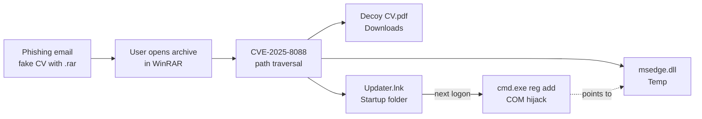
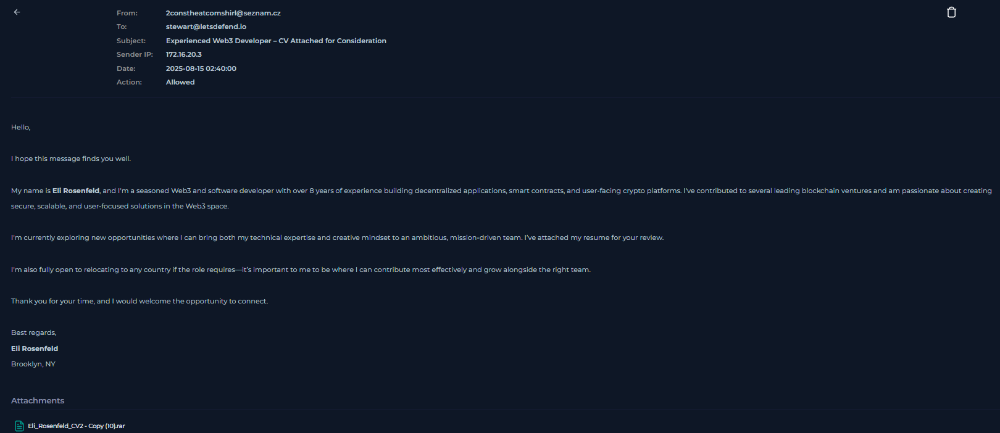
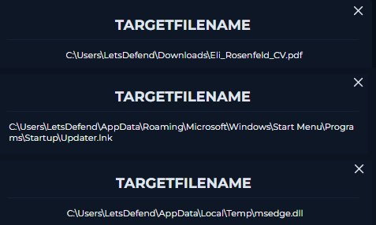
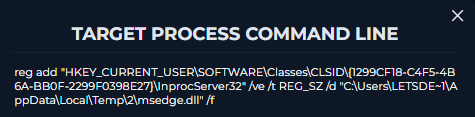
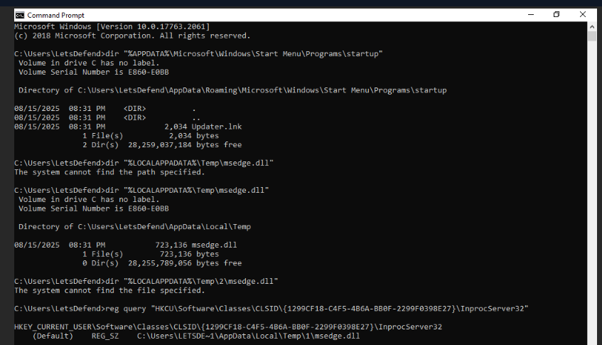
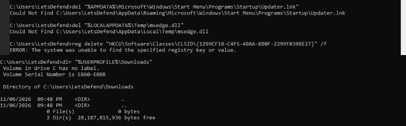

# Case Study 1: Fake CV Exploits a WinRAR Zero-Day (CVE-2025-8088)

**Platform:** LetsDefend (simulated SOC) · **Alert:** SOC343 · **Severity:** Critical · **Verdict:** True Positive
**Skills:** Email analysis · Sysmon log analysis · Persistence analysis · Live endpoint verification · Remediation

> All data comes from a simulated lab environment. No real organisation or user was involved.

---

## Summary

A phishing email posing as a job application delivered a RAR archive to an employee. When the archive was opened, it exploited **CVE-2025-8088**, a path traversal vulnerability in WinRAR, to secretly write files outside the folder the user chose: a decoy CV, a malicious DLL, and a shortcut in the Windows **Startup folder**. At the next logon the shortcut ran and registered the DLL through **COM hijacking**, so Windows would load it automatically.

I traced the full chain in the logs, then connected to the host to verify it. That showed something the logs couldn't: the hijack pointed to a path where the DLL didn't exist, so the payload **most likely never loaded** — but the persistence was still active and re-ran at every logon. I removed every component and verified the cleanup.

**Outcome:** Persistence confirmed and removed; payload execution unconfirmed; one user and one host affected. Root cause: an unpatched WinRAR.

---

## Attack chain



---

## Investigation

### 1. The lure

| Field | Value |
|---|---|
| From | `2constheatcomshirl[@]seznam[.]cz` (free-mail address; doesn't match the claimed name "Eli Rosenfeld") |
| Subject | "Experienced Web3 Developer – CV Attached for Consideration" |
| Attachment | `Eli_Rosenfeld_CV2 - Copy (10).rar` |
| Action | Allowed |

A CV is an effective lure: hiring staff are expected to open attachments from strangers. The attachment was a **RAR archive** rather than a PDF — the exact format this vulnerability abuses.



### 2. The exploit

Sysmon logs showed Chrome saving the archive (20:30:46 UTC), WinRAR opening it (20:31:11), and WinRAR creating **three files in 0.13 seconds** (20:31:28):

| File | Location | Purpose |
|---|---|---|
| `Eli_Rosenfeld_CV.pdf` | Downloads | **Decoy** – the user sees a normal CV |
| `msedge.dll` | `AppData\Local\Temp` | **Payload** – named after Microsoft Edge, but Edge doesn't live in Temp |
| `Updater.lnk` | `…\Start Menu\Programs\Startup` | **Persistence** – runs at every logon |

Two of the three were written **outside the extraction folder** — that is the path traversal. Threat Intel tagged the file hash **ROMCOM, CVE-2025-8088**.



**Decision point – could this be benign?** WinRAR legitimately writes to Temp when a user opens a file from inside an archive, so a Temp file alone wouldn't prove anything. Writing into the **Startup folder** is not normal behaviour for an archive tool. That ruled out a false positive.

### 3. Persistence

The process list showed a **new logon session** at 20:36:10. One second after Explorer started, `cmd.exe` — launched by Explorer, as Startup items are — ran:

```
reg add "HKCU\SOFTWARE\Classes\CLSID\{1299CF18-C4F5-4B6A-BB0F-2299F0398E27}\InprocServer32"
        /ve /t REG_SZ /d "C:\Users\LETSDE~1\AppData\Local\Temp\2\msedge.dll" /f
```

This is **COM hijacking**: a per-user registry entry that overrides a system component, so whatever loads that component loads the attacker's DLL instead. Sysmon **Event 13 (Registry Set Value)** confirmed the change was actually written, not just attempted.



### 4. Did the payload run?

No process ran after the registry change, there was no Sysmon Event 7 (DLL load) for `msedge.dll`, and no network traffic matched known C2. But missing logs aren't proof — image-load events are often not collected.

I noticed the paths didn't match: the DLL was dropped in `Temp\`, but the registry pointed to `Temp\2\`. Windows gives each Remote Desktop session its own temp subfolder, so I suspected the hijack pointed to a file that didn't exist.

**Verifying on the endpoint** settled it:

- `Updater.lnk` and `Temp\msedge.dll` were both present.
- The registry now pointed to **`Temp\1\msedge.dll`** — the shortcut had **re-run at my own logon**, using my session's temp folder.
- No DLL existed at `Temp\1` or `Temp\2`.



**Conclusion:** the persistence fired on every logon, but the hijack pointed to a non-existent file, so the payload most likely never loaded in this environment. The mechanism was still live and had to be removed.

### 5. Scope and network

- Only one recipient; no other hosts showed the files or the registry key.
- Network connections after the exploit were consistent with WinRAR's update server, Google, Microsoft and cloud metadata. One AWS address had no Threat Intel match. No C2 identified.
- Older WinRAR events on a different host (2023) belonged to a separate incident and were excluded.

---

## Response

**Contained:** host isolated.

**Eradicated and verified** — captured evidence first, then removed:

| Component | Location | Status |
|---|---|---|
| `Updater.lnk` | Startup folder | Removed |
| `msedge.dll` | Temp | Removed |
| COM hijack | `HKCU\Software\Classes\CLSID\{1299CF18-…}` | Removed |
| Archive and decoy | Downloads | Removed |



**Recommended:**
- **Update WinRAR to 7.13 or later on every host** — the root cause.
- Delete the email and block the sender address.
- Hunt for the file hash, `Updater.lnk` in Startup folders and the CLSID key on other hosts.
- Precautionary password reset, since the payload's capabilities are unconfirmed.
- Warn HR and hiring staff about CV lures, especially archive attachments.
- Consider sandboxing archive attachments from external senders.

---

## MITRE ATT&CK

| Tactic | Technique | Evidence |
|---|---|---|
| Initial Access | T1566.001 Spearphishing Attachment | Fake CV with RAR attachment |
| Execution | T1204.002 Malicious File · T1203 Exploitation for Client Execution | User opened the archive; WinRAR vulnerability exploited |
| Execution | T1059.003 Windows Command Shell | `cmd.exe /c reg add …` |
| Persistence | T1547.001 Startup Folder | `Updater.lnk` |
| Persistence | T1546.015 COM Hijacking | InprocServer32 → `msedge.dll` |
| Defense Evasion | T1036 Masquerading | `msedge.dll`, `Updater.lnk`, decoy CV |

---

## What I learned

- **Follow the purpose, not just the alert.** The alert was about file creation; the real story was persistence. Tracing file → logon → registry change showed how the attack was meant to work.
- **A command is an attempt; an event is proof.** The `reg add` command showed intent; Sysmon Event 13 proved the change happened.
- **The endpoint can answer what the logs can't.** Checking the live host revealed the path mismatch and showed the persistence re-running in real time.
- **Separate confirmed from unconfirmed.** "Persistence in place" and "payload executed" are different findings, and I reported them separately.
- **Capture before you delete, then verify.**

## What I'd do differently

- Check the **live endpoint earlier**, as soon as the path mismatch appeared, rather than after exhausting the logs.
- Investigate faster: this took about an hour. In a real SOC I'd escalate a Critical alert like this to Tier 2 once the persistence was confirmed, then continue the deeper analysis.
