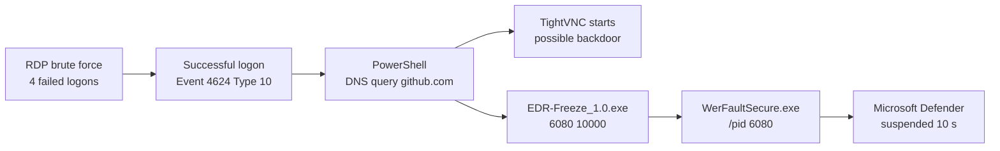
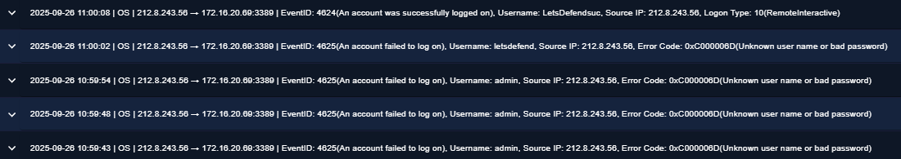
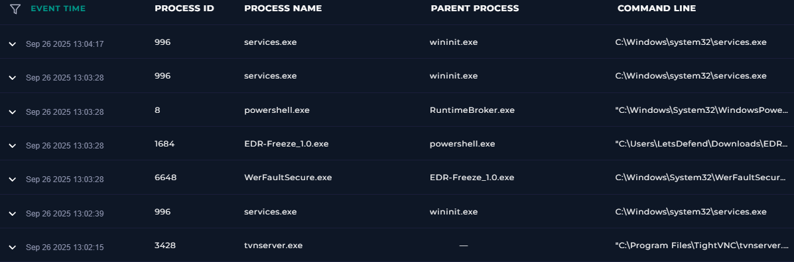
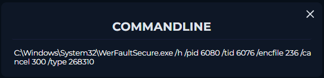

# Case Study 2: RDP Intrusion Freezes Microsoft Defender with EDR-Freeze

**Platform:** LetsDefend (simulated SOC) · **Alert:** SOC344 · **Severity:** High · **Verdict:** True Positive
**Skills:** Windows logon analysis · Process tree analysis · Defence evasion · Timeline reconstruction · Questioning detections

> All data comes from a simulated lab environment. No real organisation or user was involved.

---

## Summary

An attacker brute-forced Remote Desktop on a Windows workstation and logged in after four failed attempts. Within three and a half minutes they launched PowerShell, likely downloaded **EDR-Freeze** from GitHub, started TightVNC remote-access software, and used EDR-Freeze to **suspend Microsoft Defender** for 10 seconds.

EDR-Freeze doesn't kill the security tool — it abuses **WerFaultSecure.exe**, a trusted Windows component that is allowed to pause protected processes while creating crash dumps. I proved the technique from the process tree and command lines, aligned timestamps from sources in different timezones, and questioned one of the platform's ATT&CK tags that the evidence didn't support.

**Outcome:** Confirmed compromise and deliberate tampering with the endpoint defences; host isolated; one host affected.

---

## Attack chain



---

## Investigation

### 1. Initial access: RDP brute force

Searching Log Management for the attacker's IP, 212[.]8[.]243[.]56, showed five events, all against the same host on port 3389 (RDP):

| Time (UTC) | Event | Username |
|---|---|---|
| 12:59:43–12:59:54 | 4625 – failed logon ×3 | `admin` |
| 13:00:02 | 4625 – failed logon | `letsdefend` |
| 13:00:08 | **4624 – successful logon, Logon Type 10 (RDP)** | `LetsDefendsuc` |

The attacker guessed **usernames as well as passwords**. The successful logon recorded a slightly different username from the account that later ran the tools (`LetsDefend`) — I noted the discrepancy rather than ignoring it. The IP reached no other host.



### 2. Tooling

PowerShell started 18 seconds after the logon. At 13:01:30 UTC it made a **DNS query for github.com** and connected to GitHub addresses — EDR-Freeze is published on GitHub, and the tool then appeared in the user's Downloads folder.


At 13:02:15, **TightVNC** (`tvnserver.exe`) started. It's legitimate remote-access software, but attackers often install it to keep access to a machine.

### 3. Defence evasion: freezing Defender

The alert's command line was:

```
"C:\Users\LetsDefend\Downloads\EDR-Freeze_1.0.exe" 6080 10000
```

EDR-Freeze takes a **target process ID** and a **duration in milliseconds** — here, PID 6080 for 10 seconds. The process tree showed exactly how it worked:

```
powershell.exe
  └─> EDR-Freeze_1.0.exe (PID 1684)
        └─> WerFaultSecure.exe (PID 6648)  /h /pid 6080 /tid 6076 ...
```



Expanding WerFaultSecure's command line confirmed the target: `/pid 6080`. The platform's feedback identified PID 6080 as **Microsoft Defender**.



**Why this matters:** WerFaultSecure is a signed Windows component that is allowed to suspend protected processes while it creates a crash dump. EDR-Freeze points it at the security tool and keeps it paused — so nothing is killed, no service stops, and the attacker gets a window where the defences can't see or act.

### 4. Questioning a detection tag

The platform tagged **T1055 (Process Injection)**. A remote thread *was* created in EDR-Freeze at 13:03:32 — but its start function was **`CtrlRoutine`** in KERNELBASE.dll. That's the normal way Windows sends a console program a control signal (like Ctrl+C) as it exits, not attacker injection. I left T1055 out of the mapping and explained why.

### 5. Timeline and timezones

Log Management displayed times **2 hours behind** the `UtcTime` field inside each event. I used UtcTime throughout. Once aligned, the whole intrusion took about **3½ minutes**:

| Time (UTC) | Event |
|---|---|
| 12:59:43–13:00:02 | 4 failed RDP logons |
| 13:00:08 | Successful RDP logon |
| 13:00:26 | PowerShell launched |
| 13:01:30 | DNS query for github.com; connections to GitHub |
| 13:02:15 | TightVNC server starts |
| 13:03:28 | EDR-Freeze runs; WerFaultSecure suspends Defender for 10 seconds |

### 6. Threat intelligence

- File hash tagged **EDR-Freeze** in LetsDefend Threat Intel.
- Attacker IP: **no match** — the verdict rested on behaviour, which was unambiguous.
- GitHub addresses are legitimate infrastructure, so I recorded them as the download source rather than as malicious IOCs to block.

---

## Response

**Verdict:** True Positive — confirmed compromise with deliberate tampering with endpoint defences.

**Recommended:**
- **Isolate the host.** Once the EDR has been tampered with, nothing it reports about that period can be fully trusted.
- Disable and reset the compromised account.
- Block 212[.]8[.]243[.]56.
- Remove internet-facing RDP; require a VPN or RDP gateway, MFA and account lockout.
- Verify Defender's health and configuration; remove EDR-Freeze.
- Investigate TightVNC — was it installed by the attacker? Remove it if so.
- Check for further persistence (new accounts, services, scheduled tasks) before restoring the host.
- **Logging gap:** process logs showed only that PowerShell started, not what was typed into it. Enabling PowerShell script block logging (Event 4104) would have captured the attacker's commands.

---

## MITRE ATT&CK

| Tactic | Technique | Evidence |
|---|---|---|
| Credential Access | T1110 Brute Force | 4 failed RDP logons |
| Initial Access | T1078 Valid Accounts | Event 4624, Logon Type 10 |
| Execution | T1059.001 PowerShell | PowerShell launched EDR-Freeze |
| Defense Evasion | T1562.001 Impair Defenses – Disable or Modify Tools | Defender suspended via WerFaultSecure |

---

## What I learned

- **Name the technique by its effect.** I first considered "Hijack Execution Flow" because a Windows component was abused, but nothing ran inside WerFaultSecure — it was called normally and pointed at Defender. The effect was that the defences stopped working: **Impair Defenses**.
- **The process tree tells the story.** Parent → child relationships proved the chain without needing to see the attacker's screen.
- **Don't accept a detection label without evidence.** The T1055 tag didn't match what the logs showed.
- **Align timezones before building a timeline.** Two hours of apparent delay disappeared once I used UtcTime.
- **Note gaps honestly.** The username mismatch and the missing PowerShell command logging both went into the report.

## What I'd do differently

- Look up the target PID in the process list **before** relying on the platform to identify it.
- Investigate **TightVNC** further — its parent process and install time would show whether the attacker brought it.
- Cross-check the attacker IP with more than one reputation source.
