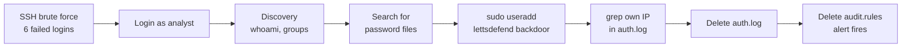
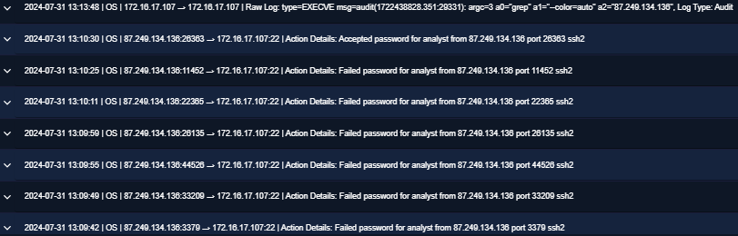
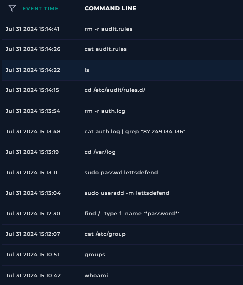
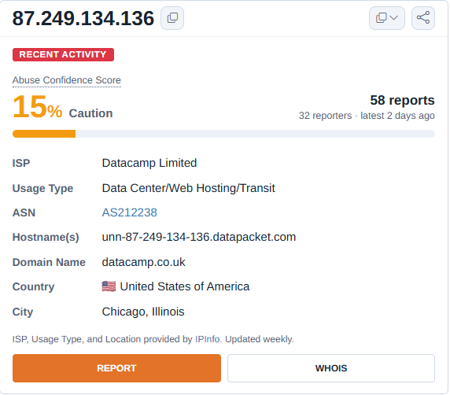

# Case Study 3: Linux SSH Compromise – Backdoor Account and Deleted Logs

**Platform:** LetsDefend (simulated SOC) · **Alert:** SOC306 · **Severity:** Medium · **Verdict:** True Positive
**Skills:** Linux log analysis · Command history analysis · Anti-forensics detection · Threat intel cross-checking · Timezone verification

> All data comes from a simulated lab environment. No real organisation or user was involved.

---

## Summary

An alert fired when the Linux audit rules file was deleted on a server. The first-line analyst couldn't tell whether it was routine admin work or an attacker.

The logs showed an **SSH brute force** that succeeded after six attempts. In the four minutes after logging in, the attacker ran discovery commands, searched the disk for password files, used `sudo` to create a **lookalike backdoor account**, searched the authentication log for **their own IP address**, deleted that log, and then **deleted the audit rules**.

The attacker tried to erase the evidence, but every step was still visible because the logs had already been **forwarded to the SIEM**. Threat intelligence on the attacker IP was mixed — clean on VirusTotal, lightly reported on AbuseIPDB — so the verdict rested on behaviour.

**Outcome:** Full compromise with root access and persistence; host isolated; one host affected.

---

## Attack chain

---

## Investigation

### 1. Was it routine admin work?

The L1 note said someone had searched the authentication log for an external IP, 87[.]249[.]134[.]136. Deleting audit rules can be legitimate configuration work, so I started with both possibilities open.

### 2. Initial access: SSH brute force

On Linux there are no Windows Event IDs; the equivalent is the SSH log text. Searching for the IP showed:

| Time (UTC) | Event |
|---|---|
| 15:09:42–15:10:25 | 6 × "Failed password for analyst … ssh2" |
| 15:10:30 | **"Accepted password for analyst"** |

All attempts targeted one account and one host on port 22.

### 3. What the attacker did

Terminal history showed the first command **12 seconds after the login**:

| Time (UTC) | Command | Purpose |
|---|---|---|
| 15:10:42–15:12:07 | `whoami`, `groups`, `cat /etc/group` | Discovery: who am I, what can I do? |
| 15:12:30 | `find / -type f -name '*password*'` | Search the whole disk for password files |
| 15:13:04–15:13:11 | `sudo useradd -m lettsdefend`, `sudo passwd lettsdefend` | **Backdoor account**, a lookalike of `letsdefend`, created with root privileges |
| 15:13:48 | `cat auth.log \| grep "87.249.134.136"` | **Check whether their own IP is logged** |
| 15:13:54 | `rm -r auth.log` | **Delete the authentication log** |
| 15:14:15–15:14:41 | `cat audit.rules`, then `rm -r audit.rules` | **Disable auditing** – the alert trigger |

**Decision point – benign or malicious?** An administrator wouldn't create an account with a misspelled lookalike name, and wouldn't search the logs for an external IP and then delete them. That's someone removing evidence of their own login. Not a false positive.

### 4. The deleted evidence survived

The attacker deleted `auth.log` on the host, but the SSH events above were already in the SIEM. The audit system had also recorded the attacker's own `grep` for their IP a minute before the audit rules were deleted — which is exactly why they removed them. This is the practical case for **central log collection**.

### 5. Settling the timezone

Log Management showed the login at 13:10 and Terminal History showed the first command at 15:10 — either a two-hour gap or a timezone difference. The audit record carried a Unix timestamp, `1722438828`, which converts to **2024-07-31 15:13:48 UTC**, matching the Terminal History entry for the same `grep` command exactly. So Terminal History was in UTC, the log display was two hours behind, and the attacker started work within seconds of logging in.

### 6. Threat intelligence: sources disagreed

| Source | Result |
|---|---|
| LetsDefend Threat Intel | No match |
| AbuseIPDB | 15% confidence, but 58 reports from 32 reporters (Hacking, Web App Attack) |
| VirusTotal | 0/92, tagged **VPN** |
| Ownership | Datacamp Limited – data centre / hosting range |

The IP belongs to a **shared hosting/VPN range**, so its reputation is noisy — many users share it, most of them harmless. That's exactly why attackers use VPNs. The reports were also from 2025–2026, while the attack happened in 2024. The behaviour was conclusive regardless.

### 7. Scope

The attacker IP only communicated with this host.

---

## Response

**Verdict:** True Positive — compromised host with root access and a backdoor account.

**Recommended:**
- **Isolate and rebuild the host.** The attacker had root and deleted logs, so nothing on the host can be fully trusted.
- Disable and reset the `analyst` account; delete `lettsdefend` and hunt for it on other Linux hosts.
- Restore the audit rules and `auth.log`; re-enable auditd.
- Check for further persistence: cron jobs, `~/.ssh/authorized_keys`, `/etc/sudoers`.
- Rotate any credentials stored in the password files the attacker searched for.
- Block 87[.]249[.]134[.]136.
- Restrict SSH: allow only from a VPN or approved IPs, use key-based authentication instead of passwords, and add lockout or rate limiting (e.g. fail2ban).
- Alert on deletion of logs and audit rules on every host — this detection is what caught the attack.

---

## MITRE ATT&CK

| Tactic | Technique | Evidence |
|---|---|---|
| Initial Access | T1133 External Remote Services · T1078 Valid Accounts | SSH login as `analyst` |
| Credential Access | T1110.001 Password Guessing | 6 failed SSH logins |
| Credential Access | T1552.001 Credentials in Files | `find / -name '*password*'` |
| Discovery | T1033 · T1069 | `whoami`, `groups`, `/etc/group` |
| Persistence | T1136.001 Create Local Account | `lettsdefend` |
| Defense Evasion | T1070.002 Clear Linux System Logs | `rm -r auth.log` |
| Defense Evasion | T1562.012 Disable or Modify Linux Audit System | `rm -r audit.rules` |

---

## What I learned

- **Linux logs speak a different language.** "Failed password" and "Accepted password" play the same role as Windows Events 4625 and 4624.
- **Covering tracks is itself evidence.** Searching the log for your own IP and then deleting it is something no administrator does.
- **Central logging defeats local deletion.** The attacker removed the evidence from the host, but the SIEM already had it.
- **A precise timestamp settles a timezone question.** Converting the audit record's Unix time removed the guesswork.
- **Reputation is one input, not the verdict.** Three sources gave three different answers; the behaviour was unambiguous.
- **Impair Defenses and Indicator Removal are different.** Disabling auditing stops future logging; deleting logs removes past evidence. This attacker did both.

## What I'd do differently

- Check whether the **backdoor account was ever used** after it was created, by searching the logs for logins as `lettsdefend`.
- Review **which password files** the `find` command would have found, to scope which credentials need rotating.
- Cross-check reputation sources **at the start** of the investigation rather than near the end.
