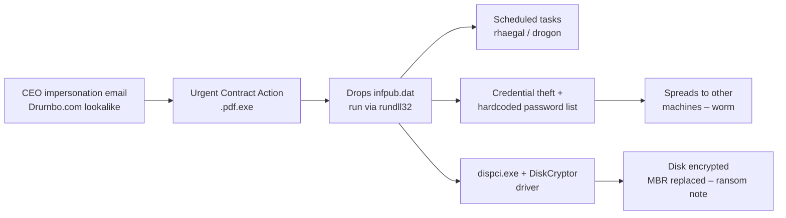
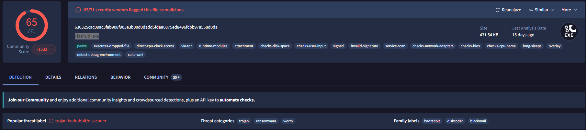
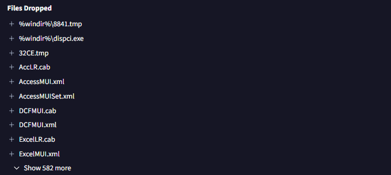

# Phishing Analysis: BRabbit – Fake Employment Contract Delivers Bad Rabbit Ransomware

**Lab:** CyberDefenders – BRabbit · **Category:** Threat Intel · **Difficulty:** Medium · **Result:** 11/11
**Tools:** Email header analysis · VirusTotal · Sandbox reports · MITRE ATT&CK
**Skills:** Header analysis · Lookalike domain detection · Malware behaviour analysis · ATT&CK mapping · Attribution

> Analysis of a lab sample containing real ransomware. The email was read as text in an isolated environment; the attachment was never saved or executed – its hashes were calculated directly from the email data and everything else came from threat intelligence and sandbox reports.

---

## Summary

An employee received an email apparently from the company's **CEO**, warning that his **employment contract** needed urgent review "by the end of the day". The attachment, `Urgent Contract Action.pdf.exe`, was not a PDF but **Bad Rabbit**, a ransomware worm first seen in 2017 and attributed to the **Sandworm** group.

The email passed **SPF, DKIM and DMARC** – because the attacker sent it from a domain they controlled – and used a **lookalike of the company's domain** in the From address. Once run, Bad Rabbit drops a malicious DLL, creates scheduled tasks for persistence, uses a hardcoded credential list to spread across the network, and encrypts the entire disk with a legitimate disk-encryption driver, replacing the boot record so the machine can't start.

This case completes the picture from the previous two: phishing isn't just about stolen passwords – one attachment can take down a network.

---

## Attack chain



---

## 1. The email

| Field | Value | Red flag |
|---|---|---|
| From (display) | Drumbo® | Brand name in the display name |
| From (address) | `theceojamessmith[@]Drurnbo[.]com` | **Lookalike domain** – `rn` instead of `m` (Drurnbo vs Drumbo) |
| To | Rafaiel@Drumbo.com | The genuine company domain |
| Return-Path | `Return[@]alaho-akbar[.]dezoeteinval[.]co[.]za` | Unrelated domain |
| Subject | Immediate Action Required: Your Employment Contract. | Urgency |
| Sent | Friday 13 Dec 2024, 22:27 UTC | Late on a Friday – less chance of checking with a colleague |
| Attachment | `Urgent Contract Action.pdf.exe` | **Double extension** – a Windows program disguised as a PDF |

**The lure:** a "CEO" tells the employee his contract must be reviewed by the end of the day, warning that "failure to respond … may result in delays or disruptions to your employment process." Authority, fear for one's job and a deadline – a combination designed to stop people thinking.

## 2. Header analysis

```
Received: from dezoeteinval.co.za (vps-fa2b00d6.vps.ovh.net [51.195.254.223]) by mx.google.com
Authentication-Results: dkim=pass header.i=@dezoeteinval.co.za;
                        spf=pass … smtp.mailfrom=Return@alaho-akbar.dezoeteinval.co.za;
                        dmarc=pass … header.from=dezoeteinval.co.za
```

**SPF, DKIM and DMARC all passed – and the email was still malicious.** The checks only prove that the message came from servers authorised by `dezoeteinval.co.za`. The attacker controlled that domain and configured it properly. None of the checks relate to `Drumbo.com`, the company being impersonated.

This is the opposite of my [PhishStrike case](../01-phishstrike/report.md), where authentication failed for an innocent reason (an email gateway in the path). Together they show that **authentication results tell you which domain is vouching for an email – not whether to trust it**.

**Other header findings:**
- **Real origin:** 51[.]195[.]254[.]223, an OVH rented virtual server – the first hop recorded by the recipient's own provider (Google).
- **Forged hops:** `Received` lines below that claim the email passed through `twitter.com` and `efianalytics.com`. Anything below the first hop your own provider adds was written by the sender and can be faked.
- **Fake trust header:** `X-Google-Sender-Delegation: … Trusted Sender` is not a genuine Google header – another attempt to appear legitimate.

## 3. The attachment

| Property | Value |
|---|---|
| File name | `Urgent Contract Action.pdf.exe` (original name: `FlashUtil.exe`) |
| Type | Windows executable (`MZ` header), 441,899 bytes |
| SHA256 | `630325cac09ac3fab908f903e3b00d0dadd5fdaa0875ed8496fcbb97a558d0da` |
| MD5 | `fbbdc39af1139aebba4da004475e8839` |



VirusTotal: **65/71 vendors** flagged it, labelled **trojan.badrabbit/diskcoder**, with categories **trojan, ransomware and worm**. The original file name, `FlashUtil.exe`, reflects Bad Rabbit's 2017 campaign, when it spread as a **fake Adobe Flash update** – here the same malware has been reused with a new lure. It also carries an **invalid digital signature**, an attempt to look like legitimate software.

## 4. Behaviour

From sandbox reports and the lab investigation:

| Stage | Behaviour |
|---|---|
| **Execution** | Drops **`infpub.dat`** into the Windows folder – a DLL with a misleading extension – and runs it with `rundll32.exe` |
| **Persistence** | Creates **scheduled tasks** named **`rhaegal`** and **`drogon`** (a Game of Thrones reference to Daenerys's dragons) |
| **Credential access and spread** | Drops a credential-stealing tool (e.g. `8841.tmp`) and carries a **hardcoded list of common usernames and passwords** – mostly generic accounts, plus one personal name, `alex` – to log in to other machines and spread as a **worm** |
| **Defence evasion** | `dispci.exe` displays a console message: **"Disable your anti-virus and anti-malware programs"** – social engineering aimed at removing the defences |
| **Command and control** | Communicates over **web protocols** (HTTP/HTTPS) |
| **Impact** | Uses **DiskCryptor**, a legitimate open-source disk encryption driver, to **encrypt the hard drive** and **replace the Master Boot Record**, so the computer boots to a ransom note instead of Windows |



Most of the hundreds of "dropped" files reported by sandboxes were ordinary files being rewritten during encryption – noise. The useful entries were `dispci.exe` and the numbered `.tmp` file in the Windows folder.

**Why encrypt the whole disk?** Encrypting individual files leaves the operating system usable. Replacing the boot record and encrypting the disk makes the **entire machine unusable** until the ransom is paid or it is rebuilt – far more disruptive, especially when the worm has spread to many machines.

## 5. Attribution

MITRE ATT&CK attributes Bad Rabbit to **Sandworm**, a threat group linked to Russian military intelligence and also responsible for NotPetya. Bad Rabbit shares code and techniques with NotPetya – including the credential-based spreading – which supports the link.

---

## Indicators of compromise

| Type | Value (defanged) | Context |
|---|---|---|
| Email | `theceojamessmith[@]Drurnbo[.]com` | Sender – lookalike of Drumbo.com |
| Domain | `Drurnbo[.]com` | Lookalike of the company domain |
| Domain | `dezoeteinval[.]co[.]za` | Attacker-controlled sending domain |
| Email | `Return[@]alaho-akbar[.]dezoeteinval[.]co[.]za` | Return-Path |
| IP | `51[.]195[.]254[.]223` | Sending server (OVH VPS) |
| File name | `Urgent Contract Action.pdf.exe` | Attachment (double extension) |
| SHA256 | `630325cac09ac3fab908f903e3b00d0dadd5fdaa0875ed8496fcbb97a558d0da` | Bad Rabbit dropper |
| MD5 | `fbbdc39af1139aebba4da004475e8839` | Bad Rabbit dropper |
| File path | `C:\Windows\infpub.dat` | Dropped malicious DLL |
| File path | `C:\Windows\dispci.exe` | Disk encryption component |
| Scheduled tasks | `rhaegal`, `drogon` | Persistence |

---

## MITRE ATT&CK

| Tactic | Technique | Evidence |
|---|---|---|
| Initial Access | T1566.001 Spearphishing Attachment | Contract-themed email with executable attachment |
| Execution | T1204.002 User Execution – Malicious File | User must open the attachment |
| Execution | T1218.011 Rundll32 | `infpub.dat` run via `rundll32.exe` |
| Persistence | T1053.005 Scheduled Task | Tasks `rhaegal` and `drogon` |
| Defense Evasion | T1036.007 Double File Extension | `.pdf.exe` |
| Defense Evasion | T1036.001 Invalid Code Signature | Signed with an invalid signature |
| Credential Access | T1110 Brute Force | Hardcoded credential list |
| Command and Control | T1071.001 Web Protocols | C2 over HTTP/HTTPS |
| Impact | T1486 Data Encrypted for Impact | Disk encrypted with DiskCryptor |
| Impact | T1495 Firmware Corruption (lab mapping) | MBR replaced so the system won't boot |

---

## Recommendations

**Immediate**
- Remove the email from all mailboxes; block the sender, the lookalike domain, the sending domain and IP.
- Block the hash in EDR; hunt for `infpub.dat`, `dispci.exe` and scheduled tasks named `rhaegal`, `drogon` or `viserion`.
- If any machine ran the attachment, **isolate it immediately** – Bad Rabbit spreads across the network – and reset credentials, since the worm steals and brute-forces them.

**Longer term**
- **Block executable attachments** (and double extensions) at the email gateway.
- **Monitor for lookalike domains** of your own brand (`rn`/`m`, `0`/`o` and similar).
- Add an **external sender banner** and a warning when a display name matches an internal executive.
- **Show file extensions** in Windows so `.pdf.exe` is visible to users.
- Limit lateral movement: strong unique local admin passwords (e.g. LAPS), restricted SMB access, and alerting on new scheduled tasks.
- Keep **offline backups** – disk-encrypting ransomware leaves no local recovery.
- Train staff that HR and contract requests arriving under time pressure should be verified through a known channel.

---

## What I learned

- **Passing authentication isn't the same as being trustworthy.** All three checks passed for the attacker's own domain; the impersonated company didn't appear in them at all.
- **Only trust headers your own systems added.** Hops below the first one recorded by the recipient's provider can be forged.
- **Look closely at domains.** `Drurnbo` vs `Drumbo` is easy to miss at a glance.
- **Sandbox output needs filtering.** Hundreds of "dropped" files were encryption noise; the process list told the real story.
- **Ransomware can be a worm.** The credential list and spreading behaviour are what turn one opened attachment into a network-wide incident.
- **Across three cases**, phishing led to a remote-access and mining bundle, to stolen crypto wallets, and to ransomware – the same entry point with very different impacts.
