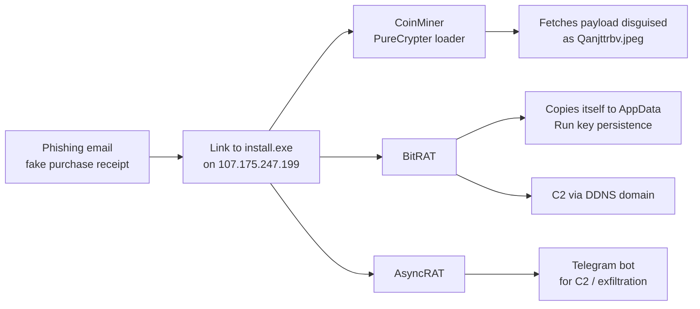
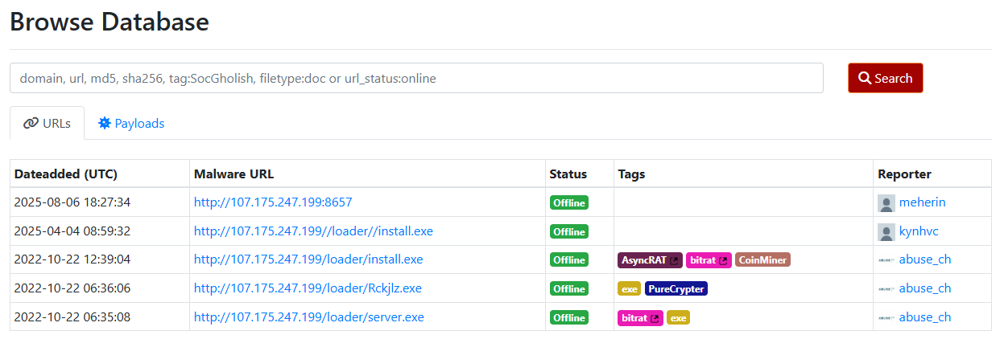
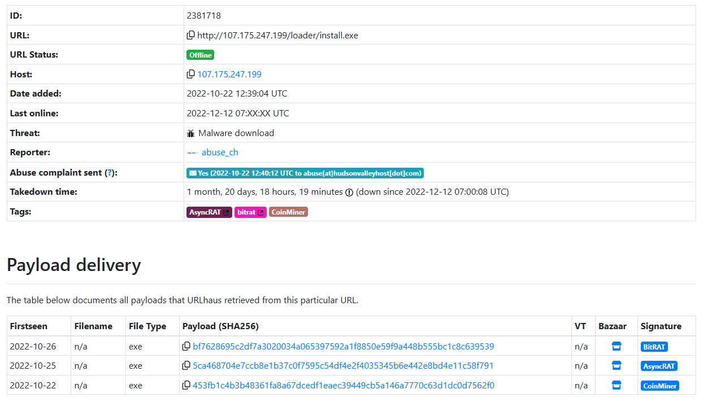
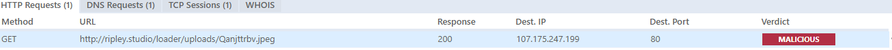
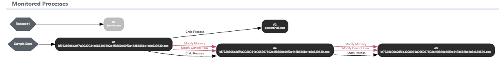
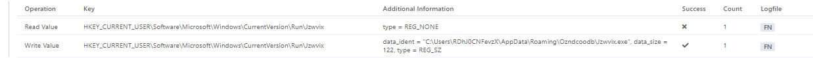
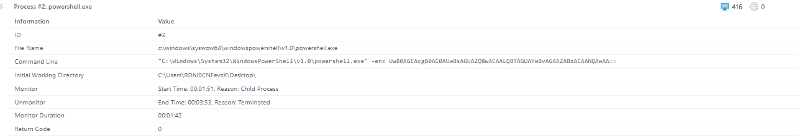

# Phishing Analysis: PhishStrike – Fake Invoice Delivers BitRAT, AsyncRAT and a CoinMiner

**Lab:** CyberDefenders – PhishStrike · **Category:** Threat Intel · **Difficulty:** Medium · **Result:** 11/11
**Tools:** Email header analysis · URLhaus · MalwareBazaar · VMRay · CyberChef
**Skills:** Header and authentication analysis · Threat intel pivoting · Sandbox report analysis · IOC extraction

> Analysis of a lab sample. All IOCs are defanged. I didn't open the email in a mail client, click the link, or download any payloads – the email was read as plain text and everything else came from threat intelligence platforms and sandbox reports.

---

## Summary

Faculty at an educational institution received an email claiming a **$625,000 purchase** had been completed, with a link to "view the invoice". The link pointed to an **`.exe` file on a raw IP address**.

Following that link through threat intelligence showed one server delivering **three malware families from the same URL**: **BitRAT** and **AsyncRAT** (remote access trojans) and a **cryptocurrency miner**, packed with the **PureCrypter** loader. Sandbox reports showed the malware hiding its next stage inside a fake JPEG, persisting through a Registry Run key, using an encoded PowerShell sleep to evade analysis, and communicating through a **dynamic DNS** domain and **Telegram**.

The authentication results also had a lesson of their own: SPF and DKIM **failed**, but not because the sender was spoofed – an email security gateway in the delivery path caused the failures, and the message most likely came from a **genuine, compromised university account**.

---

## Attack chain

---

## 1. Email overview

| Field | Value |
|---|---|
| Subject | COMMERCIAL PURCHASE RECEIPT ONLINE 27 NOV |
| From (display) | ERIKA JOHANA LOPEZ VALIENTE |
| From / Return-Path | `erikajohana.lopez[@]uptc[.]edu[.]co` (match) |
| To | `undisclosed-recipients` – a mass mailing |
| Attachments | None – the payload is behind a link |
| Lure | "Your purchase … for $625.000 pesos has been successfully completed" + "VIEW INVOICE DOCUMENT HERE" + "ACCESS CODE: 8657" |
| Link | `hxxp://107[.]175[.]247[.]199/loader/install[.]exe` |

**Red flags:** an unexpected high-value purchase (urgency and alarm), an "invoice" that is actually an **executable on a bare IP address** in a `/loader/` folder, a fake "access code" to make it feel secure, and a mass mailing with hidden recipients.

## 2. Header analysis

Reading the `Received` headers from the bottom up gave the route:

| Hop | From | To |
|---|---|---|
| 1 | Gmail (Google Workspace for `uptc.edu.co`) | — |
| 2 | `mail-wr1-f65.google.com` (209.85.221.65) | Trend Micro Email Security |
| 3 | `inpost.tmes.trendmicro.com` (18.208.22.104) | Microsoft 365 |

**Authentication results differed by hop:**

| Checked by | Saw the email from | SPF | DKIM |
|---|---|---|---|
| Trend Micro | 209.85.221.65 (Google) | **pass** | none processed |
| Microsoft 365 | 18.208.22.104 (Trend Micro) | **softfail** | **fail** (no key for signature) |

**Interpretation:** the university's SPF record authorises Google's servers, not Trend Micro's. Microsoft 365 received the message from Trend Micro's relay, so SPF softfailed – and the gateway's processing broke the DKIM signature. Trend Micro, which received it directly from Google, saw SPF **pass**.

So the failures were caused by the **email security gateway in the path, not by spoofing**. Combined with matching From and Return-Path addresses, this suggests the email came from the **genuine university account – likely compromised** – which makes it far more convincing to recipients. An SPF result has to be read in the context of every hop.

## 3. The malicious link – URLhaus

Searching the IP on URLhaus showed several malware URLs on the same server:

| URL (defanged) | Tags |
|---|---|
| `hxxp://107[.]175[.]247[.]199/loader/install[.]exe` – **the email link** | AsyncRAT, BitRAT, CoinMiner |
| `hxxp://107[.]175[.]247[.]199/loader/server[.]exe` | BitRAT |
| `hxxp://107[.]175[.]247[.]199/loader/Rckjlz[.]exe` | PureCrypter |

The email's URL had served **three different payloads in five days**:

**Key observations:**

- **Blocking one hash isn't enough** – the file behind the link kept changing. Block the URL, IP and domain.
- The server was **reported in October 2022**, about seven weeks before the email, and an abuse complaint was sent – but it stayed **online until 12 December 2022**, so the link was very likely live when faculty received it. Known-bad infrastructure in threat feeds would have blocked the download.
- Vendor labels for the "CoinMiner" sample disagreed (CoinMiner, BitRAT, PureCrypter, Trojan.Scarsi, one vendor "clean") – consistent with a **PureCrypter-packed loader** that different sandboxes label by whichever stage they observe.

I pivoted from **this URL's** payloads rather than searching the CoinMiner tag, which returns thousands of unrelated samples worldwide.

## 4. Payload analysis – sandbox reports

### CoinMiner / PureCrypter loader

The VMRay report showed one HTTP request:

The loader downloaded `hxxp://ripley[.]studio/loader/uploads/Qanjttrbv[.]jpeg` – a **next-stage payload disguised as an image**, from a domain that resolves to the **same server** (107.175.247.199). Disguising payloads as images helps them pass network filters.

### BitRAT

**Process behaviour:** the sample launched PowerShell, **injected code into new copies of itself** (process injection, shown in red), and – after VMRay rebooted the machine – a new process, `jzwvix.exe`, started automatically.

**Persistence:** the registry log explains why. BitRAT checked whether its Run key value existed (it didn't), then wrote it:

`HKCU\Software\Microsoft\Windows\CurrentVersion\Run\Jzwvix` → `C:\Users\<user>\AppData\Roaming\Ozndcoodb\Jzwvix.exe`

The file list showed `Jzwvix.exe` was **the sample itself, copied** under a random name – same SHA256. Hunting by hash finds it whatever it's renamed to.

**Sandbox evasion:** the PowerShell child process ran an **encoded command**:

Decoding it in CyberChef (From Base64 → Decode text UTF-16LE) gave `Start-Sleep -Seconds 50`. Many sandboxes only watch a sample briefly; sleeping first lets malware wait the analysis out. VMRay flagged this and shortened the sleep to observe the real behaviour.

**C2:** DNS requests showed `gh9st[.]mywire[.]org`. `mywire.org` is a **free dynamic DNS service** – attackers use DDNS so they can repoint the C2 name to a new IP whenever one is blocked.

### AsyncRAT

AsyncRAT's configuration used a **Telegram bot** (ID `5610920260`) for communication. Traffic to `api.telegram.org` looks like ordinary app use and is rarely blocked, which makes it attractive for C2 and exfiltration.

---

## Indicators of compromise

| Type | Value (defanged) | Context |
|---|---|---|
| Email | `erikajohana.lopez[@]uptc[.]edu[.]co` | Sender (likely compromised account) |
| IP | `107[.]175[.]247[.]199` | Malware hosting server |
| URL | `hxxp://107[.]175[.]247[.]199/loader/install[.]exe` | Link in the email – multi-payload |
| URL | `hxxp://107[.]175[.]247[.]199/loader/server[.]exe` | BitRAT download |
| URL | `hxxp://107[.]175[.]247[.]199/loader/Rckjlz[.]exe` | PureCrypter download |
| Domain | `ripley[.]studio` | Resolves to the hosting server |
| URL | `hxxp://ripley[.]studio/loader/uploads/Qanjttrbv[.]jpeg` | Next-stage payload disguised as an image |
| Domain | `gh9st[.]mywire[.]org` | BitRAT C2 (dynamic DNS) |
| SHA256 | `bf7628695c2df7a3020034a065397592a1f8850e59f9a448b555bc1c8c639539` | BitRAT (also dropped as Jzwvix.exe) |
| SHA256 | `5ca468704e7ccb8e1b37c0f7595c54df4e2f4035345b6e442e8bd4e11c58f791` | AsyncRAT |
| SHA256 | `453fb1c4b3b48361fa8a67dcedf1eaec39449cb5a146a7770c63d1dc0d7562f0` | CoinMiner / PureCrypter loader |
| Registry | `HKCU\…\CurrentVersion\Run\Jzwvix` | BitRAT persistence |
| File path | `%APPDATA%\Ozndcoodb\Jzwvix.exe` | BitRAT persistent copy |
| Telegram bot ID | `5610920260` | AsyncRAT C2 / exfiltration channel |

---

## MITRE ATT&CK

| Tactic | Technique | Evidence |
|---|---|---|
| Initial Access | T1566.002 Spearphishing Link | Fake invoice link to `install.exe` |
| Initial Access | T1078 Valid Accounts | Sent from a genuine (likely compromised) university account |
| Execution | T1204.002 User Execution – Malicious File | User must run the downloaded executable |
| Execution | T1059.001 PowerShell | Encoded PowerShell command |
| Persistence | T1547.001 Registry Run Keys | `Run\Jzwvix` → copied executable |
| Defense Evasion | T1027 Obfuscated Files or Information | Base64-encoded command; PureCrypter packing |
| Defense Evasion | T1036 Masquerading | Payload disguised as `.jpeg`; random file names |
| Defense Evasion | T1055 Process Injection | Code injected into new copies of the process |
| Defense Evasion | T1497.003 Time Based Evasion | `Start-Sleep -Seconds 50` |
| Command and Control | T1105 Ingress Tool Transfer | Next-stage download from `ripley.studio` |
| Command and Control | T1568 Dynamic Resolution | DDNS C2 domain |
| Command and Control | T1102 Web Service | Telegram bot |
| Impact | T1496 Resource Hijacking | Cryptocurrency miner |

---

## Recommendations

**Immediate**
- Search mail logs for every recipient of this email and remove it from all mailboxes.
- Check proxy and DNS logs for any access to the IP, `ripley.studio`, `gh9st.mywire.org` or `api.telegram.org/bot5610920260`. Any hit means a likely infection: isolate that host.
- Block the IP, domains and URLs at the proxy, firewall and DNS; block the three hashes in EDR.
- Hunt endpoints for the `Run\Jzwvix` value and `%APPDATA%\*\Jzwvix.exe`.
- Notify the sender's institution that the account appears to be compromised.

**Longer term**
- Block or warn on **links to executables and raw IP addresses** in email.
- Alert on **dynamic DNS domains** and **Telegram API traffic** from corporate machines.
- Alert on **`powershell -enc`** and enable PowerShell script block logging.
- Account for security gateways in **SPF/DKIM/DMARC** design (e.g. ARC), so that genuine mail isn't flagged and spoofed mail isn't missed.
- Train faculty on invoice and purchase lures – especially that a real colleague's account can still send phishing.

---

## What I learned

- **SPF and DKIM need context.** Failures here came from the gateway in the path, not spoofing – and the genuine sender made the phishing more dangerous, not less.
- **Pivot from your own IOC.** Searching a malware tag returns the whole internet; following this URL's own payloads kept the analysis on the right samples.
- **One URL can serve many payloads.** Blocking infrastructure is more durable than blocking hashes.
- **Sandbox reports agree when you cross-check them.** The process graph, registry log and file list each confirmed the same persistence.
- **Decoding is safe and revealing.** CyberChef turned an unreadable `-enc` string into a clear evasion technique.
- **Attackers hide in legitimate services** – dynamic DNS and Telegram – so detection has to look at context, not just reputation.
