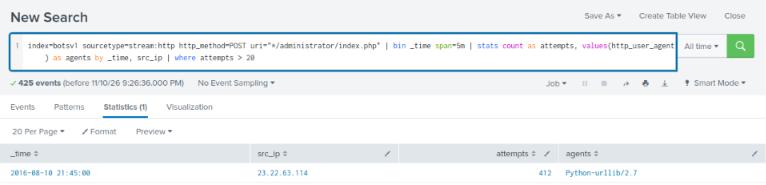

# Rule: Web Login Brute Force

**ATT&CK:** T1110.001 – Brute Force: Password Guessing · **Severity:** High · **Data source:** Web traffic (`stream:http`) or web server access logs

## What it detects
One source IP sending a large number of login attempts (POST requests) to a web application's login page in a short time.

## Logic (SPL)
```spl
index=botsv1 sourcetype=stream:http http_method=POST uri="*/administrator/index.php"
| bin _time span=5m
| stats count as attempts, dc(form_data) as unique_attempts, values(http_user_agent) as agents by _time, src_ip, dest_ip
| where attempts > 20
```

## Rationale
In the [web server investigation](../investigations/01-web-brute-force/report.md), 23.22.63.114 sent **413 login attempts**, several per second, from a `Python-urllib` script. A person logging in makes a handful of attempts at most. The `agents` column helps triage: a scripting library instead of a browser is a strong extra signal.

## Known false positives
- Uptime or monitoring tools that test the login page. Tune by excluding their IPs.
- Authorised penetration tests and vulnerability scans. Exclude during agreed test windows.
- A shared office IP (NAT) where many staff log in at once. Raise the threshold for known corporate ranges.

## Follow-up when it fires
Check whether any attempt from that IP, **or any other IP shortly afterwards**, succeeded with the same username. In this case the successful login came from a *different* IP.

## Testing
**Status:** ✅ Tested on 2026-11-10 against `botsv1` (TryHackMe – Incident Handling with Splunk).

Run as:
```spl
index=botsv1 sourcetype=stream:http http_method=POST uri="*/administrator/index.php"
| bin _time span=5m
| stats count as attempts, values(http_user_agent) as agents by _time, src_ip
| where attempts > 20
```



**Result:** 1 hit. **23.22.63.114** made **412 attempts** in the 5-minute window starting 21:45 on 10 August 2016, with User-Agent `Python-urllib/2.7`. This is a **true positive**, the brute force from the investigation. The attacker's real login from 40.80.148.42 (one attempt) correctly did not trigger. No false positives.
