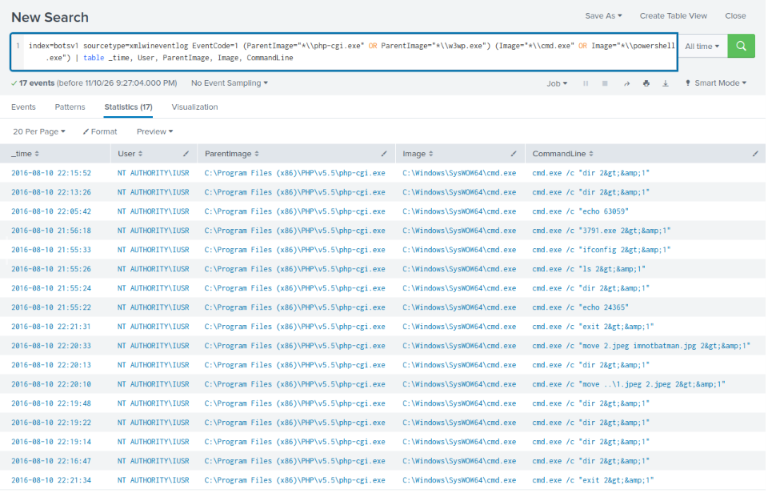

# Rule: Web Server Process Spawning a Shell

**ATT&CK:** T1505.003 – Server Software Component: Web Shell · T1059.003 – Windows Command Shell · **Severity:** High · **Data source:** Sysmon Event ID 1 / Windows Security 4688

## What it detects
A web server process (IIS, PHP, Apache, Tomcat) starting a command shell or scripting engine. This is the classic sign of a web shell or of an exploited web application.

## Logic (SPL)
```spl
index=* (EventCode=1 OR EventCode=4688)
    (ParentImage="*\\w3wp.exe" OR ParentImage="*\\php-cgi.exe" OR ParentImage="*\\php.exe" OR ParentImage="*\\httpd.exe" OR ParentImage="*\\tomcat*.exe")
    (Image="*\\cmd.exe" OR Image="*\\powershell.exe" OR Image="*\\pwsh.exe" OR Image="*\\wscript.exe" OR Image="*\\cscript.exe")
| table _time, host, User, ParentImage, Image, CommandLine
```

## Rationale
This behaviour appeared in two of my investigations:
- [Web server](../investigations/01-web-brute-force/report.md): `php-cgi.exe` → `cmd.exe /c "3791.exe 2>&1"` as `NT AUTHORITY\IUSR`, launching the uploaded backdoor.
- [Conti](../investigations/03-conti-ransomware/report.md): commands running as SYSTEM from `c:\windows\system32\inetsrv\` (the IIS folder) to prepare an Exchange web shell.

Web servers serve pages; they should almost never need to open a command prompt.

## Known false positives
- Some web applications legitimately call system commands (e.g. image processing or admin panels). Allow-list the exact command lines after review.
- Exchange and IIS maintenance can spawn processes during updates. Check against change windows.

## Testing
**Status:** ✅ Tested on 2026-11-10 against `botsv1` (TryHackMe – Incident Handling with Splunk).

Run as:
```spl
index=botsv1 sourcetype=xmlwineventlog EventCode=1 (ParentImage="*\\php-cgi.exe" OR ParentImage="*\\w3wp.exe")
    (Image="*\\cmd.exe" OR Image="*\\powershell.exe")
| table _time, User, ParentImage, Image, CommandLine
```



**Result:** 17 hits, all `php-cgi.exe` → `cmd.exe` running as `NT AUTHORITY\IUSR` between 21:55:22 and 22:21:34. **All 17 are true positives**: every command the attacker sent through the `agent.php` web shell, from the first `echo` test to `3791.exe` and the `move` commands that defaced the site. No false positives in this dataset.

The rule found **more** than the original investigation, which had only the `3791.exe` launch. See the [threat hunt](../threat-hunting/01-post-compromise-web-server.md).
