# Incident Report: Web Server Brute Force, Backdoor Upload and Defacement

**Platform:** TryHackMe – Incident Handling with Splunk (Boss of the SOC v1 dataset) · **Date investigated:** 2026-11-10 · **Analyst:** Berkan Cicekli · **Severity:** High
**Tools:** Splunk (SPL) · Suricata IDS · FortiGate firewall logs · Sysmon · VirusTotal · MITRE ATT&CK
**Skills:** Web log analysis · Brute force detection · Correlating multiple log sources · Field extraction with `rex` · Threat intelligence pivoting · Cyber Kill Chain

> All data comes from a simulated lab environment (the fictional company Wayne Enterprises). No real organisation or user was involved.

---

## Summary

The company website **imreallynotbatman.com** (Joomla, 192.168.250.70) was attacked in stages. The attacker first **scanned** it with the Acunetix vulnerability scanner, then **brute forced** the Joomla admin login with a Python script, cracking the `admin` password (`batman`) after 412 guesses. Logged in as admin, they **uploaded a backdoor** (`3791.exe`, a trojanised copy of ApacheBench) and a PHP file, used the website to **run the backdoor** on the server, and finally **defaced the site** with an image pulled from a dynamic DNS domain.

Threat intelligence linked the attacker's infrastructure to the group **P01s0n1vy**, to **pre-staged lookalike domains** for Wayne Enterprises, and to a second piece of malware, a **trojanised screensaver** likely intended for phishing.

**Outcome:** web server fully compromised (code execution and website defaced); the admin account was taken over through a weak password.

---

## Attack chain (Cyber Kill Chain)

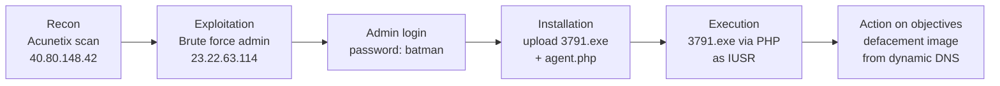

## Classification

| Field | Value |
|-------|-------|
| Incident type | Web application compromise, defacement |
| Attack vector | Brute force of the CMS admin login (weak password), after vulnerability scanning |
| Affected hosts | Web server 192.168.250.70 (imreallynotbatman.com, Joomla on IIS) |
| Affected accounts | Joomla `admin`; `NT AUTHORITY\IUSR` (used to run the backdoor) |
| Data impact | Website defaced; attacker had code execution on the server |

---

## Timeline

All on **10 August 2016**, times as displayed in Splunk.

| Time | Stage | Event | Source |
|------|-------|-------|--------|
| Before 21:46 | Reconnaissance | Acunetix scan from **40.80.148.42**, ~17,500 requests, including Shellshock (CVE-2014-6271) and SQL injection tests | stream:http, Suricata, FortiGate |
| ~21:46 | Exploitation | Brute force from **23.22.63.114** (`Python-urllib/2.7`): 412 passwords tried against `admin` | stream:http |
| After brute force | Exploitation | Login with `admin` / `batman` from **40.80.148.42** using a browser | stream:http |
| 21:52:47 | Installation | Upload of **3791.exe** and **agent.php** | stream:http |
| 21:56:18 | Installation / execution | `php-cgi.exe` → `cmd.exe /c "3791.exe 2>&1"` → **3791.exe** runs as `NT AUTHORITY\IUSR` | Sysmon (Event ID 1) |
| 21:58:23, 22:08:13 | Command and control | **3791.exe** starts `cmd.exe`, an interactive shell | Sysmon (Event ID 1) |
| 22:06:21–22:19:10 | Action on objectives | Server downloads **poisonivy-is-coming-for-you-batman.jpeg** from `prankglassinebracket.jumpingcrab.com:1337` (23.22.63.114) | FortiGate, Suricata |

---

## Investigation

The dataset is in `index=botsv1` and includes web traffic captures (`stream:http`), Suricata IDS alerts, FortiGate firewall logs and Sysmon (`xmlwineventlog`). Using several sources together was what made it possible to follow the whole attack.

### 1. Reconnaissance: who is hitting the website?

```spl
index=botsv1 imreallynotbatman.com sourcetype=stream:http | stats count by src_ip
```

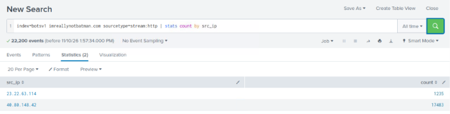

| IP | Requests | Role |
|---|---|---|
| **40.80.148.42** | 17,483 | Automated scanning: far more traffic than any normal visitor |
| **23.22.63.114** | 1,235 | Second attacker IP (the brute force, below) |

**Identifying the scanner.** The User-Agent field was full of attack payloads (SQL injection, `nslookup`, `sleep(9)`) and repeatedly contained `md5(acunetix_wvs_security_test)`:

```spl
index=botsv1 src_ip=40.80.148.42 sourcetype=stream:http | stats count by http_user_agent
```

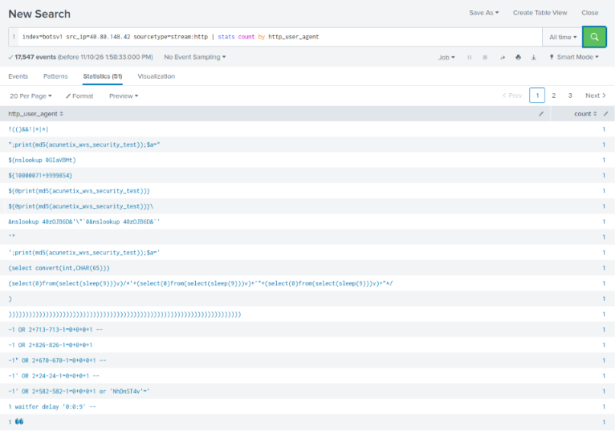

Suricata agreed, firing **"ET SCAN Acunetix Version 6 (Free Edition) Scan Detected"** 45 times, plus **"Possible CVE-2014-6271 Attempt"** (Shellshock) 36 times:

```spl
index=botsv1 src_ip=40.80.148.42 sourcetype=suricata | stats count by alert.signature
```

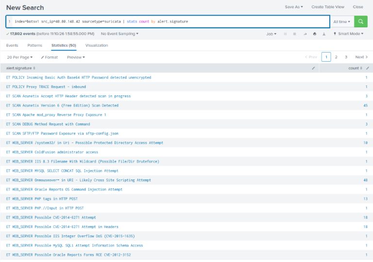

**What the scanner was probing.** The most requested paths showed the site runs **Joomla**. 68% of the scanner's requests hit the search page (testing it for injection), it tried path traversal (`/windows/win.ini`, `/boot.ini`), and it found the **admin login page**:

```spl
index=botsv1 src_ip=40.80.148.42 sourcetype=stream:http | top limit=20 uri
```

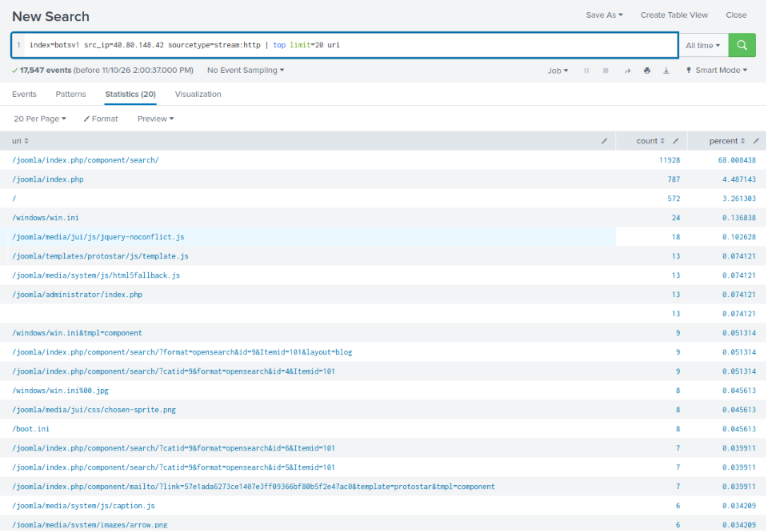

The FortiGate firewall also recorded the scan, including **`HTTP.URI.SQL.Injection`** 199 times and **Bash.Function.Definitions.Remote.Code.Execution** (Shellshock) 18 times:

```spl
index=botsv1 sourcetype=fortigate_utm src=40.80.148.42 | stats count by attack
```

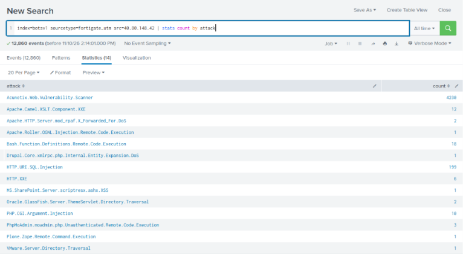

### 2. Exploitation: brute forcing the admin login

Login attempts are POST requests to `/joomla/administrator/index.php`, with the username and password in the `form_data` field. I extracted them with `rex`:

```spl
index=botsv1 sourcetype=stream:http dest_ip=192.168.250.70 http_method=POST uri="/joomla/administrator/index.php" form_data=*username*passwd*
| rex field=form_data "username=(?<user>[^&]+)" | rex field=form_data "passwd=(?<creds>[^&]+)"
| table _time, src_ip, user, creds
```

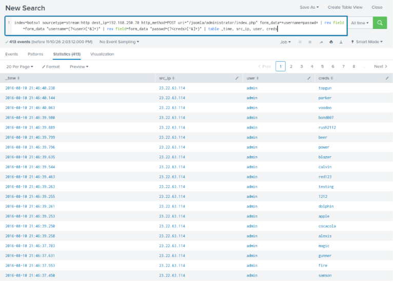

**413 attempts** from **23.22.63.114** against the `admin` account, several **per second** (topgun, parker, voodoo, bond007...): an automated wordlist attack.

**Finding the password that worked.** A password that succeeded would be used twice: once by the tool and once for a real login. So I looked for passwords that appear more than once:

```spl
... | rex field=form_data "passwd=(?<creds>[^&]+)"
| stats count, values(src_ip) as ips, values(http_user_agent) as agents by creds | where count>1
```

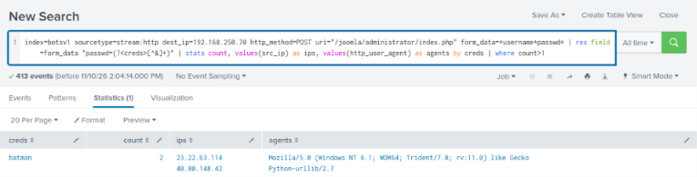

| | IP | User-Agent | Meaning |
|---|---|---|---|
| Brute force | 23.22.63.114 | `Python-urllib/2.7` | Script finds the password |
| Real login | **40.80.148.42** | Mozilla/5.0 (a browser) | Attacker logs in by hand |

Only **`batman`** appeared twice, so **412 unique passwords** were tried and `batman` was correct. The attacker split the work across **two IPs**: one for scanning and logging in, one for the brute force.

### 3. Installation: uploading the backdoor

```spl
index=botsv1 sourcetype=stream:http dest_ip=192.168.250.70 "part_filename{}"="*.exe"
| table _time, src_ip, uri, part_filename{}
```

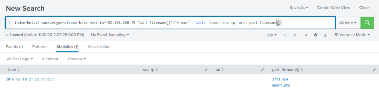

At **21:52:47**, about six minutes after the brute force, the attacker uploaded **3791.exe** and **agent.php** to the server.

**Execution.** Sysmon process creation events (**Event ID 1**) showed how it ran:

```spl
index=botsv1 "3791.exe" sourcetype=xmlwineventlog EventCode=1
| table _time, User, ParentImage, CommandLine
```

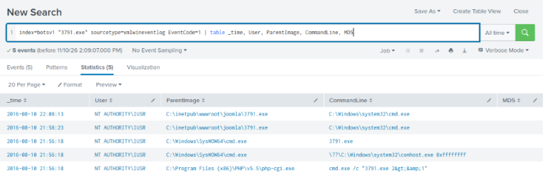

| Step | Process | Meaning |
|---|---|---|
| 1 | `php-cgi.exe` → `cmd.exe /c "3791.exe 2>&1"` | The web server's PHP engine runs a command, triggered through `agent.php` |
| 2 | `cmd.exe` → `C:\inetpub\wwwroot\joomla\3791.exe` | The backdoor starts from the website folder |
| 3 | `3791.exe` → `cmd.exe` (21:58, 22:08) | The backdoor opens **command shells** for the attacker |

Everything ran as **`NT AUTHORITY\IUSR`**, the built-in account IIS uses for anonymous visitors. That confirms the code was launched **through the website**.

**Hash and threat intelligence:**

```spl
index=botsv1 sourcetype=xmlwineventlog EventCode=1 Image="*3791.exe" | table _time, Image, Hashes
```

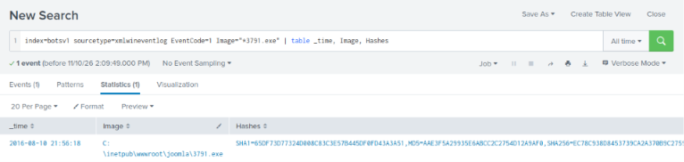

MD5 `aae3f5a29935e6abcc2c2754d12a9af0`. On **VirusTotal: 63/68** detections, original name **`ab.exe`**. It's a **trojanised copy of ApacheBench**, a genuine web testing tool, with hidden shellcode that vendors label **Meterpreter** and **Cobalt Strike**, i.e. a **reverse shell**.

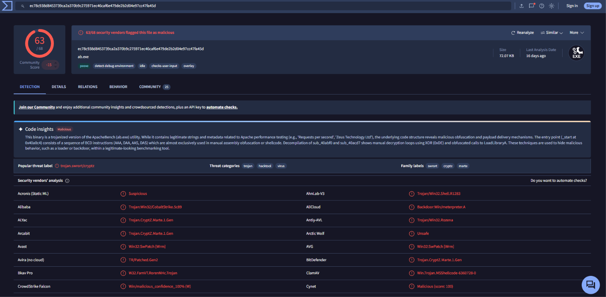

### 4. Action on objectives: defacement

A web server rarely starts connections to the internet itself, so I looked at traffic **from** the server:

```spl
index=botsv1 src_ip=192.168.250.70 sourcetype=suricata dest_ip=23.22.63.114 | stats count by http.hostname, http.url
```

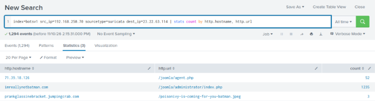

The server downloaded **`poisonivy-is-coming-for-you-batman.jpeg`** from **`prankglassinebracket.jumpingcrab.com`**, the image used to deface the site. The same results show **agent.php** being called 52 times.

The firewall confirmed it from a second source: the domain resolves to **23.22.63.114** (the brute-force IP) on the unusual port **1337**, and the image was fetched at 22:06, 22:13 and 22:19:

```spl
index=botsv1 sourcetype=fortigate_utm "poisonivy-is-coming-for-you-batman.jpeg" | table _time, srcip, dstip, hostname, url
```

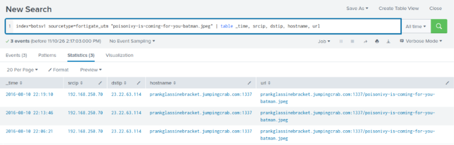

`jumpingcrab.com` is a **dynamic DNS** provider: the attacker can repoint the name to a new IP at any time, which makes blocking by IP less effective.

### 5. Threat intelligence: who is behind it?

Pivoting on **23.22.63.114** in VirusTotal (**Relations** tab):
- **Passive DNS** shows lookalike domains of the victim (e.g. `wayncorpinc.com`) and **`po1s0n1vy.com`** resolving to this IP. This is infrastructure **pre-staged** for attacking Wayne Enterprises, attributed in the scenario to the group **P01s0n1vy**.
- **Communicating files** include `ab.exe` (the backdoor found on the server, an independent link between the malware and the IP) and **`MirandaTateScreensaver.scr.exe`**.

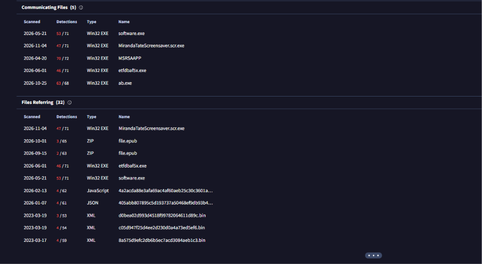

Historical **WHOIS** data for `po1s0n1vy.com` associates the group with the email address **lillian.rose@po1s0n1vy.com**.

**The second malware: `MirandaTateScreensaver.scr.exe`**

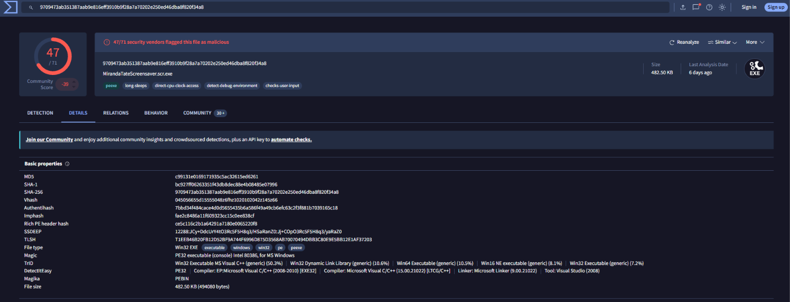

| Property | Value |
|---|---|
| MD5 | `c99131e0169171935c5ac32615ed6261` |
| Detections | 47/71, labels **Zupdax / Redsip**, some vendors **Korplug (PlugX)** |
| Compiled | 25 May 2016, about **2.5 months before the attack** |
| Trick | **Double extension** `.scr.exe`; screensavers are executables. Named after a Batman character to suit the target |

This file wasn't used in the web attack itself. It shows the group had **phishing malware ready** for Wayne Enterprises, so a second attack route is likely.

**IP reputation note:** 23.22.63.114 is an **Amazon AWS** address with **0/92** detections on VirusTotal, even though in this case it ran a brute force, hosted the C2 domain and has malware talking to it. Reputation alone would have cleared it; the behaviour in the logs did not.

---

## MITRE ATT&CK

| Tactic | Technique | Evidence |
|--------|-----------|----------|
| Reconnaissance | T1595.002 Active Scanning: Vulnerability Scanning | Acunetix scan from 40.80.148.42 |
| Resource Development | T1583.001 Acquire Infrastructure: Domains | Lookalike Wayne Enterprises domains, po1s0n1vy.com |
| Resource Development | T1608.001 Stage Capabilities: Upload Malware | Malware linked to 23.22.63.114 |
| Credential Access | T1110.001 Brute Force: Password Guessing | 412 passwords against `admin` via Python script |
| Initial Access | T1078 Valid Accounts | Login with cracked `admin` / `batman` |
| Persistence | T1505.003 Server Software Component: Web Shell | `agent.php` used to run commands |
| Execution | T1059.003 Windows Command Shell | `cmd.exe /c "3791.exe"`; shells spawned by 3791.exe |
| Defense Evasion | T1036 Masquerading | Backdoor disguised as ApacheBench (`ab.exe`) |
| Command and Control | T1071.001 Web Protocols | HTTP to `prankglassinebracket.jumpingcrab.com:1337` |
| Command and Control | T1568 Dynamic Resolution | Dynamic DNS domain |
| Impact | T1491.002 Defacement: External Defacement | `poisonivy-is-coming-for-you-batman.jpeg` |

## Indicators of compromise (defanged)

| Type | Value | Context |
|------|-------|---------|
| IP | `40[.]80[.]148[.]42` | Scanner and admin login |
| IP | `23[.]22[.]63[.]114` | Brute force; C2 / defacement host (AWS) |
| Domain | `prankglassinebracket[.]jumpingcrab[.]com` | Dynamic DNS C2 (port 1337) |
| Domain | `po1s0n1vy[.]com` | Attacker domain |
| Email | `lillian[.]rose[@]po1s0n1vy[.]com` | WHOIS registrant |
| File | `3791.exe` – MD5 `aae3f5a29935e6abcc2c2754d12a9af0` | Backdoor (trojanised ab.exe) |
| File | `agent.php` | Uploaded PHP web shell |
| File | `poisonivy-is-coming-for-you-batman.jpeg` | Defacement image |
| File | `MirandaTateScreensaver.scr.exe` – MD5 `c99131e0169171935c5ac32615ed6261` | APT malware (Zupdax / Redsip) |
| User-Agent | `Python-urllib/2.7` | Brute force tool |

---

## Recommended response

*This is a lab, so nothing was actually actioned.*

- **Containment:** take the site offline or restore a clean copy; block 40.80.148.42, 23.22.63.114 and the domains above; reset the Joomla admin password and end all sessions.
- **Eradication:** remove `3791.exe`, `agent.php` and any other uploaded files from the web root; check for further persistence on the server (accounts, services, scheduled tasks); since the backdoor gave a shell, consider rebuilding the server.
- **Recovery and scope:** restore the site from a known-good backup; search mail logs and endpoints for `MirandaTateScreensaver.scr.exe` and the lookalike domains, as phishing is the likely next step.

## Recommendations to prevent recurrence

- **Strong, unique admin passwords and MFA** on the CMS. `batman` was in a common wordlist.
- **Account lockout or rate limiting** on the login page, and **restrict `/administrator`** to internal or VPN addresses.
- **Alert** on many failed logins from one IP, and on logins from a new IP shortly after a brute force.
- **Block executable uploads** through the CMS and stop the web server from running files in the web root.
- **Alert** on `php-cgi.exe` or `w3wp.exe` spawning `cmd.exe`.
- **Alert** on outbound connections from web servers, especially to dynamic DNS domains or unusual ports.
- **Monitor** for lookalike domains of the company brand.

---

## What I learned

- **The Cyber Kill Chain is a good map.** Taking each stage in turn (recon, exploitation, installation, action on objectives) kept the investigation organised and made gaps obvious.
- **Correlate sources.** Web logs showed the requests, Suricata and FortiGate named the attacks, Sysmon showed what ran on the server, and VirusTotal tied it to the wider campaign. No single source told the whole story.
- **A repeated password reveals the successful login.** The password that appeared twice, from two IPs with different User-Agents, was the one that worked.
- **User-Agents tell you a lot.** `Python-urllib` vs a browser separated the tool from the human.
- **Outbound traffic from a server is suspicious.** Looking at the server as the *source* found the defacement and the C2 domain quickly.
- **`stats` hides events with missing fields.** When a table came back empty, `table` or a different field name showed the data.
- **Reputation isn't a verdict.** The main attacker IP scored 0/92 on VirusTotal.

## Open questions

- Did the attacker exploit anything else found during the scan (Shellshock, SQL injection), or was the brute force the only way in?
- What did they do in the `cmd.exe` shells at 21:58 and 22:08?
- Was `MirandaTateScreensaver.scr.exe` ever delivered to Wayne Enterprises staff?

---

## Appendix: queries used

```spl
-- Who is hitting the site
index=botsv1 imreallynotbatman.com sourcetype=stream:http | stats count by src_ip

-- Scanner identification
index=botsv1 src_ip=40.80.148.42 sourcetype=stream:http | stats count by http_user_agent
index=botsv1 src_ip=40.80.148.42 sourcetype=suricata | stats count by alert.signature
index=botsv1 src_ip=40.80.148.42 sourcetype=stream:http | top limit=20 uri
index=botsv1 sourcetype=fortigate_utm src=40.80.148.42 | stats count by attack

-- Brute force
index=botsv1 sourcetype=stream:http dest_ip=192.168.250.70 http_method=POST uri="/joomla/administrator/index.php" form_data=*username*passwd*
| rex field=form_data "username=(?<user>[^&]+)" | rex field=form_data "passwd=(?<creds>[^&]+)"
| table _time, src_ip, user, creds

-- Unique passwords
... | stats dc(creds) as unique_passwords

-- Password used more than once (the successful one)
... | stats count, values(src_ip) as ips, values(http_user_agent) as agents by creds | where count>1

-- Uploaded executables
index=botsv1 sourcetype=stream:http dest_ip=192.168.250.70 "part_filename{}"="*.exe" | table _time, src_ip, uri, part_filename{}

-- Execution on the server (Sysmon)
index=botsv1 "3791.exe" sourcetype=xmlwineventlog EventCode=1 | table _time, User, ParentImage, CommandLine
index=botsv1 sourcetype=xmlwineventlog EventCode=1 Image="*3791.exe" | table _time, Image, Hashes

-- Outbound traffic from the web server
index=botsv1 src_ip=192.168.250.70 sourcetype=suricata | stats count by dest_ip
index=botsv1 src_ip=192.168.250.70 sourcetype=suricata dest_ip=23.22.63.114 | stats count by http.hostname, http.url
index=botsv1 sourcetype=fortigate_utm "poisonivy-is-coming-for-you-batman.jpeg" | table _time, srcip, dstip, hostname, url
```
