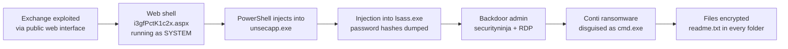
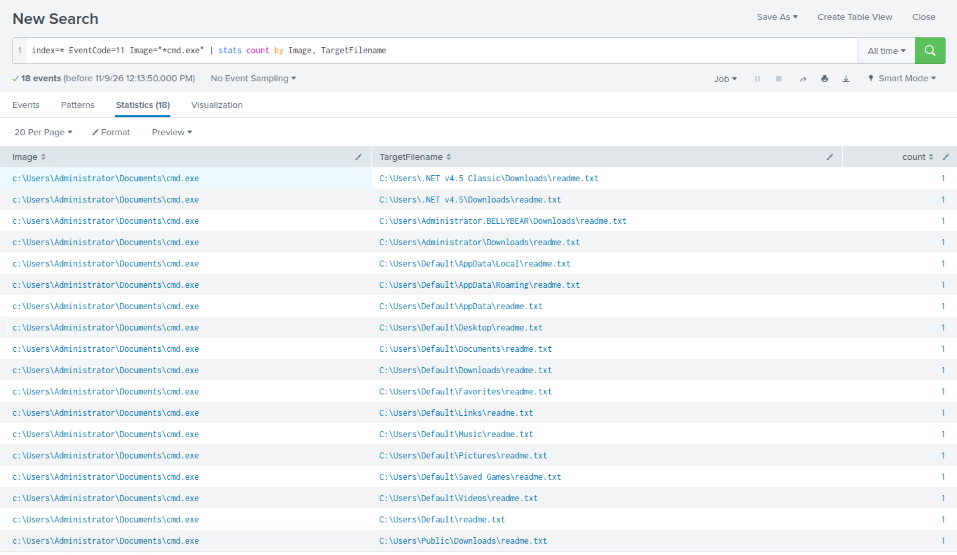
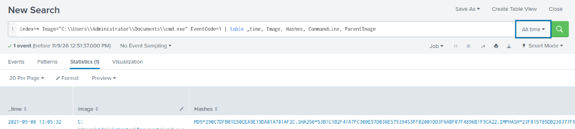
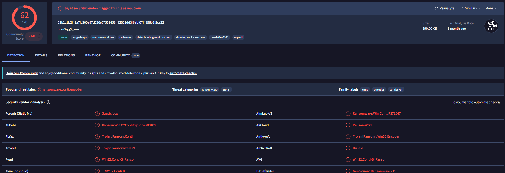
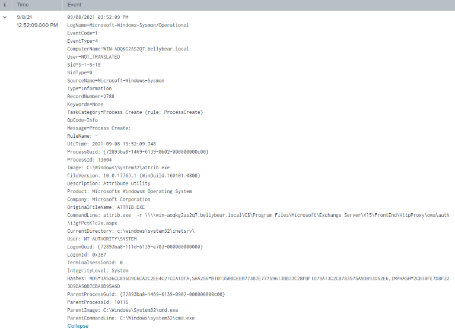
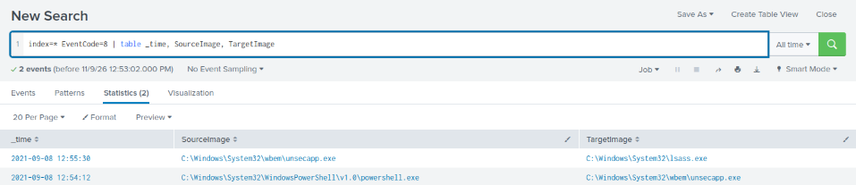
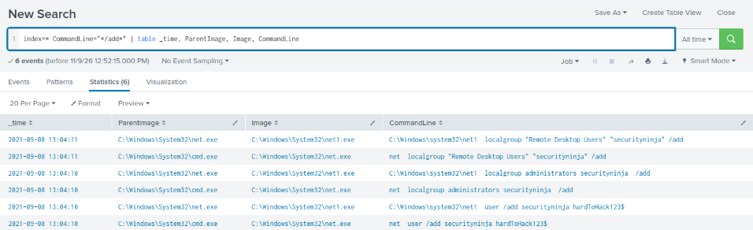

# Incident Report: Conti Ransomware on an Exchange Server

**Platform:** TryHackMe – Conti · **Date investigated:** 2026-11-09 · **Analyst:** Berkan Cicekli · **Severity:** Critical
**Tools:** Splunk (SPL) · Sysmon · VirusTotal · MITRE ATT&CK
**Skills:** SIEM investigation · Sysmon event analysis · Timeline reconstruction · Process injection analysis · Threat intel · ATT&CK mapping

> All data comes from a simulated lab environment. No real organisation or user was involved. The backdoor account's password is redacted.

---

## Executive summary

An attacker gained control of the company's Microsoft Exchange email server through its public web interface and planted a **web shell**, a small script that lets them run commands on the server from the internet with full system privileges. Over the next 13 minutes they stole password hashes from memory, created a hidden administrator account with remote desktop access, and then ran **Conti ransomware**, which encrypted files and left a ransom note in every user folder.

The server should be treated as fully compromised: isolated, rebuilt from a clean backup, and patched. All credentials stored on it should be reset, and other systems checked for the backdoor account and for logins with the stolen credentials.

---

## Classification

| Field | Value |
|-------|-------|
| Incident type | Ransomware |
| Attack vector | Exploitation of a public-facing Exchange server → web shell |
| Affected hosts | WIN-AOQKG2AS2Q7 (bellybear.local), the Exchange server |
| Affected accounts | NT AUTHORITY\SYSTEM (abused); local admin `securityninja` (created by attacker) |
| Data impact | Files encrypted; Conti is known to steal data before encrypting (double extortion). No exfiltration evidence in this dataset. |

## Detection

- **Trigger:** A Conti ransom note discovered on the server.
- **Initial indicator:** A copy of `cmd.exe` running from a user's Documents folder and writing `readme.txt` into many folders.

---

## Attack chain



## Timeline (UTC)

| Time | Phase | Event | Evidence |
|------|-------|-------|----------|
| 19:52:09 | Initial access / persistence | `attrib.exe -r` run against web shell `i3gfPctK1c2x.aspx` in Exchange's OWA folder, as SYSTEM, from the IIS directory | Sysmon Event ID 1 |
| 19:54:12 | Defence evasion | `powershell.exe` injects into `unsecapp.exe` (process migration) | Sysmon Event ID 8 |
| 19:55:30 | Credential access | `unsecapp.exe` injects into `lsass.exe` to dump password hashes | Sysmon Event ID 8 |
| 20:04:10 | Persistence | Local user `securityninja` created and added to **Administrators** | Sysmon Event ID 1 |
| 20:04:11 | Persistence | `securityninja` added to **Remote Desktop Users** | Sysmon Event ID 1 |
| 20:05:32 | Impact | Ransomware `C:\Users\Administrator\Documents\cmd.exe` executes | Sysmon Event ID 1 |
| 20:05 onwards | Impact | `readme.txt` ransom note written to 18 folders | Sysmon Event ID 11 |

**Time from first activity to ransomware: about 13 minutes.**

> **Note on timezones:** Splunk displayed times 7 hours behind UTC (e.g. 12:52:09), and the raw Windows event header showed a third local time. I used the `UtcTime` field inside the Sysmon event (`2021-09-08 19:52:09.748`) to anchor the timeline and converted the others with the same offset.

---

## Technical analysis

The dataset contained **28,145 events** from one host, mostly Sysmon and Windows event logs, on 8 September 2021.

### 1. Finding the ransomware

I started from the impact and worked backwards. Sysmon **Event ID 11 (FileCreate)** showed a process called `cmd.exe` writing the same file, `readme.txt`, into 18 different folders, the typical behaviour of ransomware dropping its note wherever it encrypts.

```spl
index=* EventCode=11 Image="*cmd.exe" | stats count by Image, TargetFilename
```



The real `cmd.exe` only lives in `C:\Windows\System32`. This one ran from **`C:\Users\Administrator\Documents\cmd.exe`**, the ransomware disguised with a trusted Windows name.

**Decision point:** a legitimate command prompt has no reason to write the same text file into every user folder. This confirmed ransomware, not an admin script.

### 2. Identifying the malware

Sysmon **Event ID 1 (Process Create)** records the hashes of every program that starts:

```spl
index=* Image="C:\\Users\\Administrator\\Documents\\cmd.exe" EventCode=1
| table _time, Image, Hashes, CommandLine, ParentImage
```



The SHA256 on **VirusTotal: 62/70 vendors** flagged it, with the popular label **ransomware.conti/encoder** and family labels *conti* and *conticrypt*. Its original filename was `mkn3qq5c.exe`, so it had been renamed to `cmd.exe` on the server.



### 3. How the attacker got in: the web shell

Searching for `.aspx` files, the web page type Exchange uses, found one event, the earliest malicious activity in the dataset:

```spl
index=* (TargetFilename="*.aspx" OR CommandLine="*.aspx*")
| table _time, EventCode, Image, TargetFilename, CommandLine, ParentImage
```



| Field | Value | Meaning |
|---|---|---|
| Image | `C:\Windows\System32\attrib.exe` | Windows tool for changing file attributes |
| CommandLine | `attrib.exe -r \\win-aoqkg2as2q7.bellybear.local\C$\Program Files\Microsoft\Exchange Server\V15\FrontEnd\HttpProxy\owa\auth\i3gfPctK1c2x.aspx` | Removes the read-only flag from a file in the **Outlook Web Access login folder** |
| User | `NT AUTHORITY\SYSTEM` | The highest privilege level on Windows |
| CurrentDirectory | `c:\windows\system32\inetsrv\` | The IIS web server's folder |
| Parent | `cmd.exe` | Commands run through a shell |

`i3gfPctK1c2x.aspx` is a randomly named page in a folder that anyone on the internet can reach. Commands running as SYSTEM from the web server's directory indicate the attacker was **already executing code through Exchange**, and this file was their **web shell** for coming back.

**Which vulnerability?** The logs show the result (a web shell in Exchange) but not the exploit itself. The joint CISA/FBI/NSA advisory on Conti ([AA21-265A](https://media.defense.gov/2021/Sep/22/2002859507/-1/-1/0/CSA_CONTI_RANSOMWARE_20210922.PDF)) lists vulnerabilities Conti actors have exploited, including **CVE-2018-13379** and **CVE-2018-13374** (Fortinet) and **CVE-2020-0796** (Windows SMB, "SMBGhost"). Confirming the exact entry point would need IIS and Exchange logs, which weren't in this dataset.

### 4. Process injection and credential theft

Sysmon **Event ID 8 (CreateRemoteThread)** shows one process starting code inside another. There were only two such events, and both were malicious:

```spl
index=* EventCode=8 | table _time, SourceImage, TargetImage
```



| Time (UTC) | Source → Target | Purpose |
|---|---|---|
| 19:54:12 | `powershell.exe` → `C:\Windows\System32\wbem\unsecapp.exe` | **Migration**: moves the attacker's code into a legitimate Windows process so it survives PowerShell closing and blends in |
| 19:55:30 | `unsecapp.exe` → `C:\Windows\System32\lsass.exe` | **Credential dumping**: LSASS holds password hashes in memory |

This two-step pattern (migrate, then inject into LSASS) is typical of post-exploitation frameworks. Once the hashes are taken, every account that had logged in to the server should be considered compromised.

### 5. Persistence: a backdoor administrator

```spl
index=* CommandLine="*/add*" | table _time, ParentImage, Image, CommandLine
```



| Time (UTC) | Command |
|---|---|
| 20:04:10 | `net user /add securityninja [password redacted]` |
| 20:04:10 | `net localgroup administrators securityninja /add` |
| 20:04:11 | `net localgroup "Remote Desktop Users" "securityninja" /add` |

Each command appears twice because `net.exe` passes the work to `net1.exe`, which is normal Windows behaviour. The attacker created an admin account they could log in to with **Remote Desktop**, a way back in even if the web shell were removed. This happened **one minute before the ransomware ran**.

### 6. Impact

At 20:05:32 the ransomware executed and wrote `readme.txt` to 18 folders across the user profiles (Desktop, Documents, Downloads, Pictures, Public and others). The note threatens to publish stolen data, Conti's **double extortion** model, though this dataset contained no direct evidence of exfiltration.

---

## Scope

- **Hosts affected:** 1 (WIN-AOQKG2AS2Q7, the Exchange server). Only this host was in the dataset.
- **Accounts affected:** SYSTEM context abused; `securityninja` created; all credentials cached in LSASS should be treated as stolen.
- **Evidence of exfiltration:** none in this dataset, but the ransom note claims data was taken and Conti routinely does this.
- **Lateral movement:** none observed, but stolen hashes and an RDP-enabled admin account make it likely in a real environment.

## MITRE ATT&CK mapping

| Tactic | Technique | Evidence |
|--------|-----------|----------|
| Initial Access | T1190 Exploit Public-Facing Application | Code execution through the Exchange web server |
| Persistence | T1505.003 Server Software Component: Web Shell | `i3gfPctK1c2x.aspx` in the OWA folder |
| Defense Evasion | T1222.001 Windows File and Directory Permissions Modification | `attrib -r` on the web shell |
| Execution | T1059.001 PowerShell | `powershell.exe` as the source of injection |
| Defense Evasion / Privilege Escalation | T1055 Process Injection | Event ID 8 into `unsecapp.exe` and `lsass.exe` |
| Credential Access | T1003.001 OS Credential Dumping: LSASS Memory | Injection into `lsass.exe` |
| Persistence | T1136.001 Create Account: Local Account | `net user /add securityninja` |
| Persistence | T1098 Account Manipulation | Added to Administrators and Remote Desktop Users |
| Defense Evasion | T1036.005 Masquerading: Match Legitimate Name | Ransomware named `cmd.exe` |
| Impact | T1486 Data Encrypted for Impact | Conti encryption and `readme.txt` notes |

## Indicators of compromise (defanged)

| Type | Value | Context |
|------|-------|---------|
| SHA256 | `53b1c1b2f41a7fc300e97d036e57539453ff82001dd3f6abf07f4896b1f9ca22` | Conti ransomware |
| MD5 | `290c7dfb01e50cea9e19da81a781af2c` | Conti ransomware |
| File path | `C:\Users\Administrator\Documents\cmd.exe` | Ransomware masquerading as cmd.exe (original name `mkn3qq5c.exe`) |
| File path | `C:\Program Files\Microsoft\Exchange Server\V15\FrontEnd\HttpProxy\owa\auth\i3gfPctK1c2x.aspx` | Web shell |
| File name | `readme.txt` | Ransom note (in many folders) |
| Account | `securityninja` | Attacker-created local admin with RDP access |
| Behaviour | `powershell.exe` → `unsecapp.exe` → `lsass.exe` remote threads | Injection chain |

No external IP addresses were present in the dataset, so there are no network IOCs.

---

## Recommended response

*This is a lab, so nothing was actually actioned.*

- **Containment:** isolate the Exchange server from the network immediately; block inbound access to OWA until patched; disable `securityninja` and search every host and the domain for it.
- **Eradication:** remove the web shell and search all Exchange web folders for other unexpected `.aspx` files; block the ransomware hashes in EDR; check for other persistence (scheduled tasks, services, Run keys).
- **Recovery:** rebuild the server from a known-good backup taken **before 8 September 2021**, since the attacker had SYSTEM access; patch Exchange fully before reconnecting; reset all passwords that could have been cached on the server, including service and admin accounts.

## Root cause

An internet-facing Exchange server was exploited, giving the attacker SYSTEM-level code execution through the web server. From there nothing stopped credential dumping, account creation or ransomware execution.

## Recommendations to prevent recurrence

- **Immediate:** patch Exchange and all internet-facing systems (VPNs, firewalls) against the vulnerabilities in the Conti advisory; restrict OWA exposure, e.g. behind a VPN or with pre-authentication.
- **Short term:** alert on new `.aspx` files in Exchange web directories; alert on `w3wp.exe` or the IIS folder spawning `cmd.exe` or `powershell.exe`; alert on any remote thread into `lsass.exe` (Sysmon Event ID 8); alert on new local admin accounts.
- **Long term:** enable LSASS protection (Credential Guard / RunAsPPL); keep offline, tested backups; apply application control to block executables running from user profile folders.

---

## What I learned

- **Start from the impact and work backwards.** The ransom note led to the ransomware, its hash, and then the earlier stages of the attack.
- **Sysmon event IDs are the map.** ID 1 (process create), 8 (remote thread) and 11 (file create) each answered a different question. Knowing which one to ask saved a lot of searching.
- **Names can lie; paths don't.** `cmd.exe` is trusted, but not from a Documents folder.
- **Rare events are valuable.** Only two remote-thread events existed in 28,000, and both were malicious.
- **Splunk syntax matters.** `stats` silently drops rows where a field is empty; `table` showed the event. Backslashes in paths must be doubled.
- **Logs show results, not always causes.** The exploit itself wasn't logged, so I stated what the evidence proves and referenced published threat intel for the rest, rather than guessing.

## What I'd do differently

- Trace the web shell's **parent process chain** (via `ParentProcessId`) to confirm it led back to `w3wp.exe`, the IIS worker process.
- Find out **how PowerShell was launched** before the injection at 19:54.
- Check whether `securityninja` was **ever used to log in** (Windows Event ID 4624, logon type 10 for RDP).
- Look for **exfiltration** in network logs (Sysmon Event ID 3) before the encryption, since Conti usually steals data first.

---

## Appendix: queries used

```spl
-- Ransom note drops (file creation)
index=* EventCode=11 Image="*cmd.exe" | stats count by Image, TargetFilename

-- Ransomware process and hashes
index=* Image="C:\\Users\\Administrator\\Documents\\cmd.exe" EventCode=1
| table _time, Image, Hashes, CommandLine, ParentImage

-- Account creation and group changes
index=* CommandLine="*/add*" | table _time, ParentImage, Image, CommandLine

-- Process injection
index=* EventCode=8 | table _time, SourceImage, TargetImage

-- Web shell
index=* (TargetFilename="*.aspx" OR CommandLine="*.aspx*")
| table _time, EventCode, Image, TargetFilename, CommandLine, ParentImage
```
