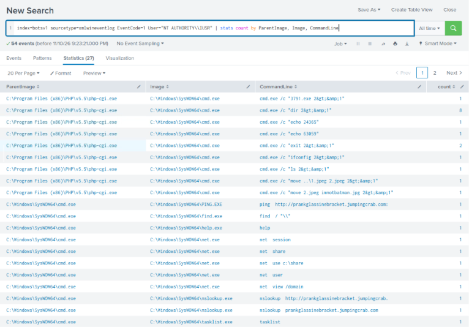
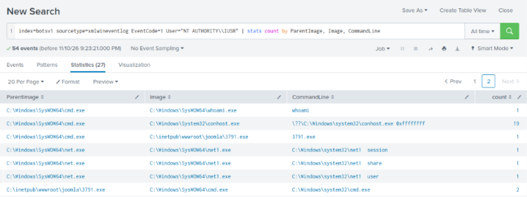
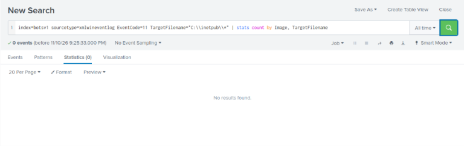
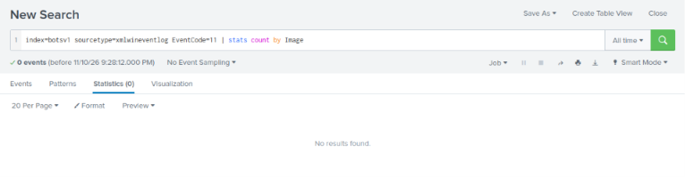
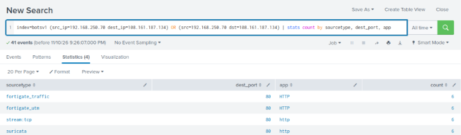
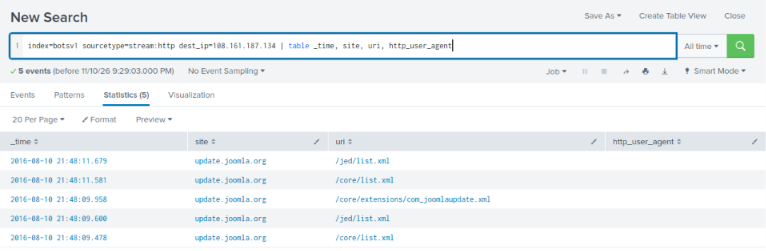

# Hunt: What Else Did the Attacker Do on the Web Server?

**Date:** 2026-11-10 · **Dataset:** TryHackMe – Incident Handling with Splunk (`index=botsv1`) · **ATT&CK:** T1505.003, T1059.003, T1087, T1135, T1049, T1057, T1033, T1491.002
**Analyst:** Berkan Cicekli · **Related investigation:** [Web server brute force, backdoor upload and defacement](../investigations/01-web-brute-force/report.md)

> All data comes from a simulated lab environment. No real organisation or user was involved.

---

## Hypothesis

> *"After gaining code execution on the web server, the attacker may have done more than the investigation found: run other commands, dropped other files, or connected to other external systems."*

**Why this is worth checking:** the original investigation followed the alerts and the TryHackMe questions: the scan, the brute force, the backdoor and the defacement image. It left open questions, such as what happened in the command shells the backdoor opened. The web server had also contacted an external IP, **108.161.187.134**, that was never explained. Alerts only show what someone thought to write a rule for; a hunt looks for what they didn't.

---

## Hunt 1: Every command run by the web server's account

The backdoor ran as **`NT AUTHORITY\IUSR`**, the account IIS uses for anonymous visitors. That account should serve web pages, not run commands, so everything it ran is suspect.

```spl
index=botsv1 sourcetype=xmlwineventlog EventCode=1 User="NT AUTHORITY\\IUSR"
| stats count by ParentImage, Image, CommandLine
```




**54 events, 27 unique commands.** They fall into two groups.

### Through the web shell (`php-cgi.exe` → `cmd.exe /c ...`)

These are commands sent through the uploaded **`agent.php`**:

| Command | Finding | Benign or suspicious |
|---|---|---|
| `echo 24365`, `echo 63059` | Testing that the web shell returns output | Suspicious |
| `dir` (×8), `ls` | Browsing the website folders | Suspicious |
| `ifconfig` | Network details. **`ls` and `ifconfig` are Linux commands**, which fail on Windows. The attacker appears more used to Linux. | Suspicious |
| `3791.exe` | Launching the backdoor (already known) | Malicious |
| `move ..\1.jpeg 2.jpeg`, then `move 2.jpeg imnotbatman.jpg` | **The defacement itself**: the downloaded image renamed to replace the site's picture | Malicious, **new finding** |
| `exit` | Closing the shell | Suspicious |

### Through the backdoor (`3791.exe` → `cmd.exe`)

A full **discovery** phase that the original investigation didn't show:

| Command | Purpose | ATT&CK |
|---|---|---|
| `whoami` | Which account am I running as? | T1033 System Owner/User Discovery |
| `net user` | List local accounts | T1087.001 Account Discovery: Local |
| `net view /domain` | Find the Windows domain and its computers | T1087.002 / T1018 |
| `net session` | Who is connected to this server? | T1049 System Network Connections Discovery |
| `net share`, `net use c:\share` | List shared folders and try to connect to one, an early step towards **lateral movement** | T1135 Network Share Discovery |
| `tasklist` | List running processes, e.g. to spot security software | T1057 Process Discovery |
| `ping` and `nslookup prankglassinebracket.jumpingcrab.com` | Check the C2 domain resolves and is reachable | T1016 |
| `find`, `help` | General exploration | |

**Note:** each `net` command appears twice, as `net.exe` and `net1.exe`. That's normal Windows behaviour (`net` hands the work to `net1`), not two separate actions.

---

## Hunt 2: Files written to the website folder

```spl
index=botsv1 sourcetype=xmlwineventlog EventCode=11 TargetFilename="C:\\inetpub\\*"
| stats count by Image, TargetFilename
```



**No results.** To tell whether that means "no files were written" or "file writes weren't logged", I checked for any Sysmon file-creation events at all:

```spl
index=botsv1 sourcetype=xmlwineventlog EventCode=11 | stats count by Image
```



**Still none. Sysmon Event ID 11 was not collected in this environment.** This is a **visibility gap**, not a clean result. We know files *were* written, because the web traffic showed `3791.exe` and `agent.php` being uploaded and Hunt 1 showed the image being moved, but the endpoint logs couldn't confirm it or reveal any others.

---

## Hunt 3: The unexplained outbound connection

```spl
index=botsv1 (src_ip=192.168.250.70 dest_ip=108.161.187.134) OR (src=192.168.250.70 dst=108.161.187.134)
| stats count by sourcetype, dest_port, app
```



Six HTTP connections on port 80, seen in four log sources. What was requested:

```spl
index=botsv1 sourcetype=stream:http dest_ip=108.161.187.134 | table _time, site, uri, http_user_agent
```



| Time | Site | URI |
|---|---|---|
| 21:48:09–21:48:11 | update.joomla.org | `/core/list.xml`, `/jed/list.xml`, `/core/extensions/com_joomlaupdate.xml` |

**Benign:** this is Joomla checking its official update server, normal CMS behaviour.

**But the timing is useful.** The check happened at **21:48**, about two minutes after the brute force at 21:46. Joomla's admin dashboard checks for updates when an administrator opens it, so this is consistent with the **attacker's first login to the admin panel** with the stolen password. That's a likely login time the original investigation didn't have. I haven't confirmed it directly from the login request.

---

## Findings summary

| # | Result | Benign or suspicious | Reasoning |
|---|---|---|---|
| 1 | Web shell commands: `echo`, `dir`, `ls`, `ifconfig`, `exit` | **Suspicious** | Interactive use of `agent.php` from 21:55 to 22:21 |
| 2 | `move` commands renaming the image to `imnotbatman.jpg` (22:20) | **Malicious** | The defacement step itself |
| 3 | Discovery through the backdoor: `whoami`, `net user/session/share/view`, `net use`, `tasklist`, `nslookup` | **Malicious** | Reconnaissance of the network, a likely prelude to lateral movement |
| 4 | No Sysmon Event ID 11 in the environment | **Visibility gap** | File creation can't be tracked on this host |
| 5 | 108.161.187.134 = `update.joomla.org` | **Benign** | Normal update check, but it suggests an admin login at ~21:48 |

## Conclusion

**The hypothesis was supported.** The attacker didn't just run a backdoor and swap an image. They used the web shell interactively for about 25 minutes, carried out the defacement by hand, and ran a **discovery phase** (accounts, sessions, shares, the domain and processes) that points to plans to **move further into the network**.

**Follow-up actions:**
- Treat this as a possible **lateral movement** risk: check other hosts for connections from 192.168.250.70 and for the `c:\share` connection attempt.
- Find out whether any accounts listed by `net user` were later used elsewhere.
- **Enable Sysmon Event ID 11** (file creation) on web servers, at least for the web root, to close the visibility gap.
- Add the improved timeline (admin login ~21:48, web shell 21:55–22:21, defacement live 22:20:33) to the incident report.

## Detection opportunity

- This hunt doubles as a successful test of **[Rule 4: Web server process spawning a shell](../detection-rules/04-web-server-spawning-shell.md)**, which caught all 17 web shell commands.
- **New rule idea:** discovery bursts. Several of `whoami`, `net user`, `net view`, `net share`, `tasklist` and `ipconfig` from the same parent process within a few minutes, especially when the parent is a web server or an unknown executable.
- **New rule idea:** Linux commands (`ls`, `ifconfig`, `cat`, `uname`) run through `cmd.exe` on Windows. They always fail, so they rarely come from real admins but often from attackers.
