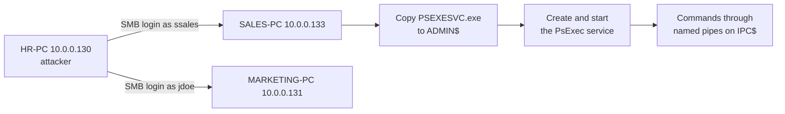
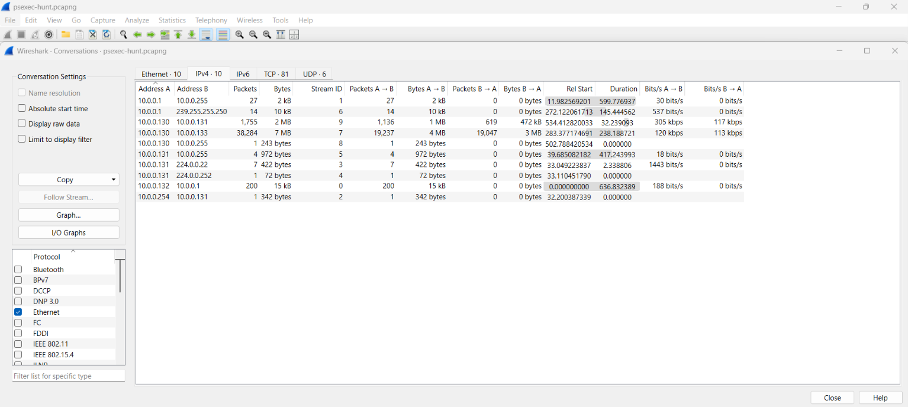
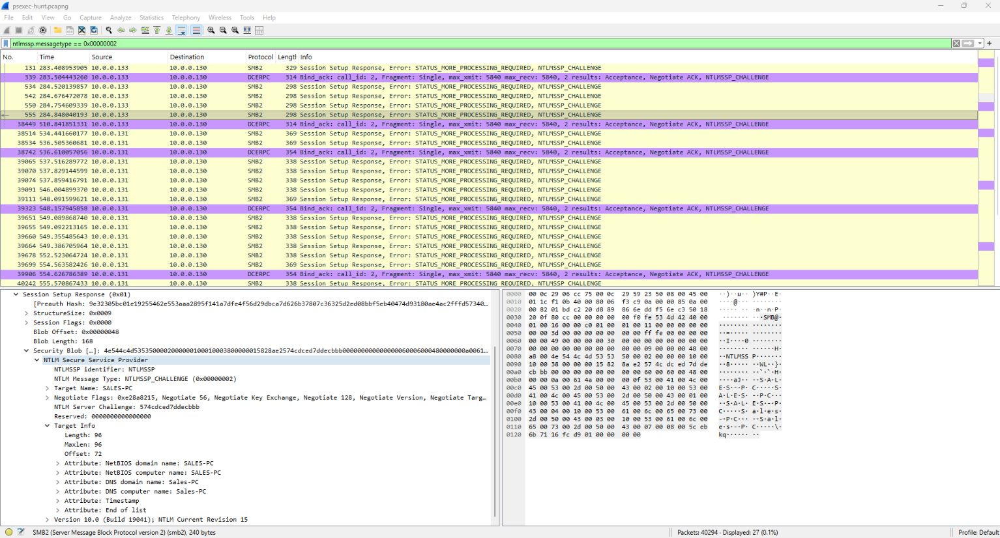
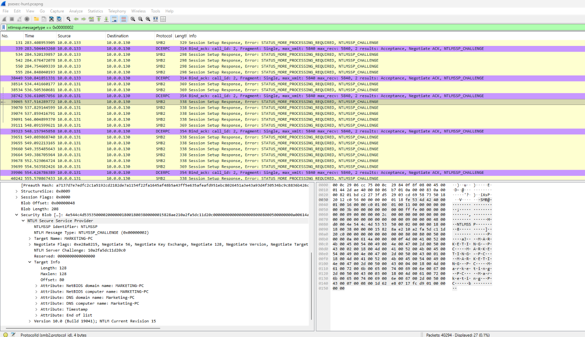
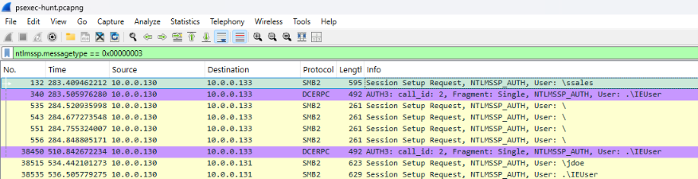
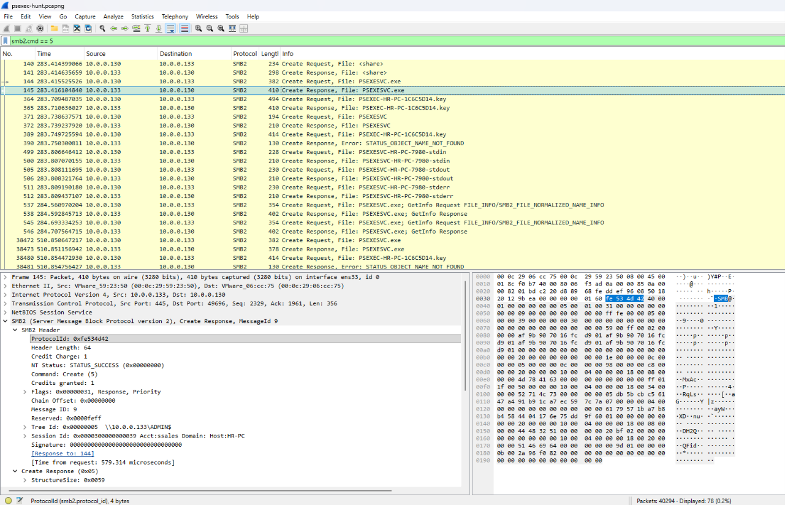
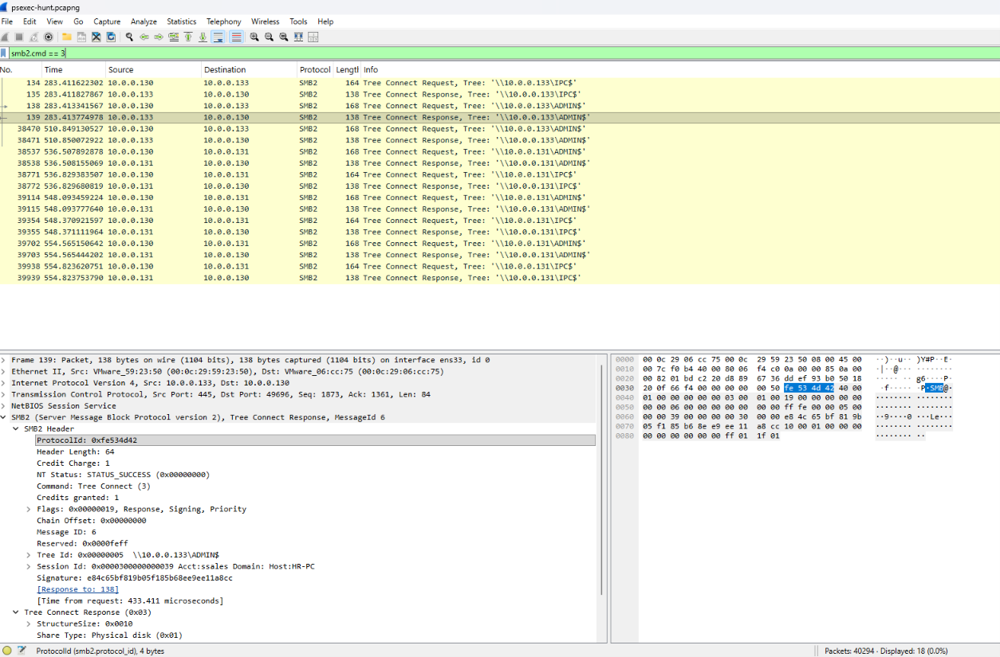

# Network Analysis: PsExec Hunt – Lateral Movement over SMB

**Lab:** CyberDefenders – PsExec Hunt · **Category:** Network Forensics · **Difficulty:** Easy · **Result:** 7/7
**Tool:** Wireshark
**Skills:** PCAP analysis · SMB2 and NTLM analysis · Lateral movement detection · Timeline reconstruction · ATT&CK mapping

> All data comes from a simulated lab environment. No real organisation or user was involved.

---

## Summary

An intrusion detection alert flagged suspicious SMB traffic on the internal network, and the network team captured the traffic for review. The capture shows an attacker on **HR-PC (10.0.0.130)** using **PsExec**, a legitimate Microsoft Sysinternals admin tool, to move to two other machines:

1. **SALES-PC (10.0.0.133)**, logged in as **ssales**
2. **MARKETING-PC (10.0.0.131)**, logged in as **jdoe**

On each target, PsExec copied its service program **PSEXESVC.exe** to the **ADMIN$** share, then used **named pipes over IPC$** to send commands and receive output. Two different accounts were used, so at least **two sets of credentials were compromised**.

---

## How PsExec moves between machines



PsExec is widely used by administrators, which is exactly why attackers like it: its traffic looks like normal administration. The signs that give it away are an unexpected source machine, unusual accounts and the timing.

---

## Investigation

### 1. Who was talking to whom?

**Statistics → Conversations → IPv4** gives an overview of every pair of machines in the capture.



| Conversation | Packets | Data | Starts |
|---|---|---|---|
| 10.0.0.130 → **10.0.0.133** | 38,284 | 7 MB | **283s** (first) |
| 10.0.0.130 → **10.0.0.131** | 1,755 | 2 MB | **534s** (second) |

Everything else was small background traffic: broadcasts, multicast and the gateway. **10.0.0.130** is the only machine starting large conversations with other workstations, so it's the attacker's starting point. The **Rel Start** column gave the order of movement before I'd opened a single packet.

**Decision point:** workstation-to-workstation SMB is unusual. Workstations normally talk to servers (file shares, domain controllers), not to each other, so this traffic was worth investigating.

### 2. Identifying the targets: NTLM challenge messages

When a Windows machine is asked to authenticate a user, its reply (the **NTLM challenge**) includes its own name.

```
ntlmssp.messagetype == 0x00000002
```



Packet 555 from **10.0.0.133**: NetBIOS computer name **SALES-PC**.



Packet 39065 from **10.0.0.131**: NetBIOS computer name **MARKETING-PC**.

### 3. Which accounts were used: NTLM authentication messages

The attacker's reply to each challenge (the **NTLM AUTH** message) contains the username.

```
ntlmssp.messagetype == 0x00000003
```



| Packet | Target | User | Meaning |
|---|---|---|---|
| 132 | SALES-PC | **ssales** | First SMB login: the PsExec session |
| 340, 38450 | SALES-PC | `.\IEUser` | Local account used for DCERPC calls (remote procedure calls, which PsExec uses to create and start its service) |
| 535–556 | SALES-PC | blank | Anonymous sessions, normal SMB noise |
| 38515 | MARKETING-PC | **jdoe** | A **different account** for the second machine |

The attacker had **two domain accounts**, plus local credentials. Each one needs resetting, and it raises the question of how they were stolen.

### 4. What was installed: SMB2 Create requests

```
smb2.cmd == 5
```



| Packet | File | Meaning |
|---|---|---|
| 144 | **PSEXESVC.exe** | PsExec's service program, written to the target |
| 364 | `PSEXEC-HR-PC-1C6C5D14.key` | PsExec session key file (includes the source machine's name, **HR-PC**) |
| 371 | `PSEXESVC` | Connecting to the service's control pipe |
| 499–511 | `PSEXESVC-HR-PC-7980-stdin`, `-stdout`, `-stderr` | **Named pipes** carrying the attacker's commands and their output |

The packet details confirm the context: **Tree Id `\\10.0.0.133\ADMIN$`**, **Acct: ssales**, **Host: HR-PC**.

### 5. Which shares were used: SMB2 Tree Connects

```
smb2.cmd == 3
```



Each PsExec session connected to two shares:
- **ADMIN$**, which maps to `C:\Windows`: used to **copy PSEXESVC.exe** onto the target
- **IPC$**, inter-process communication: used for the **named pipes** that carry commands

---

## Timeline

Times are seconds from the start of the capture.

| Time | Event |
|---|---|
| 283.4s | HR-PC → SALES-PC: SMB login as **ssales**; connects to IPC$ and ADMIN$ |
| 283.4s | **PSEXESVC.exe** copied to `\\10.0.0.133\ADMIN$` |
| 283.7s–283.8s | Session key file created; stdin/stdout/stderr named pipes opened – **remote commands running on SALES-PC** |
| 510.8s | Attacker reconnects to SALES-PC's ADMIN$ |
| 534.4s | HR-PC → MARKETING-PC: SMB login as **jdoe** |
| 536.5s–554.8s | Four ADMIN$ / IPC$ connection sets to MARKETING-PC – PsExec run repeatedly |

The first PsExec session on SALES-PC took **less than half a second** from login to running commands, which suggests a script or experienced operator.

---

## MITRE ATT&CK

| Tactic | Technique | Evidence |
|---|---|---|
| Lateral Movement | T1021.002 Remote Services: SMB/Windows Admin Shares | ADMIN$ and IPC$ connections from HR-PC to two workstations |
| Lateral Movement | T1570 Lateral Tool Transfer | PSEXESVC.exe copied to each target |
| Execution | T1569.002 System Services: Service Execution | PsExec service created and run on the targets |
| Defense Evasion / Initial Access | T1078 Valid Accounts | Logins as ssales and jdoe |

## Indicators of compromise

| Type | Value | Context |
|---|---|---|
| IP | `10.0.0.130` (HR-PC) | Source of lateral movement – likely compromised |
| Host | SALES-PC (10.0.0.133) | First target |
| Host | MARKETING-PC (10.0.0.131) | Second target |
| Account | `ssales` | Used to access SALES-PC |
| Account | `jdoe` | Used to access MARKETING-PC |
| Account | `.\IEUser` | Local account used in DCERPC authentication |
| File | `PSEXESVC.exe` | PsExec service written to ADMIN$ |
| File | `PSEXEC-HR-PC-*.key` | PsExec session key files |
| Named pipes | `PSEXESVC-HR-PC-*-stdin/stdout/stderr` | Remote command channel |

No external IPs appear in this capture; all activity is internal.

---

## Recommended response

*This is a lab, so nothing was actually actioned.*

- **Contain:** isolate HR-PC, SALES-PC and MARKETING-PC. Disable `ssales` and `jdoe`, reset their passwords, and reset the local `IEUser` account.
- **Investigate HR-PC:** find out how the attacker got onto it in the first place (phishing, malware, stolen credentials) and how they obtained the two accounts.
- **Check the targets:** review what commands were run through PsExec (EDR process logs, Windows event 7045 for new services) and remove `PSEXESVC.exe` and any other dropped files.
- **Scope:** search all hosts for SMB connections from 10.0.0.130 and for `PSEXESVC` service installations.

## Recommendations to prevent recurrence

- **Restrict admin shares and SMB between workstations** with host firewalls; workstations rarely need to talk to each other over SMB.
- **Alert on service creation** (Windows event 7045) and specifically on services named `PSEXESVC`.
- **Alert on ADMIN$ access** from anything other than approved admin machines.
- **Limit local admin rights** and use unique local admin passwords per machine (e.g. Microsoft LAPS), so one stolen password doesn't open every machine.
- If PsExec is used legitimately, allow it **only from specific admin hosts**, so its use from an HR workstation stands out immediately.

---

## What I learned

- **Start with Conversations.** One statistics window showed the attacker, both targets and the order of movement before I opened a packet.
- **NTLM gives away names on both sides.** The challenge reveals the target's hostname; the AUTH message reveals the username and the source machine.
- **PsExec has a clear fingerprint:** ADMIN$ plus IPC$, `PSEXESVC.exe`, and stdin/stdout/stderr named pipes. PsExec even puts the source hostname (HR-PC) in its file and pipe names.
- **Legitimate tools are dangerous in the wrong hands.** Nothing here was malware; the attacker used a signed Microsoft tool and valid accounts. Context (which machine, which account, when) is what makes it suspicious.
- **Two machines, two accounts.** Spotting that a different account was used for each target changed the scope of the response: more than one credential to reset, and a question about how they were stolen.
- **Networking background helps.** Knowing how SMB, NTLM and shares work made the traffic readable rather than overwhelming.
